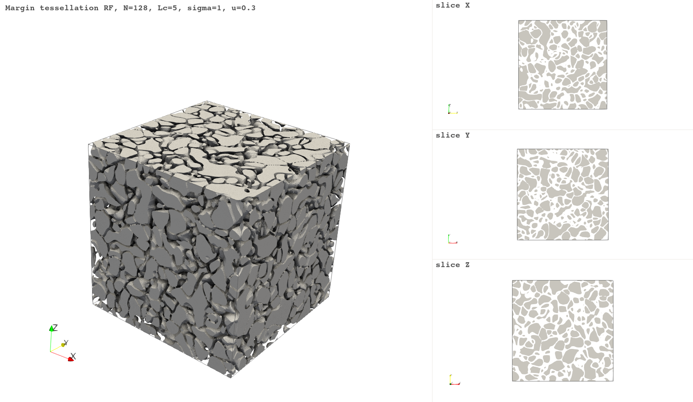
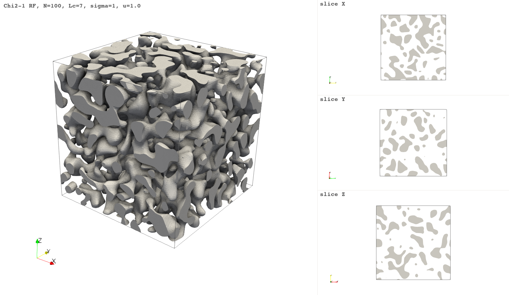
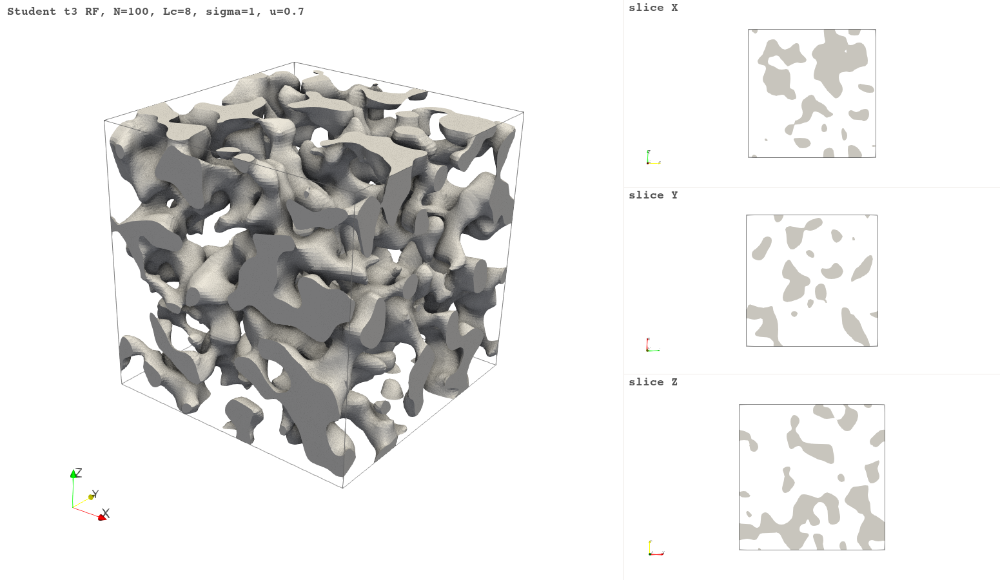
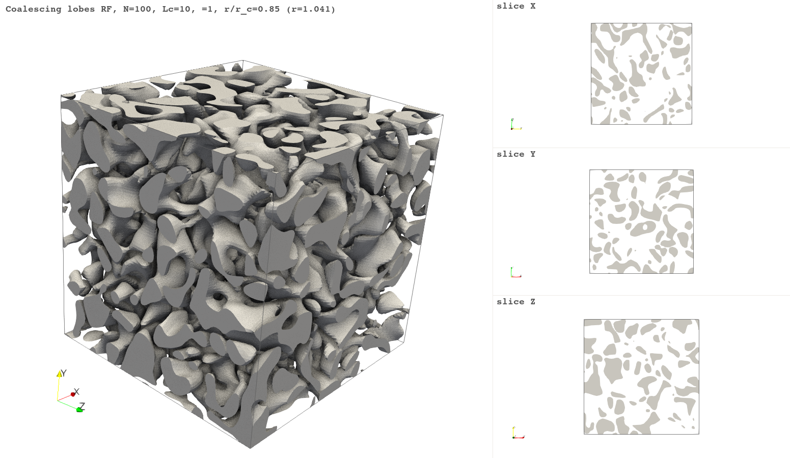
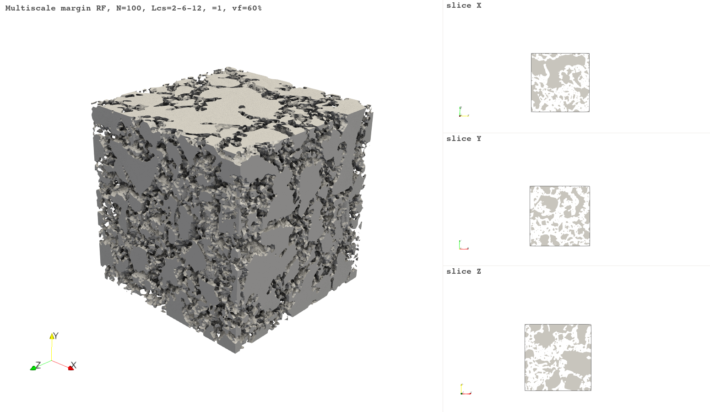

# high-vf-excursions

Excursion sets of Gaussian-related random fields as microstructure
models, with analytical descriptors through the Gaussian Kinematic
Formula (GKF).

A scalar Gaussian random field in 3D tops out at ~16% disconnected
inclusion volume fraction — the point where the Euler characteristic of
the excursion set crosses zero and inclusions begin to merge into a
spanning phase. For a lot of microstructures of interest (concrete
aggregates, battery electrodes, closed-cell foams) that ceiling is way
below where you want to be. This repo collects a progression of model
extensions that push the ceiling and tracks what happens to the Adler
link along the way.

Nothing here is a publication-ready contribution. It's an exploration of
four hitting-set families inside the same GKF scaffolding, with the
numerical checks that convinced us the formulas work.



*Margin tessellation at `q = 16`, `φ = 0.70` — 16 competing Gaussian
fields with a non-zero winner-vs-runner-up margin. The matrix film is
sub-voxel in places; individual winner cells are coloured.*

## The story in one page

The Adler–Taylor GKF (Adler & Taylor 2007; Taylor 2006) gives a
closed-form expectation for every Lipschitz–Killing curvature of the
excursion set of a Gaussian-related field. For a cube of side `a` and a
scalar hitting set `D`,

```
E[L_i(f^{-1}(D))] = Σ_j C(i, j) · ρ^j · L_{i+j}(cube) · M_j^γ(D)
```

with `ρ = √(λ_2 / 2π)`, `λ_2 = -C''(0)`. The spatial side (`ρ`, the cube
LKCs) and the value-space side (`M_j^γ(D)`) are completely separate.
Change the hitting set, change the morphology; the spatial side is
unchanged. This is what makes the GKF a *morphology generator*: pick a
hitting set, pay the price of computing its Gaussian Minkowski
functionals, get analytical control over the first four morphological
moments of the resulting random microstructure.

We work through four hitting-set families, roughly in order of how far
each strays from the standard GKF territory:

- **Scalar half-line** `[u, ∞)` — the Gaussian baseline.
- **Scalar `[u, ∞)` under non-Gaussian marginal** — chi² and
  Student-$t_\nu$ fields, both already in the literature (Worsley 1994).
- **Polyhedral winner chamber** `{z_{(q)} - z_{(q-1)} ≥ δ}` — the
  margin tessellation.
- **Union of balls** `⋃_a B(c_a, r)` — coalescing lobes.

The first two give us the standard tools and tell us one simple negative
result: the marginal distribution almost doesn't matter for the
disconnected-phase VF ceiling. The ceiling is set by the spatial
correlation. The last two are the small novel pieces here: both reach
VFs far above the Gaussian ceiling, both come with closed-form `M_j`
(the lobes case only before contact), both validated numerically to a
few percent on `N^3 >= 128^3` grids.

## Disconnected-phase VF ceiling at a glance

The upper `E[L_0] = 0` crossing on a 100³ grid at `lc = 8` (lc = 5 for
exp04), per model family:

| Family | `φ_c⁺` (finite domain) | Adler link |
|--------|------------------------|------------|
| Gaussian (scalar)         | ~22% | Full closed-form |
| Student-$t_\nu$ (ν = 3)   | ~21% | Full closed-form (Worsley 1994) |
| Chi² (k = 1)              | ~37–51% (lc-dependent) | Full closed-form (Worsley 1994) |
| Margin tessellation (q = 16) | 85–90% | Closed-form `M_j`, informal proof |
| Coalescing lobes          | ~55% at `r/r_c = 1` | Closed-form before contact only |
| Multiscale margin union   | up to ~85% composite | Independent-union approximation |

"Finite domain" matters: the bulk-limit numbers are lower
(e.g. 16% Gaussian) because boundary terms shift the crossing. For the
derivation story, see [`theory/README.md`](theory/README.md).

## Experiments

Six experiments, each self-contained in `experiments/NN_*/`. Each one has
its own `README.md` with the model, inline formulas, estimator choices,
and the current numerical results.

### 01 — Gaussian baseline


The ground truth. Scalar Gaussian field, Gaussian covariance, exact
closed-form `M_j`, MC comparison across `L_0..L_3` at three correlation
lengths. Every other experiment is compared to this.

### 02 — Chi² field



`X = Σ_i f_i²`. For `k = 1` the excursion set is just the two-tail
Gaussian `{|Z| ≥ √u}`, so the volume fraction doubles. `E[L_0] = 0` lands
at ~32% bulk, ~37–51% finite-domain. Higher `k` interpolates back toward
Gaussian. `M_j` closed-form (Worsley 1994).

### 03 — Student-$t_\nu$ field



Worsley field `T_ν = Z_0 / √(χ²_ν / ν)`. Polynomial tails barely move
`φ_c⁺` — it drops *slightly* with ν (from 21.8% at ν → ∞ to 21.1% at
ν = 3). The marginal distribution is not the lever. Our main contribution
here was fixing a wrong `M_j` formula that circulated in an earlier
version — the correct cone-geometry derivation is in
[`theory/student_t_derivation.md`](theory/student_t_derivation.md).

### 04 — Margin tessellation


`q` competing i.i.d. Gaussian fields; include a voxel iff the winner's
lead over the runner-up exceeds a margin `δ`. The matrix film sits where
two or more fields are nearly tied. Reaches VFs of 85–90% with every
individual winner cell topologically disconnected from the rest. Closed-
form `M_j^γ(D_δ)` derived from the polyhedral chamber geometry and
validated against MC to <2% on all four LKCs at `N = 256`.

**Plain-English take.** Imagine four referees scoring every voxel. Only
include the voxel if the highest score beats the second-highest by at
least `δ`. The result tiles space into "winner cells" separated by a thin
matrix film wherever two fields are tied. Push `q` up and the cells get
smaller; push `δ` down and the film thins; both knobs give you high VFs
of mutually disconnected inclusions.

### 05 — Coalescing lobes



Vector Gaussian field `G: M → ℝ³`. Fix four centres at the vertices of a
tetrahedron in Gaussian value space; include a voxel iff its Gaussian-
space image lies within `r` of any centre. Single morphology parameter
`r/r_c` sweeps from disjoint droplets (`r/r_c = 0.5`), to touching
(`r/r_c = 1`), to merged bicontinuous (`r/r_c > 1`). Closed-form `M_j`
*before contact* via single-ball tube probability + additivity; after
contact the Gaussian-weighted ball-intersection volumes are an open
analytic problem.

**Plain-English take.** Imagine every voxel is mapped to a 3D point by a
smooth random field. Place four target points. A voxel is "in" if its
point lands close to any target. As you grow the capture radius `r`, the
four droplets inflate until they touch (at `r = r_c`), then merge into a
richly connected lobe network. One scalar knob, qualitatively different
morphologies at either end.

### 06 — Multiscale margin union



Combines three margin tessellations at different correlation lengths
(coarse / fine / sand) into a single composite. Deferred prototype: the
exact union-GMF is unknown in closed form, so we use the independent-
union approximation of Roubin (2013). The experiment is primarily a
granulometry demo — "can we hit a prescribed VF-per-phase mix inside the
margin model?" — rather than a GKF validation.

## Quick start

```bash
mamba env create -f environment.yml
mamba activate rf_explo

cd experiments/01_gaussian_baseline
mamba run -n rf_explo python run.py
# outputs land in experiments/01_gaussian_baseline/results/
```

Each experiment writes figures, CSVs, and (optionally) ParaView-ready
`.vti`/`.vtp` to its own `results/`. See the experiment's `README.md` for
parameters, runtimes, and what to look at.

## Documentation

- [`docs/framework.md`](docs/framework.md) — GKF primer and library usage.
- [`docs/limits.md`](docs/limits.md) — what the Adler link does and does
  not give for each family.
- [`docs/measurement_conventions.md`](docs/measurement_conventions.md) —
  how we estimate `L_0..L_3` from voxels; which estimator we use for what
  and why.
- [`theory/README.md`](theory/README.md) — umbrella note; derivations in
  the siblings.

## Repository layout

```
src/
  fields.py          RF generation (Gaussian, chi², Student-t, margin, vector) via gstools
  excursions.py      excursion-set construction, margin phase, lobe distances
  measures.py        L_0..L_3 estimators (26-conn, dihedral L_1, Crofton L_2)
  adler.py           Adler-Taylor expectations for every hitting set used here
  io.py / io_hdf5.py ParaView export (VTI/VTP), HDF5 for the multiscale run

experiments/
  01_gaussian_baseline/   scalar Gaussian — baseline GKF validation
  02_chi2/                chi² field — Worsley M_j, raises VF ceiling
  03_student_t/           Student-t field — cone-geometry M_j, VF ceiling essentially unchanged
  04_margin_tessellation/ winner-margin tessellation — reaches 85–90% VF
  05_coalescing_lobes/    tetrahedral lobe union — single morphology knob
  06_multiscale_margin/   multi-Lc composite via independent-union approximation

docs/     short usage / limits / measurement notes
theory/   derivations (Student-t, margin, ball-union)
references/   reference PDFs
```

`explorations/` holds sandbox code, pilot runs, and older research notes;
it is `.gitignore`d.

## References

- Adler, R.J. & Taylor, J.E. (2007). *Random Fields and Geometry*.
  Springer.
- Taylor, J.E. (2006). A Gaussian kinematic formula.
  *Annals of Probability* 34(1), 122–158.
- Worsley, K.J. (1994). Local maxima and the expected Euler characteristic
  of excursion sets of chi-squared, F and t fields.
  *Adv. Appl. Prob.* 26(1), 13–42.
- Roubin, E. & Colliat, J.-B. (2016). Critical probability of percolation
  over bounded region in N-dimensional Euclidean space.
  *J. Stat. Mech.* P033306.
- Roubin, E. (2013). *Meso-scale FE and morphological modelling of
  heterogeneous media*. PhD thesis, ENS Cachan.
