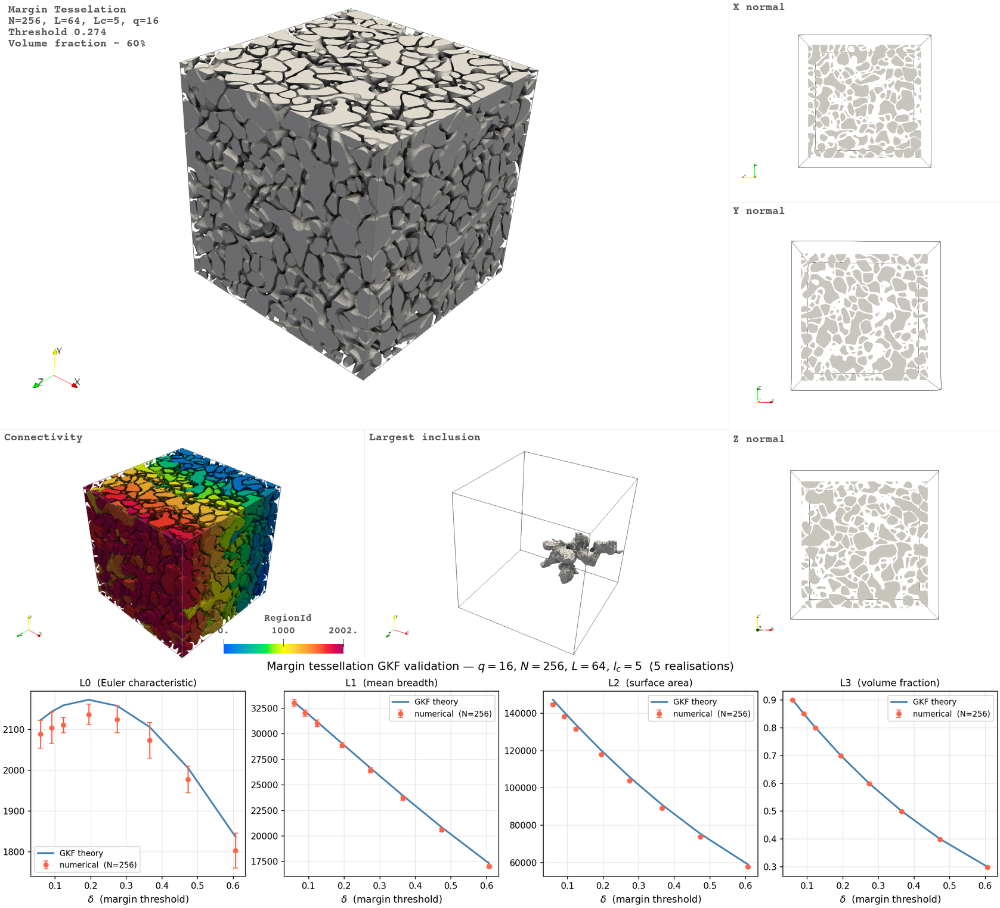
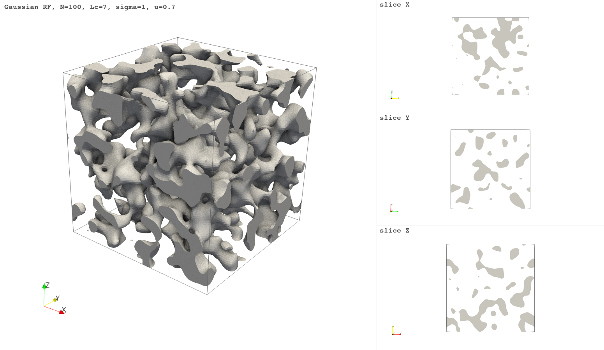
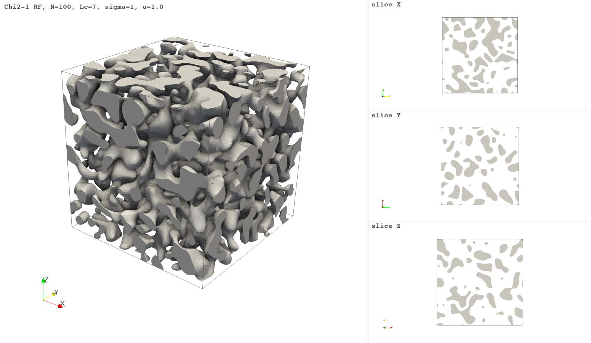
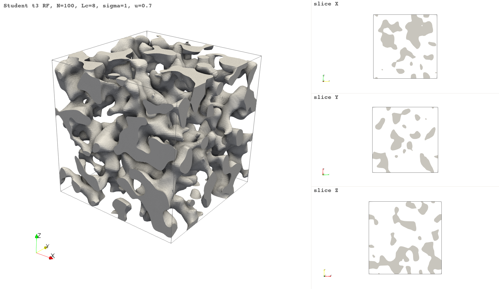
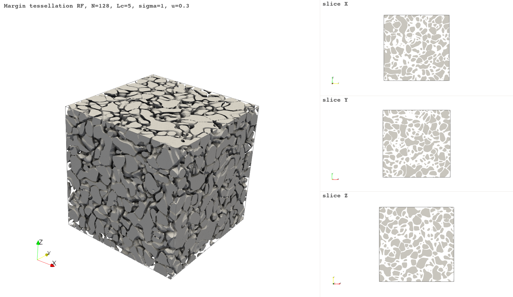
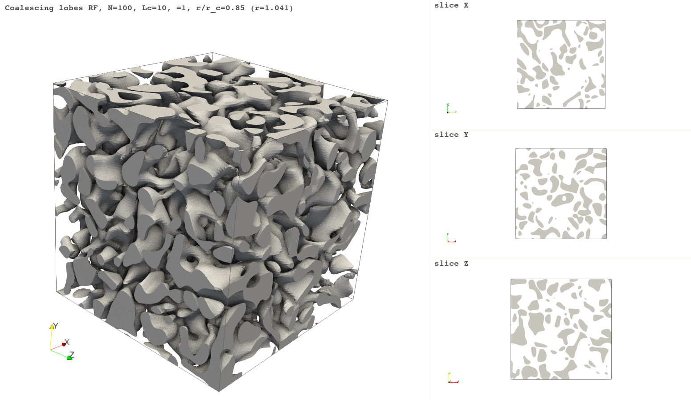
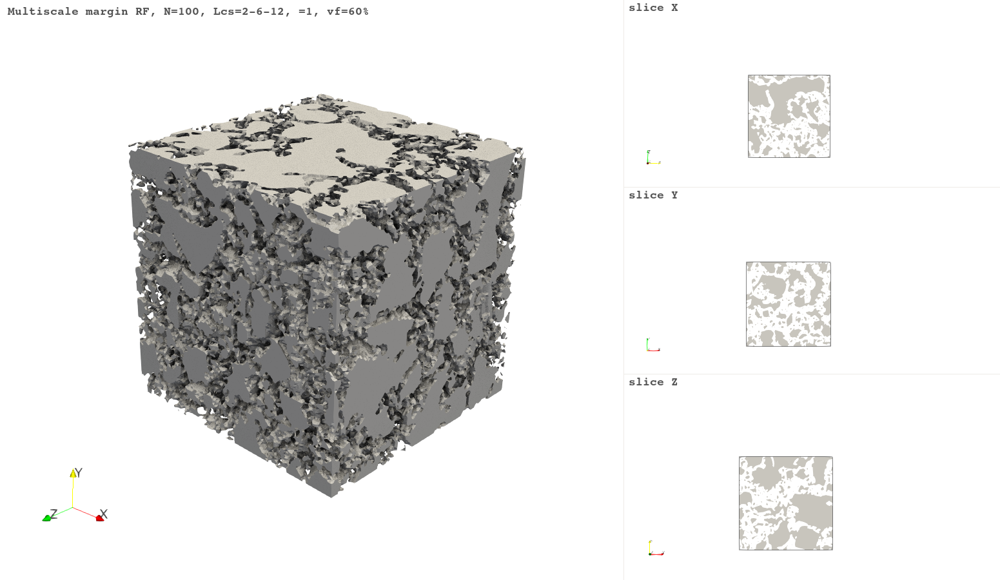

# high-vf-excursions

> **Work in progress.** This is an unfinished research project. Nothing here
> should be treated as a final, fully validated framework: theory, numerical
> methods, results, and interpretations remain subject to revision.

Random-field excursion sets as microstructure models, with expected
Lipschitz–Killing curvatures (LKCs) from the Gaussian Kinematic Formula (GKF).

The aim is high aggregate volume fraction (VF), a scalar morphology control,
and analytical expectations, especially for Euler characteristic $L_0$ and
volume $L_3$. The familiar Gaussian bulk EC-zero occurs at about 16% VF.
It is a topology proxy, **not a hard limit on disconnected VF or a
percolation theorem**. This repository explores other hitting sets and
records both their analytical scope and their numerical limitations.

This saved $q=16$, $N=256$, $L=64$, $l_c=5$ scene has measured VF 60.77%.
Its component colouring uses 6-neighbour connectivity. Rechecking the same
binary phase gives:

| Convention | Components | Largest component / inclusion volume | Spans |
|---|---:|---:|---|
| 6 neighbours | 3,206 | 2.04% | No |
| 26 neighbours | 1,838 | 44.86% | All three axes |

The image therefore does not establish disconnected continuum aggregates.
The accompanying LKC comparison uses five separate realisations at target
VF 60%; those ensemble means agree within 2% at this particular setting.

## The analytical link

For independent, identically distributed, smooth unit-variance Gaussian
components $G$, a regular hitting set $D$, and an isotropic spatial metric,

$$
\mathbb E[L_i(G^{-1}(D))]
=\sum_{j=0}^{3-i}
\left[\begin{matrix}i+j\\j\end{matrix}\right]
\rho^j L_{i+j}(M)\mathcal M_j^\gamma(D),
\qquad
\left[\begin{matrix}n\\k\end{matrix}\right]
=\binom nk\frac{\omega_n}{\omega_k\omega_{n-k}}.
$$

Here $\omega_k=\pi^{k/2}/\Gamma(1+k/2)$, $\omega_0=1$, and
$\rho=1/(l_c\sqrt\pi)$ for component correlation
$\exp(-r^2/l_c^2)$. These are **flag coefficients**, not ordinary binomial
coefficients. The spatial metric belongs to the underlying Gaussian
components; nonlinear derived fields generally have different covariance.

Changing $D$ changes the expected LKCs while retaining the spatial factor.
These are four expected geometric descriptors, not a complete description
of morphology or a prediction of connectivity. Some GMFs require numerical
quadrature; “analytical” does not always mean an elementary closed form.

## What each experiment establishes

| Experiment | Quantity being reported | Analytical scope and qualification |
|---|---|---|
| 01 Gaussian | Finite-cube EC-zero VF ≈21.8% for $L=100,l_c=8$ | All four expected LKCs; bulk EC-zero VF ≈15.9% |
| 02 $\chi^2$, $k=1$ | EC-zero VF ≈37–51% across the tested correlation lengths | Two Gaussian tails; all four expected LKCs |
| 03 Student-$t_3$ | Finite-cube EC-zero VF ≈21.1% for $L=100,l_c=8$ | Standard ratio-field formulas; little change in this EC-zero proxy |
| 04 Margin tessellation | High prescribed VF, including 85–90% | Implemented chamber GMFs for $\delta>0$; proof outline and numerical evidence, with substantial resolution/connectivity qualifications |
| 05 Coalescing lobes | Pre-contact measured VF reaches 66.84% in the centre-position sweep | Ball additivity only for $r<r_c$; within-lobe spanning persists, and voxel-union topology remains resolution-sensitive |
| 06 Multiscale margin | Composite target VF 60–85% | Conditional GKF for independent stages; numerical unions span in the saved pilot |

These rows deliberately report different quantities. In particular, 85–90%
is not an EC-zero ceiling for margin tessellation, and value-space contact
does not identify a spatial spanning threshold.

### 01 — Gaussian baseline

A scalar half-line hitting set with exact GMFs. The saved measurements
provide a baseline for discretisation and sampling errors; systematic
bias remains in some estimators even after averaging.

### 02 — Chi-squared fields

$X=\sum_i G_i^2$. For $k=1$, the positive-threshold excursion is
$\{|G|\geq\sqrt u\}$, a disjoint union of two tails. At low thresholds,
the separating film can be unresolved by the grid.

### 03 — Student-t fields

$T_\nu=G_0/\sqrt{\sum_{i=1}^{\nu}G_i^2/\nu}$ uses spatially varying,
independent Gaussian components. Its GMFs come from cone geometry, not
derivatives of its marginal density. Common component amplitude cancels.
See [the formula note](theory/student_t_derivation.md).

### 04 — Margin tessellation

Include a point when the winner's lead over the runner-up exceeds
$\delta$. Different winner labels cannot touch in the continuous model
when $\delta>0$, but a single label can have a spanning component.
The margin is in **field-value units**, not spatial film thickness.
Thin films and sampled connectivity remain central limitations.

### 05 — Coalescing lobes

A vector Gaussian field maps into four balls centred at tetrahedral
vertices. Radius controls VF and value-space overlap. Below contact,
ball GMFs add; after contact, intersection terms are required.
The runner now separates binary-union, individual-ball, and nearest-centre
partition measurements. Historical results are preserved and explicitly
qualified in the [experiment README](experiments/05_coalescing_lobes/README.md).
Completed resolution and centre-position studies find good volume agreement
and encouraging per-ball Euler agreement, but do not establish isolated
spatial aggregates. Their remaining questions are documented there.

### 06 — Multiscale margin union

Independent coarse, fine, and sand stages use different correlation
lengths. Conditional GKF gives expected intersection LKCs and hence a
union recursion under its regularity assumptions; a single common-metric
union GMF is unnecessary. Expected VF and phase shares are calibrated,
but the saved numerical composites span. Precise interpolation remains
a deferred prototype.

## Running and reading the repository

~~~bash
mamba env create -f environment.yml
mamba activate rf_explo
cd experiments/01_gaussian_baseline
python run.py
~~~

Experiments share `src/`. Read each experiment's README before running:
parameters, output paths, estimator conventions, and costs differ.
The corrected experiment 05 runner defaults to `results_union_v2/` and
refuses to overwrite a nonempty output directory.

- [Framework and API](docs/framework.md)
- [Limits of the analytical claims](docs/limits.md)
- [Measurement conventions](docs/measurement_conventions.md)
- [Theory notes and outstanding derivations](theory/README.md)

`src/` contains generation, excursion construction, measurements,
expectations, and exports. `experiments/01_*` through `06_*` contain the
main studies; `references/` holds source material. Most of
`explorations/` is ignored, but the oscillatory-Bochner README and runner
are tracked. Historical CSVs and figures have not been regenerated by
the review corrections.

## References

- Adler & Taylor (2007), *Random Fields and Geometry*.
- [Taylor (2006), A Gaussian kinematic formula](https://arxiv.org/abs/math/0602545).
- [Taylor & Adler (2009), Gaussian processes, kinematic formulae and Poincaré's limit](https://arxiv.org/abs/math/0612580).
- Worsley (1994), *Local maxima and the expected Euler characteristic of excursion sets of chi-squared, F and t fields*.
- [Roubin & Colliat (2016), Critical probability of percolation over bounded region](https://arxiv.org/abs/1510.08252).
- [Bobrowski & Skraba (2020), Homological percolation and the Euler characteristic](https://arxiv.org/abs/1910.10146), for the distinction between EC-zero heuristics and percolation.
- [Bogdan (2015), Morphological multiscale modeling of cementitious materials](https://theses.hal.science/tel-01346484v1).
