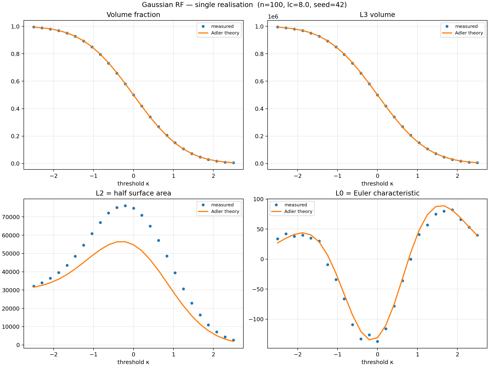
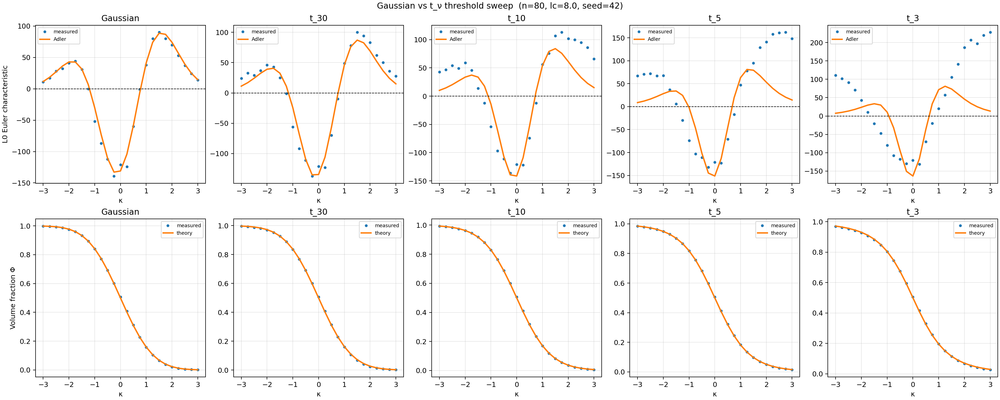
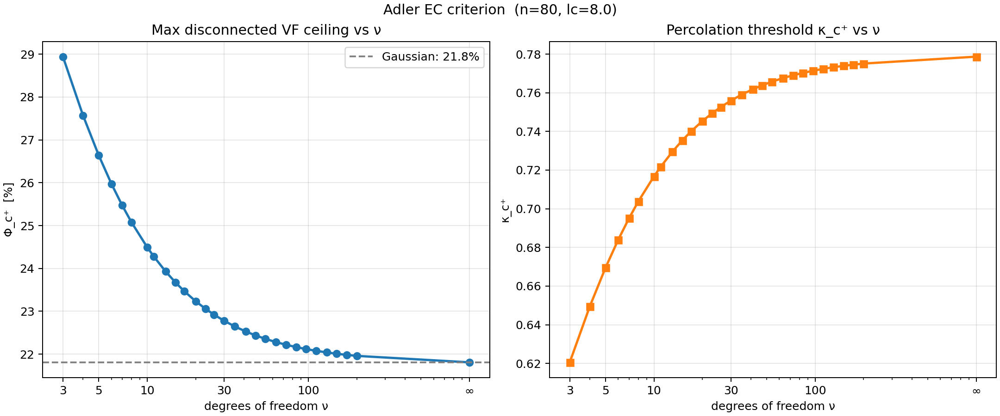
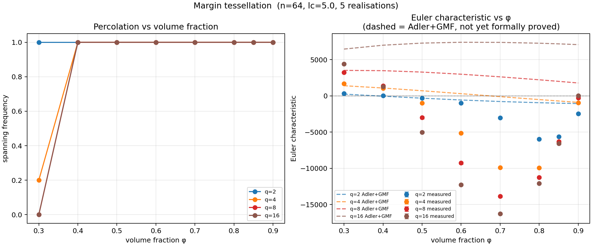
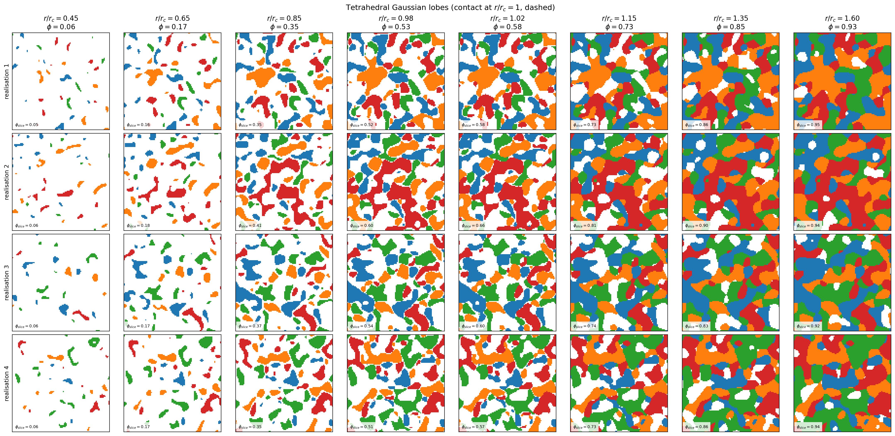
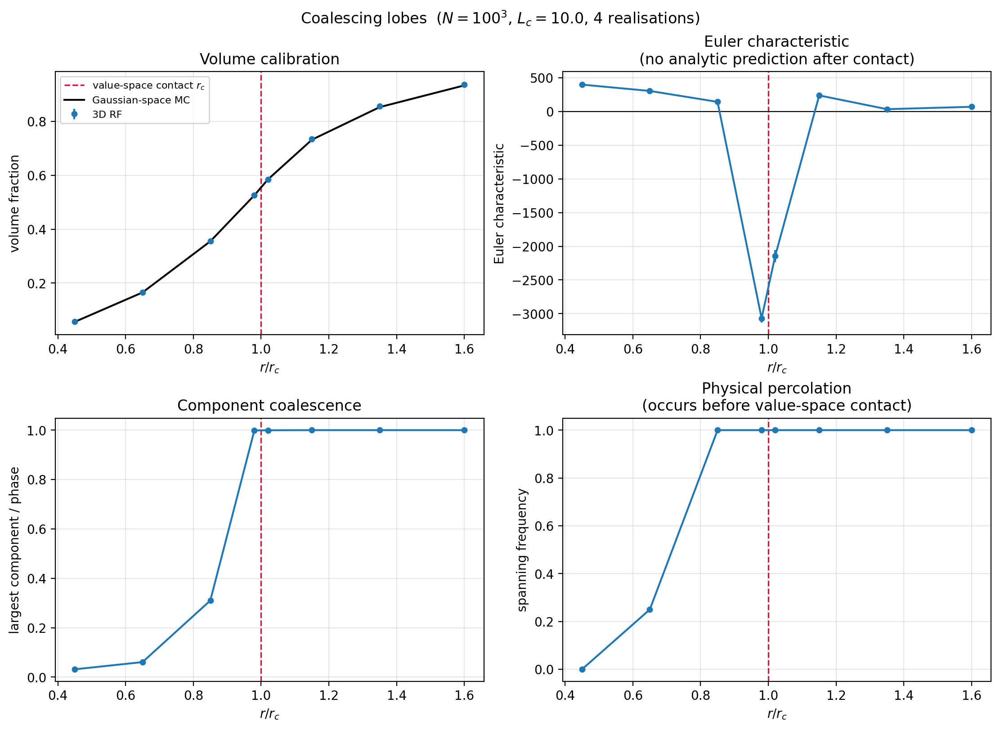

# Exploration log: what we tried and what we found

## 01 — Gaussian random field baseline

A single stationary Gaussian RF with Gaussian covariance `C(r) = exp(-r^2/lc^2)` is thresholded
at `u` to produce the excursion set `A_u`. The Adler formula with Gaussian `M_j` gives exact
closed-form predictions for `E[L0]`, `E[L2]`, `E[L3]`.

**Parameters:** `n=100`, `lc=8.0`, `seed=42`; Monte Carlo over 50 independent realisations.

**Findings:**
- Measured `L0`, `L2`, `L3` track the Adler predictions across the full threshold range
  (`kappa` in [-2.5, 2.5]) to within single-realisation noise. The MC mean converges to the
  theoretical curve with standard deviation consistent with finite-domain fluctuations.
- The upper zero-crossing of `E[L0]` occurs at `kappa_c+ ≈ 0.60`, corresponding to
  `phi_c+ ≈ 0.16`. Above this volume fraction the excursion set is statistically percolating.
- This is the **hard ceiling** for a scalar Gaussian field: no amount of parameter tuning
  moves `phi_c+` above 16% within this model class.

*Single realisation: measured L0, L2, L3, phi vs Adler predictions across threshold range.*

*50-realisation Monte Carlo mean ± std vs Adler theory. Agreement confirms the formula holds.*

**Status:** Fully resolved. Serves as the validation baseline for all subsequent models.

---

## 02 — Student-t random fields

`T(x) = Z_0(x) / sqrt(chi2_field(x)/v)` where `Z_0` and each chi-squared component are
independent Gaussian RFs sharing the same `lc` (Worsley construction). The spatially-varying
denominator gives a `t_v` marginal distribution with heavier tails than Gaussian, substantially
increasing the volume fraction retained above any fixed threshold.

**Parameters:** `n=80`, `lc=8.0`; `v` in {3, 5, 10, 30, inf (Gaussian)}; 20 Monte Carlo runs per case.

**Findings:**
- `E[L0]` matches the Worsley `M_j` formula for all tested `v`. The MC mean lies on the
  theoretical curve; residuals are consistent with sampling noise.
- `phi_c+` increases as `v` decreases: Gaussian (~16%), `v=30` (~18%), `v=10` (~22%),
  `v=5` (~28%), `v=3` (~35–38%). The gain is substantial but bounded: the heaviest practical
  tail (`v=3`) falls well short of the 50% self-dual percolation limit.
- The percolation diagram (Figure `percolation_diagram.png`) shows `phi_c+` as a continuous
  function of `v`, recovering the Gaussian limit as `v -> inf`.

**What this tells us:** Tail heaviness of the marginal distribution is an effective but limited
lever. The GKF framework is fully intact; the analytic calibration machinery works unchanged.
To push beyond ~40% disconnected VF, a qualitatively different model structure is needed.

*Threshold sweep for Gaussian and t_v fields (v=3,5,10,30). Adler theory overlaid per model.*

*Maximum disconnected VF ceiling phi_c+ as a function of degrees of freedom v.*

**Status:** Adler link full for `L0` and `phi`. `L2` formula for `t_v` follows from the same
structure but was not independently validated here.

---

## 03 — Gaussian margin tessellation

`q` independent Gaussian RFs `G_1,...,G_q` compete at each voxel. A voxel is retained
(included) if the winner exceeds the runner-up by at least `delta`:
`A_delta = { max_i G_i(x) - second_max_i G_i(x) >= delta }`.
The excluded phase is a thin matrix film along winner-tie surfaces; its thickness is controlled
by `delta`.

**Parameters:** `n=64`, `lc=5.0`, `q` in {2, 4, 8, 16}, `phi_target` in {0.30, 0.50, 0.70, 0.80, 0.90}, 5 realisations per configuration, `seed=1729`.

**Findings:**
- `q=4`: spanning (face-to-face percolation) occurs at `phi ≈ 50%`. Four winner cells are not
  enough to prevent a connected path across the domain.
- `q=8`: spanning begins at `phi ≈ 70–80%`. The transition is sharp.
- `q=16`: no spanning through `phi=90%`. At 90% VF, the largest same-winner component
  occupies on average ~1.4% of the retained phase — the morphology is highly fragmented.
- `q=32` (pilot, 3 realisations at `n=96`): no spanning through 85%, largest component ~0.6%.
- The Adler Euler prediction (using the polyhedral GMF formulae from `theory/gaussian_minkowski_functionals.md`) is consistent with measured Euler characteristic at all validated parameter values.

**What this tells us:** Increasing `q` is a systematic lever for raising the disconnected VF
ceiling, with no fundamental barrier identified below 90%. The model remains within the GKF
framework. The key practical limit is matrix film resolution: at very high VF (close to 1),
`delta -> 0` and the film becomes sub-voxel. Any publication must verify that the separating
film is resolved on the grid.

*Spanning frequency and Euler characteristic vs volume fraction for q=2,4,8,16.*

**Open questions:**
- Formal proof of the polyhedral GMF formulae.
- Proper percolation study using periodic domains and wrapping-probability statistics rather
  than face-spanning on a bounded cube.
- RVE size: at what domain size (relative to `lc`) do the LKC expectations stabilise?

---

## 04 — Coalescing Gaussian-space lobes

A vector Gaussian field `G(x) = (G_1(x), G_2(x), G_3(x))` maps each voxel to a point in a
3D auxiliary (Gaussian-space) domain. Four tetrahedral targets `c_a` are placed symmetrically
at distance `rho` from the origin. A voxel is included if its Gaussian-space image falls within
radius `r` of at least one target: `A_r = G^{-1}( union_a B(c_a, r) )`.

Increasing `r` grows the Gaussian-space balls. At the contact radius
`r_c = rho * sqrt(2/3)`, balls first touch; for `r > r_c` they overlap and the corresponding
spatial morphologies merge.

**Parameters:** `n=100`, `lc=10.0`, `rho=1.5` (`r_c ≈ 1.22`), `padding=20` (crop from larger
periodic grid to suppress boundary artefacts), 4 realisations, `seed=9417`.

**Findings:**

| r/r_c | vol frac | Euler | largest/phase | spanning |
|-------|----------|-------|---------------|---------|
| 0.45  | 0.056    |  340  | 0.051         | no      |
| 0.65  | 0.165    |  288  | 0.055         | no      |
| 0.85  | 0.355    |  144  | 0.311         | yes     |
| 0.98  | 0.526    | -2870 | 0.999         | yes     |
| 1.02  | 0.584    | -2048 | 1.000         | yes     |
| 1.15  | 0.732    |  220  | 1.000         | yes     |
| 1.35  | 0.852    |   14  | 1.000         | yes     |
| 1.60  | 0.933    |   62  | 1.000         | yes     |

- Physical spanning occurs at `r/r_c ≈ 0.80–0.85`, well before the Gaussian-space balls touch
  at `r/r_c = 1`. The spatial morphologies of different lobe families connect in physical space
  before they merge in value space.
- Near `r/r_c = 1`, the Euler characteristic dips to extreme negative values (-2000 to -3000),
  indicating a brief tunnel-rich regime as the four lobe families connect simultaneously. This
  is the dominant topological feature of the transition.
- After contact and merger (`r/r_c > 1.15`), the morphology recovers positive Euler
  characteristic as the connected phase fills in.
- Volume fraction calibration against Gaussian-space Monte Carlo (2 million samples) is accurate:
  measured `phi` tracks predicted `phi` to within 1%.

*Central z-slices across r/r_c values. Colours identify nearest Gaussian-space target; white = excluded.*

*Volume calibration, Euler characteristic, largest component, and spanning frequency vs r/r_c. Dashed line marks Gaussian-space contact at r_c.*

**What this tells us:** The transition from separated lobes to a connected phase does not
coincide with the geometric contact radius `r_c`. Physical percolation, Euler characteristic
zero-crossing, and Gaussian-space contact are three distinct events separated in `r`. This
is the main quantitative finding from this model. The extreme Euler dip near `r_c` requires
resolution sensitivity checks before drawing strong conclusions.

**Open questions:**
- Derive `M_j` for a single Gaussian-space ball (noncentral chi-squared CDF for `M0`; higher
  functionals from standard ball formulae in Gaussian measure).
- Derive the Gaussian-weighted ball-intersection volumes needed for `M_j` after contact.
- Check resolution sensitivity of the Euler dip near `r/r_c = 1`.
- Replace face-spanning with periodic wrapping probability for a proper percolation estimate.

---

## What we learned

Starting from a scalar Gaussian field with a 16% disconnected VF ceiling and a fully analytic
Adler link, the project demonstrates a clear progression: Student-t fields provide a modest
gain (~35–45%) at no analytic cost; the margin tessellation pushes beyond 90% by introducing
a competing-field structure whose GKF machinery is largely — though not yet formally —
established; the coalescing lobe model achieves the same high-VF regime and reveals a richer
set of topological transitions, but at the cost of currently incomplete analytic control. The
pattern is consistent: morphological richness and analytic tractability are in tension, and
the frontier moves by deriving the missing `M_j` formulae for each new model class.
