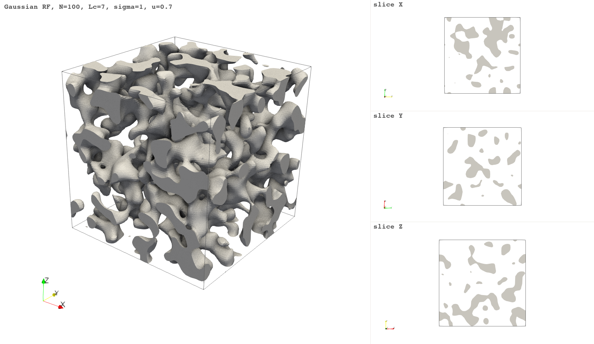
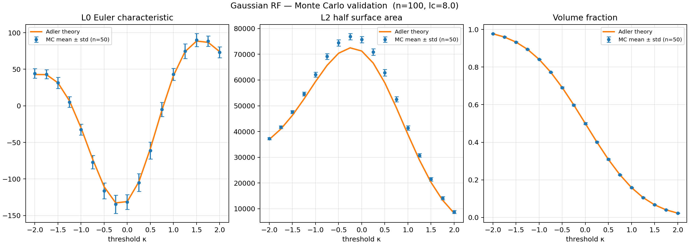
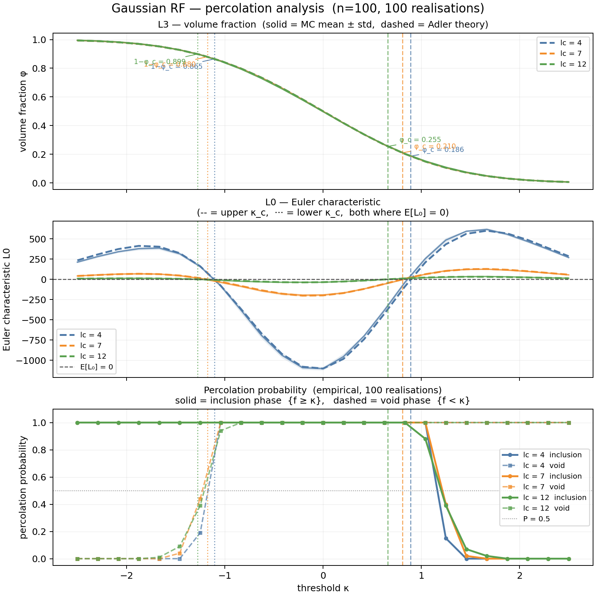

# Experiment 01 — Gaussian baseline



The ground-truth check. Scalar Gaussian field, Gaussian covariance
$C(r) = e^{-r^2/l_c^2}$. Numerical LKCs vs the Adler expectation across
the full threshold range. Every other experiment is compared to this.

**Adler link:** fully closed-form. The hitting set $D_u = [u, \infty)$
has exact Gaussian Minkowski functionals; see `docs/framework.md` for
the four formulas.

## What it runs

- `LCS = [4, 7, 12]`, $N = 100$ grid, $L = 100$, 10 realizations each.
- 25 thresholds in $[-2.5, 2.5]$, measures $L_0 \ldots L_3$ + percolation
  per axis.
- Exports one realization per $l_c$ as `.vti`/`.vtp` for ParaView.

```bash
mamba run -n rf_explo python run.py
```

Runtime ≈ 5 min on a laptop.

## Outputs

| File | Contents |
|---|---|
| `results/mc_gaussian.png` | 3×5 grid: LKC error bars vs Adler + mid-plane slices |
| `results/percolation.png` | $\varphi(\kappa)$, $L_0(\kappa)$, empirical $P(\text{span})$ with the two $\mathbb{E}[L_0] = 0$ crossings marked |
| `results/lc_XX/threshold_sweep.csv` | per-threshold means ± std and Adler values |
| `results/lc_XX/*.vti` / `*.vtp` | one realization for ParaView |

## What it shows





- $L_0, L_2, L_3$ match Adler to MC noise across all three $l_c$.
- $L_1$ matches in shape; absolute amplitude depends on which estimator —
  see `docs/measurement_conventions.md`.
- The upper $\mathbb{E}[L_0] = 0$ crossing lands at $\varphi_c^+ \approx 22\%$
  for $l_c = 8$ in a $100^3$ box (bulk value is 15.9%; the boundary terms
  shift it up).

## Known limitations

- 10 realizations: error bars are indicative, not tight.
- Percolation sigmoids are coarse at 10 realizations; the broader
  percolation panel was produced with a separate 100-realization re-run.
