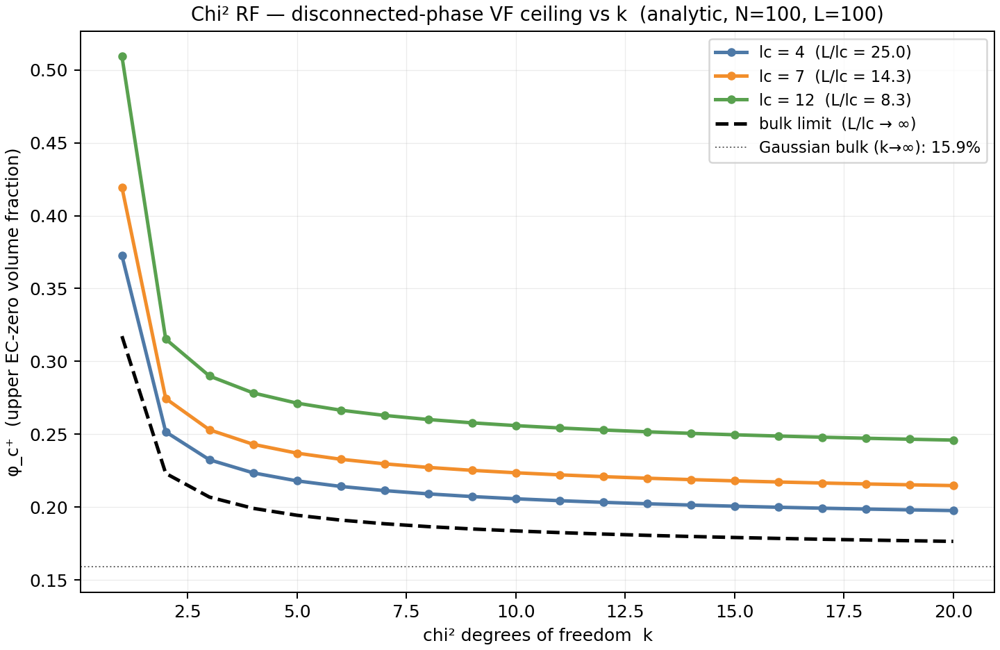
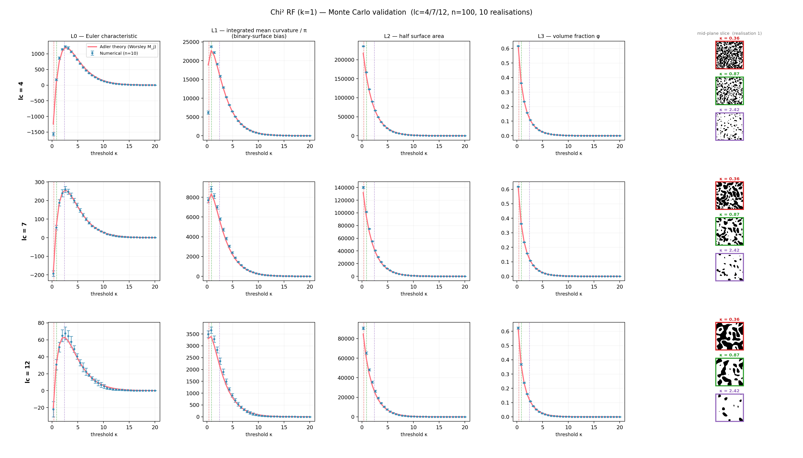
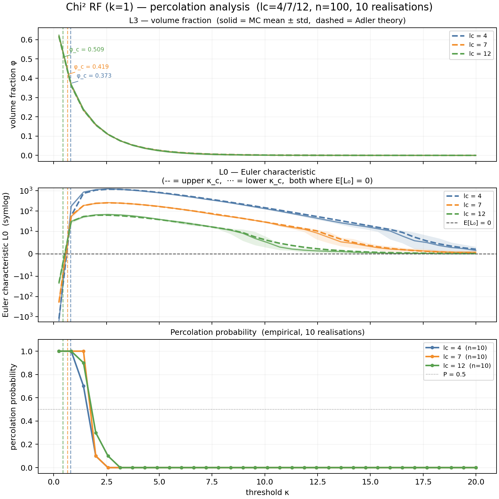

# Experiment 02 — Chi-squared field


Chi² field `X(x) = Σ_i f_i(x)²` with `k = 1` (one squared Gaussian) as the
default. The marginal is `χ²(k)`; the Adler GKF applies with the Worsley
(1994) `M_j` for `D_u = [u, ∞)` under a chi-squared distribution.

**Adler link:** fully closed-form. See `theory/README.md` for context;
Worsley (1994, eq. 3) for the `M_j`.

## What's non-Gaussian here

For $k = 1$, $\chi^2(1) = Z^2$, so $\{X \geq u\}$ is the two-tail Gaussian
excursion $\{\lvert Z\rvert \geq \sqrt{u}\}$ — the volume fraction at any
threshold is twice the one-sided Gaussian value. This moves the
$\mathbb{E}[L_0] = 0$ crossing from the Gaussian 16% to roughly 32% in
the bulk limit, and higher still in a finite domain. Larger $k$
interpolates back toward the Gaussian ceiling.

Bulk $\varphi_c^+$ (where $\mathcal M_3(u) = 0$):

| $k$ | $\kappa_c$ | $\varphi_c^+$ (bulk) |
|---|-----|-------------|
| 1 | 1   | 31.7% |
| 2 | 3   | 22.3% |
| 4 | 6   | 19.9% |
| $\to \infty$ | — | 15.9% (Gaussian) |

Our 100³ box amplifies these numbers via the boundary terms —
`phi_c_vs_k.png` plots the finite-domain `φ_c⁺` across `k = 1..20` for
each `lc`, with the lc-independent bulk curve for reference:



## What it runs

- `K = 1`, `LCS = [4, 7, 12]`, `N = 100`, 10 realizations.
- Dense threshold grid near the EC crossings + a sparse tail.
- MC validation of `L_0..L_3` + spanning probability per `lc`.

```bash
mamba run -n rf_explo python run.py
```

Runtime ≈ 10–15 min.

## Outputs

| File | Contents |
|---|---|
| `results/mc_chi2.png` | LKC error bars vs Adler + slice thumbnails |
| `results/percolation.png` | φ(κ), `L_0(κ)`, P(span), both EC crossings marked |
| `results/phi_c_vs_k.png` | analytic `φ_c⁺` vs chi² dof `k` for each `lc` + bulk curve |




| `results/lc_XX/threshold_sweep.csv` | per-threshold measurements and theory |
| `results/lc_XX/*.vti` / `*.vtp` | one realization for ParaView |

## Known limitations

- At `lc = 4` and very low `u`, opposite-sign Gaussian regions
  (`{Z ≥ √u}` vs `{Z ≤ −√u}`) can touch across voxel faces (594 contacts
  seen at `u = 0.25`, seed 42). The binary union then loses the separating
  interface, biasing `L_0` and `L_1` at those thresholds. Not seen at
  `lc ≥ 7`.
- Spanning probability from only 10 realizations is a coarse staircase;
  the plotted sigmoid is indicative.

## References

- Worsley, K.J. (1994). Local maxima and the expected Euler characteristic
  of excursion sets of chi-squared, F and t fields. *Adv. Appl. Prob.*
  26(1), 13–42.
