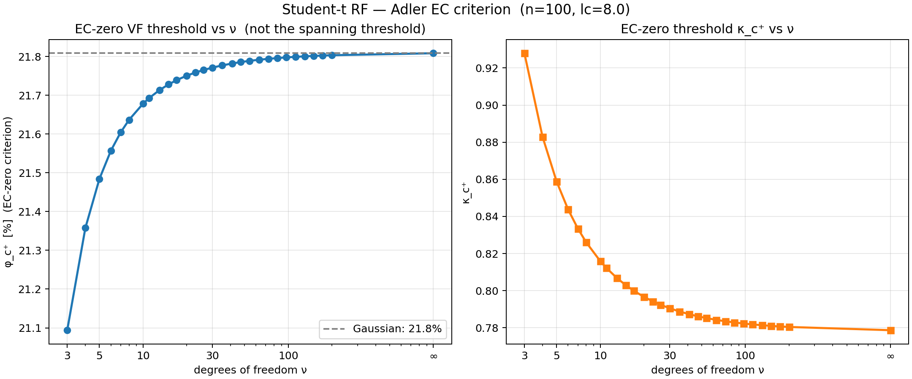
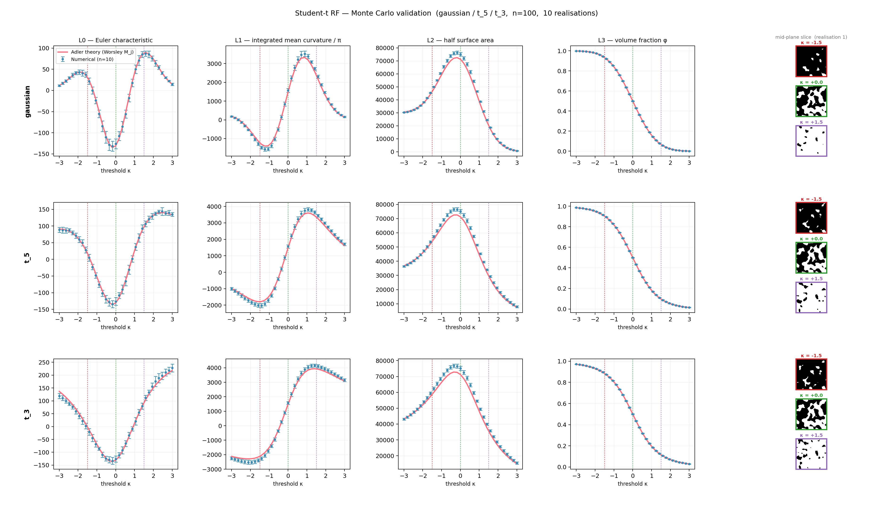
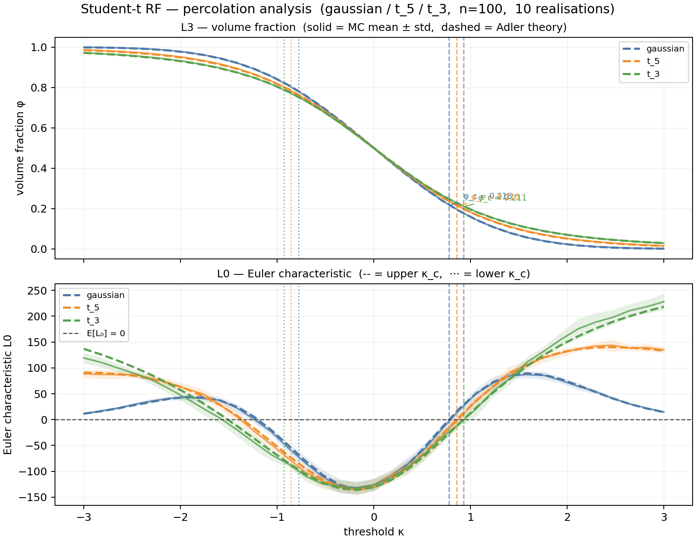

# Experiment 03 — Student-$t$ field


Does a heavier-tailed marginal raise the disconnected-phase VF ceiling?

**No.** The correct cone-geometry `M_j` for the Worsley $t_\nu$ field give
`φ_c⁺` nearly identical to Gaussian and *slightly decreasing* with ν. The
marginal distribution barely matters — the ceiling is set by the spatial
correlation structure.

**Adler link:** fully closed-form. Derivation and derivation of the
previous-wrong-formulas story are in
[`theory/student_t_derivation.md`](../../theory/student_t_derivation.md) §5.

## What's non-Gaussian here

The Worsley field `T_ν(x) = Z_0(x) / √(χ²_ν(x)/ν)` has a spatially varying
denominator with the same correlation length as `Z_0`. Marginal is `t_ν`;
Adler GKF applies with ν-dependent `M_j`.

The cone-geometry `M_j` (not the PDF derivatives — see the derivation note
for why the latter is wrong):

| `M_j` | Formula |
|-------|---------|
| `M_0(u)` | `t.sf(u, df=ν)` |
| `M_1(u)` | `c_ν(u) = (1/√2π)·(1 + u²/ν)^(-(ν-1)/2)` |
| `M_2(u)` | `A_ν · u · c_ν(u)`, `A_ν = √(2/ν)·Γ((ν+1)/2)/Γ(ν/2)` |
| `M_3(u)` | `((ν-1)/ν · u² − 1) · c_ν(u)` |

Finite-domain `φ_c⁺` on our 100³ box at `lc = 8`:

| ν | u_c = √(ν/(ν−1)) | φ_c⁺ (finite domain) |
|---|------------------|----------------------|
| ∞ (Gaussian) | 1.000 | 21.81% |
| 10 | 1.054 | 21.68% |
| 5  | 1.118 | 21.48% |
| 3  | 1.225 | 21.09% |

Changes under half a percent. Not a VF-ceiling story — a correct-formula
story. Valid range: `ν ≥ 3` (variance diverges at ν = 2, `λ_2` undefined
at ν = 1).

### Reading `percolation_diagram.png`

Both panels are purely analytic sweeps of `E[L_0(κ)] = 0` on the same
`N = 100, L = 100, lc = 8` box used for MC. No measurements involved.

- **Left (blue — `φ_c⁺` vs ν):** volume fraction at the upper EC-zero
  crossing, `φ_c⁺ = t.sf(κ_c⁺, ν)`. Heavier tails (small ν) give slightly
  *lower* `φ_c⁺` — the whole ν axis spans ~0.7 percentage points
  (21.09% at ν = 3 → 21.81% at ν → ∞, the Gaussian dashed line).
- **Right (orange — `κ_c⁺` vs ν):** threshold in field units at the same
  crossing. Heavier tails push `κ_c⁺` *up* (0.78 → 0.93) because `t_ν`
  spreads more mass into the tails, so a higher threshold is needed to
  carve off the same volume.

The two panels tell the same story in different units: as ν shrinks, `κ_c⁺`
climbs *and* `t.sf` assigns slightly more mass above it, and the two
effects nearly cancel — hence the almost-flat `φ_c⁺` curve on the left.
The finite-domain boundary terms shift both panels up by ~6 percentage
points vs the bulk `L/lc → ∞` values (`φ_c⁺ = 15.4–15.9%`) but preserve
the qualitative shape.



## What it runs

- Three MC cases: Gaussian, `t_5`, `t_3`.
- `LC = 8`, `N = 100`, 10 realizations each, 35 thresholds in `[-3, 3]`.
- Plus a theory-only sweep of `φ_c⁺` across `ν ∈ {3, …, ∞}`.

```bash
mamba run -n rf_explo python run.py
```

Runtime ≈ 10–15 min.

## Outputs

| File | Contents |
|---|---|
| `results/mc_student_t.png` | LKC error bars vs Adler + slice thumbnails |
| `results/percolation.png` | φ(κ) and `L_0(κ)` with EC-zero crossings |
| `results/percolation_diagram.png` | analytic `φ_c⁺` and `κ_c⁺` vs ν (see above) |




| `results/<case>/threshold_sweep.csv` | per-threshold measurements and theory |
| `results/<case>/*.vti` / `*.vtp` | one realization for ParaView |

## Known limitations

- 10 realizations: MC noise is ~5–10% on `L_0, L_1, L_2` for `t_3` at
  large |κ|.
- `t_3` has formally infinite field-level `λ_2(T)` (the `1/D²` term diverges
  for ν ≤ 4); the GKF uses the *component* `λ_2 = 2/lc²` so the formula
  still works, but a few rare extreme voxels may bias measurements.

## References

- Worsley, K.J. (1994). Local maxima and the expected Euler characteristic
  of excursion sets of chi-squared, F and t fields. *Adv. Appl. Prob.*
  26(1), 13–42.
- SPM's `spm_ECdensity` — reference implementation of the cone-geometry
  `M_j` for `t` fields.
