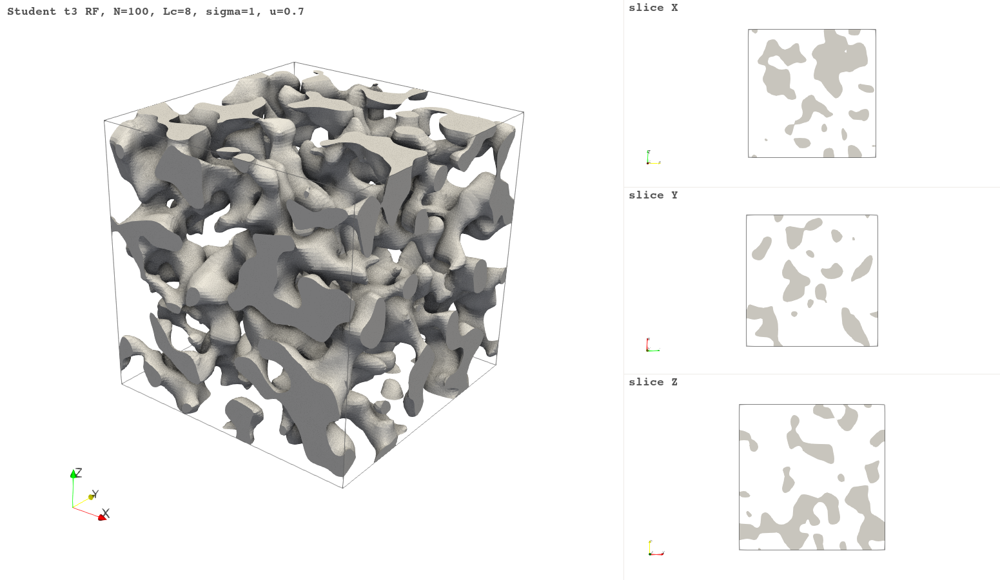
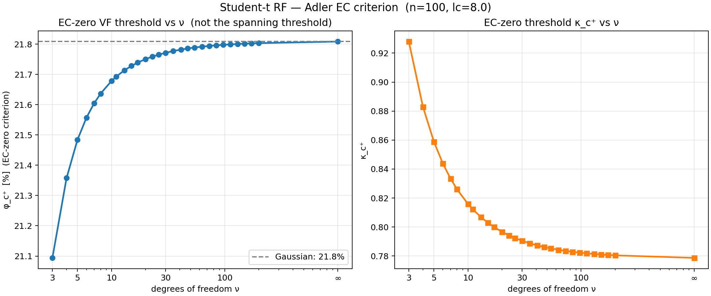
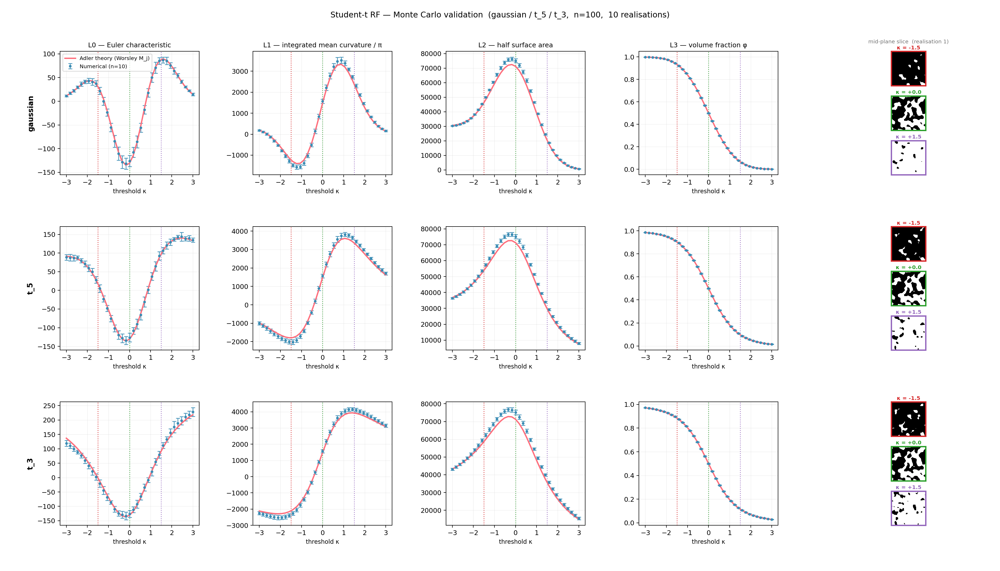
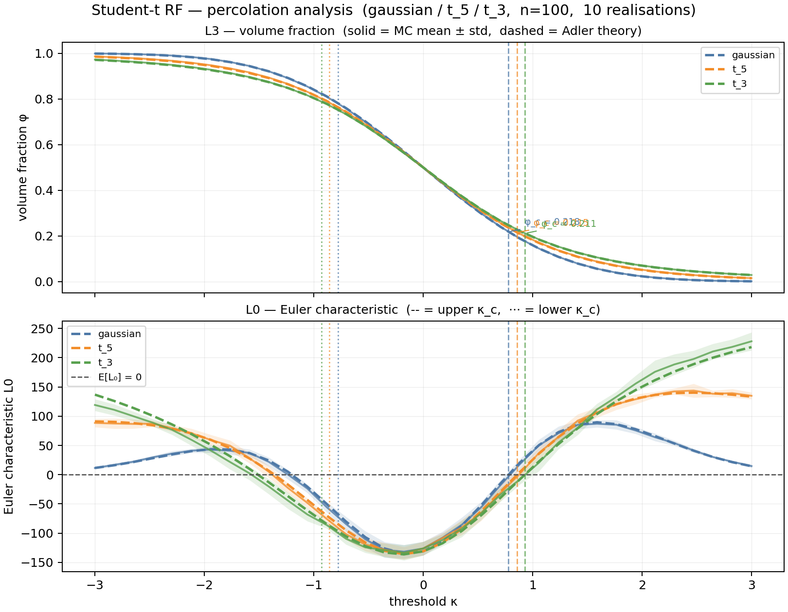

# Experiment 03 — Student-$t$ field



Does the Worsley ratio construction raise the expected-Euler-zero VF?

At fixed component correlation and domain size, its EC-zero VF is close
to the Gaussian value and decreases slightly as $\nu$ decreases. This
is a statement about this family and this proxy, not a general ceiling
on disconnected morphology or evidence that marginal distributions never matter.

**Adler link:** fully closed-form. Derivation and the previous-wrong-
formulas story are in
[`theory/student_t_derivation.md`](../../theory/student_t_derivation.md) §5.

## What's non-Gaussian here

The Worsley field $T_\nu(x) = Z_0(x) / \sqrt{\chi^2_\nu(x)/\nu}$ has a
spatially varying denominator built from independent Gaussian components
with the same correlation length as $Z_0$. The nonlinear denominator and
the ratio do not themselves have the Gaussian component covariance.
Marginal is $t_\nu$; Adler GKF applies with $\nu$-dependent
$\mathcal M_j$.

The cone-geometry $\mathcal M_j$ (not the PDF derivatives — see the
derivation note for why the latter is wrong), with
$c_\nu(u) = (2\pi)^{-1/2}\bigl(1 + u^2/\nu\bigr)^{-(\nu-1)/2}$ and
$A_\nu = \sqrt{2/\nu}\,\Gamma((\nu+1)/2)/\Gamma(\nu/2)$:

$$
\begin{aligned}
\mathcal M_0(u) &= \mathbb{P}(T_\nu \geq u), \\[2pt]
\mathcal M_1(u) &= c_\nu(u), \\[2pt]
\mathcal M_2(u) &= A_\nu\, u\, c_\nu(u), \\[2pt]
\mathcal M_3(u) &= \left(\tfrac{\nu-1}{\nu}\, u^2 - 1\right) c_\nu(u).
\end{aligned}
$$

Finite-domain $\varphi_c^+$ on our $100^3$ box at $l_c = 8$:

| $\nu$ | Finite-cube EC-zero threshold | $\varphi_c^+$ (finite domain) |
|---|------------------|----------------------|
| $\infty$ (Gaussian) | 0.7787 | 21.81% |
| 10 | 0.8159 | 21.68% |
| 5  | 0.8588 | 21.48% |
| 3  | 0.9280 | 21.09% |

The spread is about 0.72 percentage points. The bulk threshold
$\sqrt{\nu/(\nu-1)}$ is different from the finite-cube threshold above.
The formula API supports finite $\nu\geq3$ and the generator requires
integer $\nu\geq3$. Common component SD cancels in the ratio. These
contracts concern the implemented model, not finiteness of the t-field
gradient variance; the GKF uses the standardized Gaussian-component metric.

### Reading `percolation_diagram.png`

Both panels are purely analytic sweeps of $\mathbb{E}[L_0(\kappa)] = 0$
on the same $N = 100$, $L = 100$, $l_c = 8$ box used for MC. No
measurements involved.

- **Left (blue — $\varphi_c^+$ vs $\nu$):** volume fraction at the upper
  EC-zero crossing, $\varphi_c^+ = \mathbb{P}(T_\nu \geq \kappa_c^+)$.
  Heavier tails (small $\nu$) give slightly *lower* $\varphi_c^+$ — the
  whole $\nu$ axis spans ~0.7 percentage points (21.09% at $\nu = 3$ →
  21.81% at $\nu \to \infty$, the Gaussian dashed line).
- **Right (orange — $\kappa_c^+$ vs $\nu$):** threshold in field units at
  the same crossing. Heavier tails push $\kappa_c^+$ *up* (0.78 → 0.93)
  because $t_\nu$ spreads more mass into the tails, so a higher threshold
  is needed to carve off the same volume.

As $\nu$ shrinks, heavier tails and a higher EC-zero threshold nearly
offset in the resulting VF. Boundary terms raise the VF by about six
percentage points relative to the bulk values (15.4–15.9%); they lower
the threshold in field units. Percentages do not describe the threshold axis.



## What it runs

- Three MC cases: Gaussian, $t_5$, $t_3$.
- `LC = 8`, $N = 100$, 10 realizations each, 35 thresholds in $[-3, 3]$.
- Plus a theory-only sweep of $\varphi_c^+$ across
  $\nu \in \{3, \ldots, \infty\}$.

```bash
mamba run -n rf_explo python run.py
```

Runtime ≈ 10–15 min.

## Outputs

| File | Contents |
|---|---|
| `results/mc_student_t.png` | LKC error bars vs Adler + slice thumbnails |
| `results/percolation.png` | $\varphi(\kappa)$ and $L_0(\kappa)$ with EC-zero crossings |
| `results/percolation_diagram.png` | analytic $\varphi_c^+$ and $\kappa_c^+$ vs $\nu$ (see above) |
| `results/<case>/threshold_sweep.csv` | per-threshold measurements and theory |
| `results/<case>/*.vti` / `*.vtp` | one realization for ParaView |





## Known limitations

- 10 realizations: MC noise is ~5–10% on $L_0, L_1, L_2$ for $t_3$ at
  large $\lvert\kappa\rvert$.
- $t_3$ has formally infinite field-level $\lambda_2(T)$ (the $1/D^2$
  term diverges for $\nu \leq 4$); the GKF uses the *component*
  $\lambda_2 = 2/l_c^2$ so the formula still works, but a few rare
  extreme voxels may bias measurements.

## References

- Worsley, K.J. (1994). Local maxima and the expected Euler characteristic
  of excursion sets of chi-squared, F and t fields. *Adv. Appl. Prob.*
  26(1), 13–42.
- SPM's `spm_ECdensity` — reference implementation of the cone-geometry
  $\mathcal M_j$ for $t$ fields.
