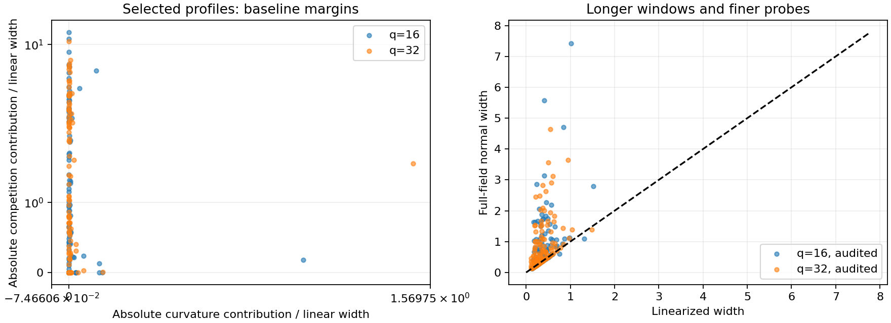

# Bounded audit of film-width tails

This follow-up addresses the unresolved and large-error normal profiles in
the [film-width pilot](FILM_WIDTHS.md). It reuses the same finite-mode
Gaussian fields, interface locations, normals, margins, and area weights.
It does not generate new fields or measure particle sizes.

## Questions and comparison

The comparison uses three widths along each original interface normal:

1. $W_{\rm lin}=2\delta/\|\nabla(G_i-G_j)\|$, the local linear prediction.
2. $W_{\rm pair}$, obtained from the actual curved two-field profile by
   finding the matrix interval containing the tie for $|G_i-G_j|<\delta$.
3. $W_{\rm full}$, the corresponding interval of the full $q$-component
   top-two-gap field at the same margin.

When both numerical widths are resolved, the signed contributions satisfy

$$
\frac{W_{\rm full}-W_{\rm lin}}{W_{\rm lin}}
=\underbrace{\frac{W_{\rm pair}-W_{\rm lin}}{W_{\rm lin}}}_{\text{curvature / higher-order pair variation}}
+\underbrace{\frac{W_{\rm full}-W_{\rm pair}}{W_{\rm lin}}}_{\text{additional competitors}}.
$$

These are comparisons along the same fixed normal, not shortest distances
between curved surfaces. Either contribution can have either sign. The
two-field profile is a diagnostic counterfactual: dropping other fields
does not redefine the production margin model or its Adler coefficients.

## Selection and bounded computation

All interface points having at least one censored case, unstable case, or
absolute relative width error above 10% are selected. Eight random controls
are added from the remaining points in each $(q,\text{realization})$ group,
using selection seed 47211. Every selected point is rechecked at all six
original margins. The selection reasons are saved in `selection.csv`.

Those margins use baseline VF calibrations 75% and 85%, multiplied by
1, 1/2, and 1/4. Reduced margins correspond to higher VFs; the baseline
`target_vf` label is retained only to identify their calibration family.

The original sample contains 256 interface points reused at six margins,
or 1,536 profile/margin rows. Updated measurements replace their original
rows; the remaining measurements are inherited. All original sampling
weights are preserved. The audit subset alone is deliberately biased
toward difficult cases and must not be treated as a new representative
interface sample.

The calculation starts from saved component values. It doubles the search
window without coarsening its samples when an occupied endpoint is missing,
up to a half-length of $2l_c$. It then halves the sampling step, requiring
two successive endpoint comparisons within $10^{-7}l_c$. The implementation
allows at most five step refinements and **8,193 distinct evaluated
positions per profile**, including cached root probes and the original
samples. The same evaluations serve all margins and both field comparisons.
Profiles are processed individually, without a full-domain grid.

Brent refinement evaluates the original spectral fields inside each
detected bracket. Stability under finer probes is a numerical diagnostic,
not a proof that every narrow occupied interval has been isolated.
An explicit stop reason distinguishes stable closure, the extent cap,
the point cap, and the refinement cap.

## Bounds and population accounting

A stable, closed full-field profile contributes its measured width. A
stable scan with an unclosed side contributes the searched distance on
that side as a lower bound and infinity as the upper bound. Unstable
measurements receive the conservative interval $[0,\infty)$.

These bounds are **conditional on the sampled interval search**. They do
not certify continuum root completeness. Unresolved observations retain
their full area weight. For width threshold $h$, the weighted CDF bounds
are computed from

$$
\frac{\sum_k\omega_k\mathbf1\{U_k\leq h\}}{\sum_k\omega_k}
\ \leq F(h)\leq
\frac{\sum_k\omega_k\mathbf1\{L_k\leq h\}}{\sum_k\omega_k},
$$

where $[L_k,U_k]$ is each profile's numerical width interval. The summary
also records lower and upper mean widths. An infinite upper mean is kept
explicitly if an unresolved observation prevents a finite bound. Error
quantiles remain conditional on stable, uncensored profiles and are labelled
separately from these full-population bounds.

## Results

The saved run completed on 2026-11-13 in 391.3 seconds (about 6.5 minutes).
It rechecked 136 interface points: 104 flagged points and 32 random controls.
Their 816 profile/margin rows replace the corresponding original rows;
the other 720 rows are inherited. The audit requires two consecutive
refinement comparisons, whereas inherited rows retain the pilot's single
comparison criterion. This is a targeted follow-up, not uniform refinement
of every observation.

Both full-field endpoints were found for all 1,536 rows. Of these,
**1,505 satisfy their applicable stability criterion and 31 remain
numerically uncertain**. Among the 86 formerly censored rows, 72 are now
stable and 14 remain uncertain; all three formerly uncensored unstable
rows are now stable. The stricter audit also leaves 17 previously accepted
rows uncertain. These 31 cases occur at six $q=32$ interface points
(`crossing_id` 1460, 1788, 4143, 4629, 4748, and 5414).

Of the 136 audited points, 130 stopped with stable results and six stopped
because the next refinement would exceed the point budget. No point used
more than 4,369 distinct positions: the code refuses a whole additional
refinement batch when it cannot fit within the 8,193-position cap. Finding
both endpoints alone does not remove the stability uncertainty.

At the two baseline margins, the updated area-weighted error quantiles are:

| $q$ | Target VF | Stable / 128 | Uncertain / 128 | Median absolute relative width error | 90th-percentile error |
|---:|---:|---:|---:|---:|---:|
| 16 | 75% | 128 | 0 | 0.448% | 247.4% |
| 16 | 85% | 128 | 0 | 0.105% | 159.4% |
| 32 | 75% | 123 | 5 | 0.880% | 352.2% |
| 32 | 85% | 123 | 5 | 0.107% | 142.6% |

These quantiles include only stable full-field widths. Resolving previously
censored intervals increases the observed tail substantially compared with
the pilot. Small median errors therefore do not validate the full width
distribution. For $q=16$, the full-sample area-weighted mean widths are
0.8023 and 0.3930 length units at VF 75% and 85%, respectively; the
small-margin law predicts 0.4947 and 0.2832. For $q=32$, unresolved weights
leave the conservative upper mean infinite at every tested margin.
The retained uncertainty is available in `cdf_bounds.csv` and `summary.csv`.

Among **157 baseline profile/margin cases** with absolute relative error
above 10% and stable full-field and pair widths, the absolute competition
contribution exceeds the absolute curvature contribution in **152 cases**.
This is a descriptive count, not an independent-observation probability:
the same interface points are reused across margins and the two $q$ values
share component fields. It identifies additional competitors as the main
source of large discrepancies in this sample. A long matrix interval along
the chosen normal can pass through a junction and need not represent the
thickness of a locally parallel film.



The figure compares the magnitudes of the two signed contributions and
the measured full-field width with its linear prediction. The decomposition
closes to within $1.8\times10^{-15}$ in relative-error units. All eight new
software controls pass; 28 recorded source, input, and output hashes were
verified, and every original area weight was preserved.

The evidence supports the thin-film law as a local small-margin description
and exposes its finite-margin limitations near competing fields. It does
not contradict the GMF/Adler expectation formulas, which do not assume that
every finite-width normal profile is a two-field linear film. The remaining
31 uncertain rows are retained explicitly; no larger computation is needed
for the planned visual exploration.

## Reproduction

From the repository root, in the existing `rf_explo` environment:

```powershell
mamba run -n rf_explo python -B experiments/04_margin_tessellation/test_film_tail_audit.py
mamba run -n rf_explo python -B -u experiments/04_margin_tessellation/audit_film_tails.py --output experiments/04_margin_tessellation/results_film_tails_repeat
```

The defaults read `results_film_widths_refined/` and the modes in
`results_film_widths/`. Both inputs are checked against their recorded
hashes, and the spectral streams are compared with stored profile values
before extending each profile. Nonempty destinations are refused.

Outputs in `results_film_tails/` include the selection, combined
`profiles.csv`, iteration diagnostics in `refinement.csv`, `summary.csv`,
`cdf_bounds.csv`, saved component evaluations for audited profiles, a figure,
and metadata with limits, versions, source hashes and artifact hashes.

Eight software controls test extension of a censored affine film,
curvature/competition separation, retained censoring at a cap, the unique-
point budget, selection completeness, weighted CDF bounds, and output
preservation. The original pilot and follow-up remain unchanged.

## Scope after this audit

Grain-size analysis is deferred. The next requested direction is visual
inspection of random-field realizations generated within experiment 04
and exported for ParaView. Any such exports should retain the margin,
winner labels, physical spacing, and generation parameters, and document
whether the displayed geometry uses voxels or interpolated components.
