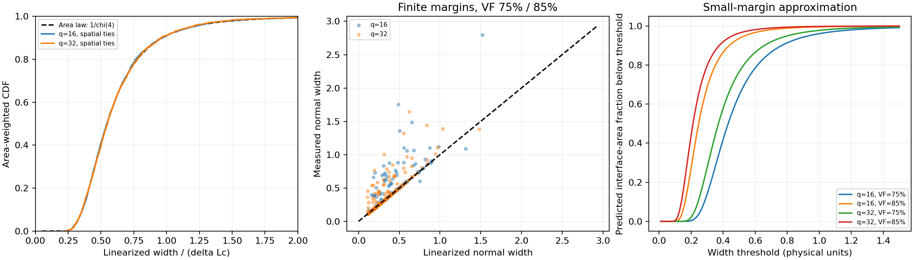

# Interface-area sampling and physical normal film widths

This pilot tests the [small-margin film-width theory](../../theory/margin_film_widths.md)
using direct GSTools evaluations on lines and local normal profiles. It
does not generate a 3D voxel field, build a mesh, or measure global Euler.
The original Gaussian components and margin hitting set are retained.

## Sampling design

The configuration uses $q=16,32$, $L=64$, $l_c=5$, 1000 RandMeth modes,
and two independent maximum-size vector realizations with seeds 481703
and 481704. Within each realization, the $q=16$ model uses the first 16
of the same 32 components. Comparisons across $q$ are therefore paired,
not independent realizations. GSTools uses unit ensemble variance and
`Gaussian(rescale=1)`; no empirical field normalization is applied.

There are 24 uniformly placed axis-parallel lines in each of the three
directions, each of length 64. The same lines are reused across $q$.
Fine line spacing is approximately $l_c/16$, with a nested $l_c/8$
comparison. A change of winning component brackets a possible tie;
Brent solves the original pair difference. A root is rejected if a third
component exceeds the tied pair there. The number of rejected candidates
and unmatched crossings under refinement is recorded, not hidden.

This cannot certify that every short winner interval was found. The
refinement comparison quantifies changes in the sampled crossing set,
but intervals missed at both spacings remain possible.

## Why crossing weights recover interface area

For a surface with unit normal $n$, intersections with lines parallel to
axis $a$ sample area with density proportional to $|n_a|$. Pooling equal
line densities along all three axes gives density proportional to
$s(n)=|n_x|+|n_y|+|n_z|$. Each crossing is therefore weighted by

$$
\omega(n)=1/s(n),\qquad 1/\sqrt3\leq\omega\leq1.
$$

This removes the projection bias without the divergent near-tangent
weights that would arise from correcting a single direction alone. For
$m$ lines per axis in a cube of side $L$, the interface area density
estimate is $\sum\omega/(mL)$. The factor is $mL$, not $3mL$:
the three orientation projection factors have already been summed and
cancelled by $\omega$.

Weighted averages over all retained ties are compared with the area-Palm
gradient prediction $(l_c/2)\|\nabla(G_i-G_j)\|\sim\chi_4$. They are
ratio estimates of area-weighted ensemble quantities, not iid samples.
The report gives descriptive CDF discrepancies, without KS-test p-values
or confidence intervals based on treating all crossings as independent.

## Direct normal profiles

From each realization/$q$ crossing pool, 64 crossings are selected
uniformly without replacement. Their weights include both the orientation
factor and inverse subsampling probability, so pooled summaries retain
the area weighting when the two realizations have different pool sizes.
The same selected ties are used at all margins.

Each normal is computed analytically from the original random Fourier
modes. The mode values are checked against the GSTools field evaluator;
tests also compare gradients with central differences. This uses private
GSTools spectral arrays, so the version and actual mode arrays are saved.

The baseline margins correspond to theoretical aggregate VFs 75% and
85%. Each is also multiplied by 1/2 and 1/4 on the same profiles, to test
the small-margin limit. Those reduced margins have **higher VFs**;
`target_vf` in their rows identifies the baseline calibration, not their
own VF. No global sample VF is inferred from these selected interfaces.

The profile extends symmetrically along the zero-margin interface normal,
with half-length
$\min(l_c,\max(0.05l_c,4\delta_{\max}/\|\nabla H\|))$.
Its 65- and 129-point nested grids locate the first occupied interval on
each side of the central tie. Brent then refines each threshold crossing
using direct evaluations of all Gaussian components. Boundary movement
below $10^{-7}l_c$ between the two probe levels is the numerical stability
criterion. This is not certified root isolation.

The measured quantity is the length of the connected matrix interval
containing the tie along its fixed normal. It is not the shortest distance
between curved aggregate surfaces. Profiles may extend outside the cube:
the stationary field is evaluated there to avoid censoring intrinsic film
widths at an artificial observation boundary.

An unclosed side at the finite profile endpoint is recorded as censored.
Stable uncensored profiles enter width-error summaries; their count is
reported. Endpoint winners and runners distinguish a change of grain
labels from the subtler case where a third competitor becomes runner-up.
The latter can change the film width even if both endpoint winners remain
the original pair. Both cases remain in the primary finite-margin error
summary; an additional pair-controlled summary is explicitly conditional.

## Numerical findings

The original pilot completed in 1121.5 seconds (about 18.7 minutes).
Its simple crossing finder missed some short third-winner intervals:
the initial interface-area estimates were 5–8% below their ensemble
predictions. This prompted the adaptive follow-up described below.

The theoretical predictions use physical units consistent with $l_c=5$:

| $q$ | Target VF | Margin | Mean linearized width | 10th percentile | Area fraction below width 0.5 |
|---:|---:|---:|---:|---:|---:|
| 16 | 75% | 0.157897 | 0.49474 | 0.28305 | 64.59% |
| 16 | 85% | 0.090391 | 0.28322 | 0.16204 | 93.61% |
| 32 | 75% | 0.135616 | 0.42493 | 0.24311 | 76.53% |
| 32 | 85% | 0.077423 | 0.24259 | 0.13879 | 96.31% |

These are predictions for the linearized area law, not measured finite-margin
width fractions. In particular, the 0.5 threshold can be compared with the
saved N=128 grid spacing, but the last column is not a voxel-error probability.

## Adaptive sampling follow-up

[refine_film_widths.py](refine_film_widths.py) uses the saved mode arrays and
the same random lines. A pair root hidden below a third winner now splits
the bracket into two winner-transition problems, recursively. This recovers
the intervening winning region instead of discarding the entire bracket.
The line spacing is also halved, with nested levels $l_c/16$ and $l_c/32$.
Intervals having the same endpoint winner can still hide a short region;
the nested comparison remains necessary and is not a proof of root completeness.

Direct evaluation of the stored spectral sum bypasses repeated SRF
position bookkeeping. Tests verify values against GSTools and check the
adaptive split on a constructed hidden-winner example. The physical fields
are unchanged. A two-realization execution regression also checks that the
refinement factor remains independent of the margin factors.

The improved crossing pools are sampled anew for 64 normal profiles per
realization/$q$. Profile selections across the original and refined
studies are **not paired**, because the pools changed. The margin-factor
comparisons within either study are paired. The same normal-profile
window, censoring rules, and 65/129-point stability diagnostic are retained.

The original results are in [results_film_widths/](results_film_widths/).
The follow-up is in [results_film_widths_refined/](results_film_widths_refined/).
Its metadata additionally hashes the parent metadata and the two saved
mode files. It adds no independent field realizations.

The follow-up completed in **98.8 seconds**. It retained 5,629 crossings
across the two $q$ values and two vector realizations, versus 5,304 in the
original pilot. With adaptive splitting enabled at both levels, halving
the line spacing added only two crossings and lost none. This is a much
smaller remaining sampling discrepancy, but not certified root completeness.

| $q$ | Realization | Crossings | Measured tie area / volume | Predicted tie area / volume | Weighted gradient CDF discrepancy |
|---:|---:|---:|---:|---:|---:|
| 16 | 0 | 1,306 | 0.565388 | 0.563623 | 0.01495 |
| 16 | 1 | 1,296 | 0.559001 | 0.563623 | 0.02324 |
| 32 | 0 | 1,512 | 0.652671 | 0.660543 | 0.02378 |
| 32 | 1 | 1,515 | 0.657849 | 0.660543 | 0.01969 |

All four area estimates are within 1.2% of their ideal ensemble predictions.
The maximum weighted gradient CDF difference is 0.0238; this is an absolute
CDF discrepancy, not a relative width error or a significance test. The
mean normalized linear widths range from 0.6184 to 0.6393, against
$\sqrt{\pi/8}=0.6267$. These observations support the area-Palm gradient
law in this finite pilot.

Finite-margin widths show a less uniform result. There are 128 sampled
profiles per $q$ across the two realizations, each reused at six margins.
The table below uses the unscaled 75%/85% margins. Width errors are
area-weighted and computed **only among stable, uncensored profiles**.

| $q$ | Target VF | Stable, uncensored / 128 | Censored / 128 | Median absolute relative width error | 90th-percentile error |
|---:|---:|---:|---:|---:|---:|
| 16 | 75% | 109 | 19 | 0.337% | 74.1% |
| 16 | 85% | 119 | 9 | 0.097% | 62.3% |
| 32 | 75% | 95 | 33 | 0.324% | 66.0% |
| 32 | 85% | 119 | 9 | 0.102% | 80.3% |

The medians are encouraging, but they do not describe the tail. Third
competitors can strongly change widths, and the censored cases can be
wider than the local window. Across all six margins there are 1,536
profile/margin rows: 1,447 are stable and uncensored, 86 are censored,
and three are uncensored but fail the probe stability check. These are
256 reused interface points, not 1,536 independent observations.

Reducing the margins improves the local approximation. At one quarter
of the 85%-VF margin, median relative errors are about 0.0048% ($q=16$)
and 0.0052% ($q=32$); the 90th-percentile errors are 0.183% and 0.084%,
respectively. No profiles are censored at these two reduced margins,
although one $q=32$ profile remains numerically unstable and is excluded.
At one quarter of the 75%-VF margin, the 90th-percentile errors are still
about 21–24%, showing that a uniform finite-margin error bound is not
established even when the median is small.



The left panel compares the normalized **linearized** width law using all
crossing gradients; it is not the measured finite-width CDF. The middle
panel shows stable, uncensored normal widths at the two baseline margins.
The right panel is the theoretical small-margin CDF. Censored observations
are excluded from the middle panel and retained in the CSV files.

The result supports a useful width scale and an interface-area prediction
while exposing the finite-VF limitation near junctions. The subsequent
[bounded tail audit](FILM_TAILS.md) expands and refines the difficult
profiles and separates pair curvature from additional competitors. It finds
both endpoints for every full-field interval, with 1,505 stable rows and
31 remaining uncertain under the bounded refinement. Updated baseline
90th-percentile errors are 143–352%; additional competitors dominate the
curvature contribution in 152 of 157 resolved large-error baseline cases.
The tables above remain the historical pilot results; the linked audit
contains their updated finite-width measurements and uncertainty bounds.
Neither the small gradient CDF discrepancy nor the median width errors
validate global Euler, connectivity, or particle grading.

## Reproduction and provenance

From the repository root:

```powershell
mamba run -n rf_explo python -B experiments/04_margin_tessellation/test_film_widths.py
mamba run -n rf_explo python -B experiments/04_margin_tessellation/test_film_width_refinement.py
mamba run -n rf_explo python -B -u experiments/04_margin_tessellation/run_film_widths.py --output experiments/04_margin_tessellation/results_film_widths_repeat
mamba run -n rf_explo python -B -u experiments/04_margin_tessellation/refine_film_widths.py --source experiments/04_margin_tessellation/results_film_widths_repeat --output experiments/04_margin_tessellation/results_film_widths_refined_repeat
```

The runner refuses nonempty output directories. It uses one GSTools
thread and processes profiles sequentially. No full-domain component
grid is allocated. Results contain:

- `crossings.csv`: locations, winner pairs, normals, gradients, weights,
  third-competitor clearance, and tie residuals.
- `crossing_refinement.csv`: coarse/fine crossing counts, rejected candidates,
  and unmatched roots by realization, $q$, and line direction.
- `profiles.csv`: all margins, normal widths, weights, endpoint labels,
  stability and censoring flags, and linearization errors.
- `gradient_summary.csv`, `width_summary.csv`, `predictions.csv`: spatial
  comparisons and theoretical physical-width predictions.
- `field_diagnostics.csv`: reproduction errors and conditional spectral
  derivative variances compared with the ideal value $2/l_c^2$.
- `spectral_modes_*.npz`, `profiles_q*_r*.npz`: the sampled finite-mode
  fields and raw normal-profile values.
- `film_widths.png`: normalized linear-width CDFs, finite-margin width
  comparisons, and the theoretical thin-film fractions.
- `metadata.json`: configuration, versions, completion status, runtime,
  source hashes, and hashes of all numerical/figure artifacts.

The 12 controls cover the chi-three to chi-four area bias, closed CDF and
quantiles, moments and the Adler volume identity, orientation weights,
spectral gradients, affine tie location and width, third-runner effects,
censoring, crossing refinement, invalid inputs, and output preservation.
Four additional controls cover the saved-mode evaluator, adaptive hidden
winners, pure-pair agreement, and the two-realization execution regression:
16 controls total. Tiny $q=2$ execution checks are separate from the spatial
pilot; they are not ensemble validation.

The study is a two-realization, finite-mode pilot. The line sampling,
profile bracketing, local Taylor approximation, and finite sample size
introduce different uncertainties. A width below one grid spacing does
not by itself determine a voxel error or certify global connectivity.
