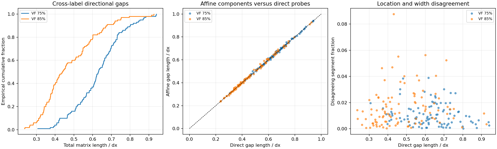

# Local reconstruction of the inter-label films

## Completed calculation

The local audit is complete for the saved q=32, N=128, L=64, lc=5
realization, at theoretical target VFs 75% and 85%. The grid spacing is
dx=0.5. At each threshold, 100 occupied face-neighbour pairs with different
winner labels and 100 with the same label were sampled: 400 segments total.
Only values along these short segments were evaluated; no full grid or
three-dimensional mesh was regenerated.

The final results are in
[results_local_films_refined](results_local_films_refined/summary.md).
All 400 references passed the numerical stability criterion described below.
The earlier results_local_films folder is preserved: its 257-point cap left
one segment short of the required two stable comparisons. The repeat used
identical segments and endpoint values with a larger cap. That segment
passed at 513 points; its gap length changed by only 6.73e-9 times dx.

## Main findings

Every sampled cross-label contact contains a matrix gap under direct field
evaluation. Interpolating the Gaussian components recovers all 200 gaps;
linearly interpolating the saved margin recovers none.

| Target VF | Cross-label segments | Median direct gap / dx | Direct gap / dx, 10th–90th percentiles | Affine width error / dx, median / max |
|---|---:|---:|---:|---:|
| 75% | 100 | 0.630299 | 0.460014–0.799373 | 0.004207 / 0.019719 |
| 85% | 100 | 0.438984 | 0.317423–0.672345 | 0.004454 / 0.027149 |

Here “gap” means total matrix length along a segment of length dx. All
sampled cross-label segments have exactly one detected gap. The median
physical lengths are therefore about 0.31515 and 0.21949 domain units.
These are directional chords, not thicknesses measured normal to a film.
No conversion to millimetres has been calibrated.

The median absolute width errors are 0.421% and 0.445% **of dx**, not
percentages of the true gap width. Location also matters: the median
fraction of a segment assigned differently by the affine and direct
methods is 0.831% at 75% VF and 1.219% at 85%, with maxima of 3.895%
and 8.770%. Similar widths do not imply identical boundary positions.

No gap was detected in the 100 same-label controls at either threshold.
No additional occupied interior winner was detected in these 400 segments.
Neither observation rules out such configurations elsewhere. In particular,
the tests include examples where a third winner appears between endpoint
winners and where curved fields hide a gap between same-label endpoints.

The [profile examples](results_local_films_refined/profile_examples.png)
show the largest affine/direct phase disagreement in each group, rather
than representative random profiles. For the same-label groups all
disagreements are zero, so the first tied example is shown.

## What is being compared

Let the margin be m(x)=G_(1)(x)-G_(2)(x), the difference between the largest
and second-largest component values. Inclusion means m(x)>=delta. The
thresholds come from delta_for_vf(q, phi), not empirical quantiles:
delta=0.135616478475 at 75% and 0.077423438447 at 85%.
The saved voxel VFs at those thresholds are 74.921% and 84.935%.

Three constructions are compared along each grid edge:

1. **Linear saved margin:** interpolate the two stored margin values.
   Both endpoints were selected to exceed delta, so this construction
   necessarily fills the entire segment. It cannot reveal the missing gap.
2. **Affine Gaussian components:** interpolate each of the 32 component
   values, then intersect G_i(t)-G_j(t)>=delta for every j!=i, for each
   possible winner i. These inequalities give exact occupied intervals
   for this one-dimensional affine approximation. All competitors are used.
3. **Direct field probes:** evaluate the original finite-mode GSTools
   realization at nested points between the endpoints, recompute the margin,
   and linearly locate threshold crossings between successive probes.

The presence of some gap between occupied endpoints with different winners
is already required by continuity at positive delta: changing the maximum
requires a tie, where the margin vanishes. The quantitative result here is
how wide and where these gaps are, and how closely the component
interpolation approximates them. For a fixed winner, affine inequalities
that hold at both endpoints hold throughout the segment; consequently,
affine interpolation cannot reveal a curved-field gap in same-label controls.

Interpolating the margin and computing the margin after interpolating the
components are different operations. A smooth-looking contour of the
stored scalar therefore does not establish correct inter-label separation.

## Recovery, sampling, and numerical checks

The original q=32 streams were recovered using master seed 321729, the
legacy double seed draw, 1000 RandMeth modes, and voxel-index coordinates.
The Gaussian model has len_scale=lc/dx=10 and rescale=1. After rounding the
regenerated components to float32, the first field, margin, and winner
matched the saved arrays exactly at 1056 unique validation nodes, including
every sampled endpoint. Endpoint membership was also checked in float64.
The saved first field and derived arrays are the available validation data;
the other 31 full component grids were not stored for comparison.

Selection seed 119731 gives uniform sampling without replacement within
each pool, pooling the three positive coordinate directions. Eligible pairs
have occupied endpoints. The cross-label pool contains 74,719 pairs at
75% and 262,866 at 85%; the same-label pools contain 3,898,937 and
4,437,388. These are conditional samples from one realization, not an
unbiased sample of all films or independent realizations. The two thresholds
also use different selected segments, so the comparison is not paired edge
by edge.

Direct probes use nested grids of 17, 33, 65, 129, 257, and, when needed,
513 points. A segment passes after two consecutive comparisons have the
same gap count and boundary movement <=1e-4 dx, with at least 65 points
and no unresolved change of winner between occupied consecutive probes.
Cross-label segments must contain a detected gap. Of the 400 segments,
388 stopped at 65 points, seven at 129, four at 257, and one at 513.

This is a numerical stability criterion, not certified root isolation.
Features narrower than the probes can remain undetected. The reference
uses the finite-mode sampled field, not an exact simulation of the ideal
Gaussian covariance at all spatial scales.

Seven software controls passed, covering hidden competitors, curved-field
gaps, sampling, seed recovery, interval arithmetic, and a tiny end-to-end
run with overwrite protection. Final integrity checks verified source/input
hashes, CSV interval accounting, profile consistency, convergence flags,
and the affine intervals against independent dense classification of all
32 interpolated components. Input files were unchanged.

The refined run took about 20 seconds for probing and reporting, excluding
initial scene loading and seed validation. Peak RAM was not measured.

## Outputs and reproduction

The final folder contains measurements.csv (one row per segment),
gap_intervals.csv, aggregate.csv, segments.csv, sampling_pools.csv,
convergence.csv, profiles.npz, figures, summary.md, and metadata.json.
The NPZ retains endpoint component values and sampled margin/winner
profiles for later inspection. Metadata includes seeds, parameters,
dependency versions, file hashes, and validation results.

From the repository root, using a new output directory:

~~~powershell
mamba run -n rf_explo python -B experiments/04_margin_tessellation/test_local_films.py
mamba run -n rf_explo python -B -u experiments/04_margin_tessellation/run_local_films.py --max-points 1025 --output experiments/04_margin_tessellation/results_local_films_repeat
~~~

The default cap is 257; the command above reproduces the refined run's
1025-point cap, stopping each segment early when stable. Nonempty outputs
are protected. There is no resume mode. The runner depends on the
experiment-local run_saved_sweep.py and shared src utilities. Reproduction
requires the ignored local VTI scene in paraview/q32_phi75, including
field_g1.vti; the saved tables and figures can be read without those files.

## Implications and next question

This supports reconstructing the Gaussian components before applying the
margin inequalities. It leaves the intended field model, hitting set, and
single scalar delta unchanged, preserving the intended Adler/GKF link.
It does not prove the margin GMF formulas or turn their continuum
expectations into exact identities for a piecewise-affine numerical mesh.

No global volume, Euler characteristic, three-dimensional connectivity, or
particle grading was recomputed. In particular, a gap on each sampled edge
does not determine the topology inside neighbouring faces and cells. The
absence of gaps in 200 same-label controls is not a continuum-connectivity
certificate.

The subsequent [3D patch study](LOCAL_PATCHES.md) is now complete for six
selected boxes, with direct probes and two component interpolation methods.
It also checks finer component input grids. Geometry improves substantially
with input refinement, while two difficult 75% patches retain unresolved
digital Euler measurements. Independent realizations and a global paired
resolution study remain necessary to assess global L0 and L3.
