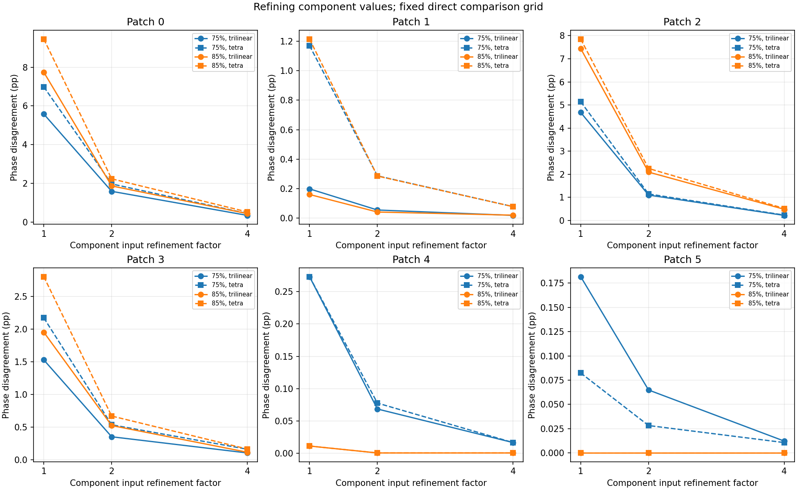
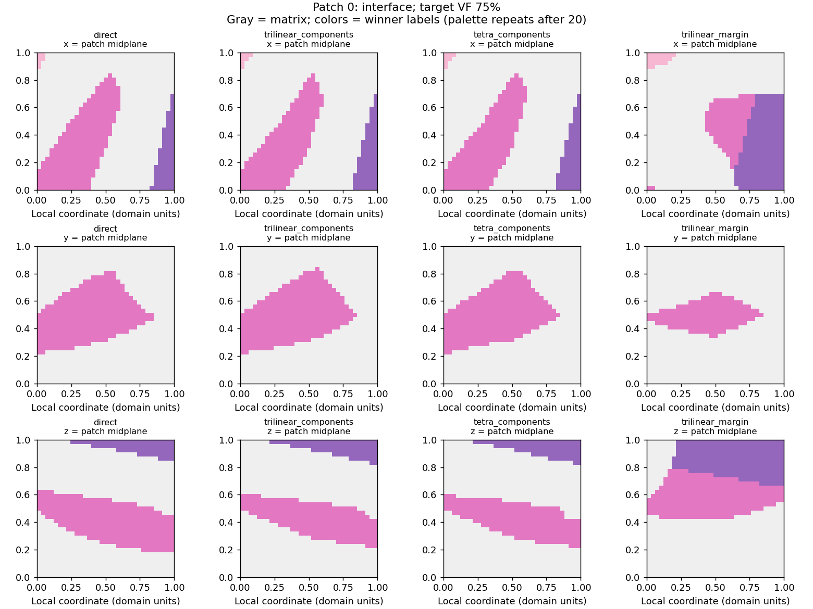

# Local 3D patch reconstruction

## Status and main result

Complete: six patches of the saved q=32, N=128, L=64, lc=5 realization,
each evaluated at theoretical target VF 75% and 85%. Nine software controls
passed. All implementation and outputs for this study are in experiment 04.

Reconstructing the Gaussian components gives much better geometry than
interpolating the already-derived margin. However, the original component
grid can still produce substantial errors near difficult interfaces and
multiple-winner regions. Refining the component input grid reduces those
errors strongly, while some digital Euler measurements remain unresolved.

| Component input spacing | Nodes per patch | Worst trilinear phase disagreement | Worst tetrahedral phase disagreement |
|---|---:|---:|---:|
| dx = 0.5 | 3^3 | 7.7393 pp | 9.4467 pp |
| dx/2 = 0.25 | 5^3 | 2.0905 pp | 2.2491 pp |
| dx/4 = 0.125 | 9^3 | 0.4791 pp | 0.5341 pp |

These maxima are over the six chosen patches and two thresholds. “pp” means
percentage points of **local patch volume** assigned to different phases
than the direct reference. It is a spatial disagreement measure, not a
relative error in aggregate volume or a global accuracy bound. All entries
in this table use the same finite 33^3 direct-reference samples.

The full tables are in the [initial patch report](results_local_patches/summary.md)
and [component refinement report](results_local_patch_components_refined/summary.md).

## Why volume agreement alone is insufficient

Patch 0 at target VF 75% is a useful counterexample. Interpolating the scalar
margin gives a net local VF bias of only -0.3082 percentage points, but
misclassifies **42.6987% of the patch volume**. Added and removed regions
largely cancel in the volume total. The smooth appearance of a scalar
contour and agreement in L3 therefore do not establish correct morphology.

On the original component grid, trilinear phase disagreements at target
VF 85% are 7.7393%, 0.1602%, 7.4432%, and 1.9516% for patches 0–3.
At input spacing dx/4 they fall to 0.4471%, 0.0198%, 0.4791%, and
0.1175%, respectively. The contrast between the two interfaces shows why
the earlier edge audit should not be extrapolated to a uniform 3D error bound.

One near-threshold control also reveals a feature the edge sample did not
find: patch 4 has a small matrix region at target VF 85%, although all 27
original patch nodes are occupied with the same winner. The finest direct
grid detects 15 matrix samples along a patch boundary edge, contributing
0.01144% of patch volume under the quadrature convention. Original-grid
component interpolation fills that region. With refined component inputs,
the remaining disagreement falls to 0.00076%. This is a boundary feature,
not evidence of a closed interior cavity or of changed component count.

## Topology: encouraging at 85%, unresolved cases at 75%

The digital diagnostics compare Euler characteristic, component count,
and each component's incidence on the six patch faces, separately by
winner and for the union. Face incidence distinguishes configurations that
have equal Euler and component counts but connect different patch faces.
It is still only a partial description of topology.

At the finest direct grid, there are **zero occupied cross-label neighbour
contacts** in all twelve patch/threshold cases, under both 6 and 26
adjacency. This resolves the sampled inter-label bridges in these patches;
it does not certify all paths through the continuum or the full domain.

At target VF **85%**, both component methods with input spacing dx/4 match
the direct sample diagnostics in all six patches under both adjacencies.
At **75%**, patches 0 and 2 remain problematic:

| Patch, target VF 75% | Direct per-winner Euler, 6 / 26 | Direct per-winner components, 6 / 26 |
|---|---:|---:|
| 0, difficult interface | 2 / 3 | 3 / 3 |
| 2, junction candidate | 5 / 4 | 7 / 5 |

Their direct 6-neighbour topology also changed between the last two
evaluation grids. Their component reconstructions can differ from the
reference even at input spacing dx/4. Over all twelve cases and both
adjacencies, trilinear diagnostic agreement changes from 21/24 on original
inputs to 22/24 at dx/4; tetrahedral agreement changes from 19/24 to 21/24.
Those counts do not imply a monotone convergence of Euler with refinement.

The reference study records a stable comparison when the whole recorded
topology signature is unchanged and local VF changes by at most 0.005
(0.5 percentage points). At the final grid, 22/24 direct topology signatures
match the preceding grid, but only 15/24 have two consecutive stable
comparisons. The largest last-step VF change is 0.2369 percentage points.
Thus **the reference topology is not fully converged**, even though local
volume changes are small. Refining component inputs does not remove this
uncertainty because the comparison grid stays fixed in that follow-up.

## Patch selection and field recovery

Each patch spans two original cells in each direction: side 2*dx=1 in
domain units. The selected closed boxes are disjoint and lie inside the
original domain. They are purposeful stress cases from one realization,
not independent trials or a representative sample of the full microstructure.

| ID | Category | Lower original-grid index | Selection |
|---|---|---|---|
| 0 | Interface | (56, 28, 6) | Largest disagreement in the prior 85% edge audit, segment 247 |
| 1 | Interface | (119, 35, 80) | Gap nearest the prior 85% median, segment 297 |
| 2 | Junction candidate | (8, 30, 55) | Six distinct occupied coarse labels at 85% |
| 3 | Junction candidate | (11, 10, 26) | Six distinct occupied coarse labels at 85% |
| 4 | Same-label near threshold | (25, 113, 64) | Minimum coarse margin excess 8.45e-5 at 85% |
| 5 | Same-label near threshold | (96, 19, 15) | Minimum coarse margin excess 2.27e-4 at 85% |

The junction/control selection uses seed 62713 and 8192 candidate draws,
giving 8173 distinct boxes: 1938 have at least three occupied coarse labels
and 2047 have one winner with all coarse nodes occupied at 85%. Selection
prioritizes many occupied labels for the junction candidates and a small
positive threshold excess for the controls, while excluding overlapping
boxes. A junction candidate need not contain a single exact six-way tie.

The original GSTools streams are recovered as in [LOCAL_FILMS.md](LOCAL_FILMS.md):
master seed 321729, 1000 RandMeth modes, voxel-index coordinates, and the
same legacy seed transformation. After float32 conversion, the first
Gaussian field, margin, and winners match saved values exactly at all
162 original patch nodes. The follow-up also checks exact recovery of all
stored coarse component values before adding finer input nodes.

Both VFs use **the same boxes and fields**. The thresholds remain
delta=0.135616478475 and 0.077423438447. Local VF need not equal the
global target, particularly in these deliberately selected boundary regions.

## Reconstruction and measurement conventions

The initial study evaluates nested 9^3, 17^3, and 33^3 grids in each
fixed patch, corresponding to 4, 8, and 16 subdivisions per original cell.
The finest sample spacing is dx/16=0.03125. Only new direct-field locations
are evaluated on refinement; previously evaluated nodes are reused.

Four methods are compared at identical sample coordinates:

1. **Direct:** the finite-mode GSTools components evaluated at those points,
   followed by the largest-minus-second-largest margin.
2. **Trilinear components:** interpolate all q components within each original
   cube, then compute the margin and winner.
3. **Tetrahedral components:** use six conforming Freudenthal tetrahedra per
   cube, sharing the 000–111 diagonal, and affine component interpolation
   within each tetrahedron; then compute margin and winner.
4. **Trilinear margin:** interpolate the saved scalar margin as a baseline.
   This scalar has no label information. For labelled diagnostics and colors
   only, the runner assigns trilinear-component winners. Union measurements
   do not depend on that label convention.

The tetrahedral interpolant is evaluated on the comparison grid: this
study does **not** clip polyhedra or compute exact mesh Euler/volume.
All topology is measured on the thresholded samples under bounded 6/26
digital adjacency. Local face connections are not domain-spanning claims.

Volume is tensor-product trapezoid quadrature of the indicator over the
fixed box, with half weights at endpoints along each axis. A full patch
has volume exactly (2*dx)^3 at every resolution. This avoids changing the
domain volume as nodes are added. It remains an approximate integration
of a discontinuous indicator. It differs deliberately from assigning a
full voxel volume to every endpoint sample in the earlier global sweep.

The inexpensive follow-up fixes the direct 33^3 reference and resamples
the original components on 5^3 and 9^3 input grids. Interpolation now uses
those finer nodes. This separates component-interpolation error from
reference-grid sampling error, which remains unchanged. The smaller
phase disagreements are comparisons on that fixed grid, not certified
continuum error bounds.

The intended Gaussian field, margin hitting set, and scalar delta are
unchanged. This preserves the intended Adler/GKF connection. Neither the
finite-mode simulation nor its interpolants make the ideal continuum GKF
expectations exact numerical identities. No new GMF proof or ensemble
validation has been performed.

## Outputs, validation, and reproduction

The main folder, results_local_patches, contains 288 measurement rows,
886 per-winner rows, patches.json, metadata, six NPZ archives, six VTI
volumes, and twelve figures showing the three orthogonal midplanes.
The follow-up folder, results_local_patch_components_refined, contains
144 comparison rows, six NPZ archives, metadata, and the refinement figure.
The original output folders are preserved.

VTI arrays include margins and winners for all four original-input methods.
To inspect a phase in ParaView, threshold its margin at the delta above.
Interpolating those already sampled margins for display introduces another
approximation; these volumes are not certified continuous boundary meshes.
Refined-input arrays are saved in the follow-up NPZ files.

Nine tests cover affine reproduction, interpolation continuity, a hidden
interior winner, a missed curved-field cavity, face incidence, diagonal
adjacency, fixed-domain quadrature, nested reuse, selection, and tiny
end-to-end runs of both scripts. Integrity audits verified source/input
hashes, original-node reproduction, per-winner accounting, independent
trapezoid integration, and agreement between saved arrays and reported
errors. The plotted slices and refinement figure were also inspected.

The main computation and reports took about 173 seconds; the follow-up
took about 7.5 seconds. Initial loading/seed validation is excluded from
the main timing. Peak RAM was not measured. Patches are processed one at
a time; no full-domain component reconstruction was allocated.

From the repository root, using new output directories:

~~~powershell
mamba run -n rf_explo python -B experiments/04_margin_tessellation/test_local_patches.py
mamba run -n rf_explo python -B -u experiments/04_margin_tessellation/run_local_patches.py --output experiments/04_margin_tessellation/results_local_patches_repeat
mamba run -n rf_explo python -B -u experiments/04_margin_tessellation/refine_patch_components.py --source experiments/04_margin_tessellation/results_local_patches_repeat --output experiments/04_margin_tessellation/results_local_patch_components_repeat
~~~

Nonempty outputs are protected; there is no resume mode. Automatic patch
selection uses the completed local film audit and the ignored local VTI
scene. To reuse fixed boxes, pass --patches pointing to a previous
patches.json. --refinements accepts powers of two for the evaluation grid;
--input-factors controls the follow-up component grids. The follow-up can
run from the saved patch outputs without loading the original full VTI
scene, and verifies that the source study's numerical code is unchanged.
The scripts import experiment-local helpers and shared src utilities.

## Recommended next question

The geometry evidence favors local refinement of the Gaussian component
values near interfaces and multiple-winner regions. Trilinear interpolation
has smaller phase disagreement in most of these cases, but that is not
a universal superiority result or a reason to discard tetrahedral geometry.

Before a full-domain implementation or an L0 accuracy claim, concentrate
on patches 0 and 2 at 75%: distinguish small real features from grid-induced
holes/fragments using further direct-reference refinement and a consistent
continuous geometry. The current results justify that targeted work; they
do not justify treating Euler as converged or replacing the framework globally.
Particle grading, independent realizations, global L0/L3 convergence, and
the complete margin GMF derivation remain separate open questions.
