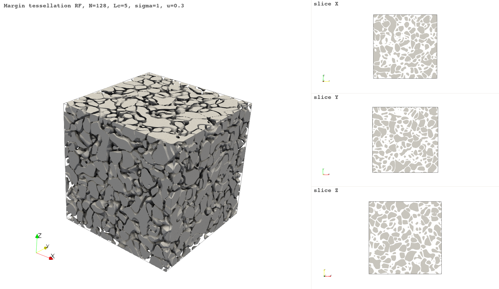
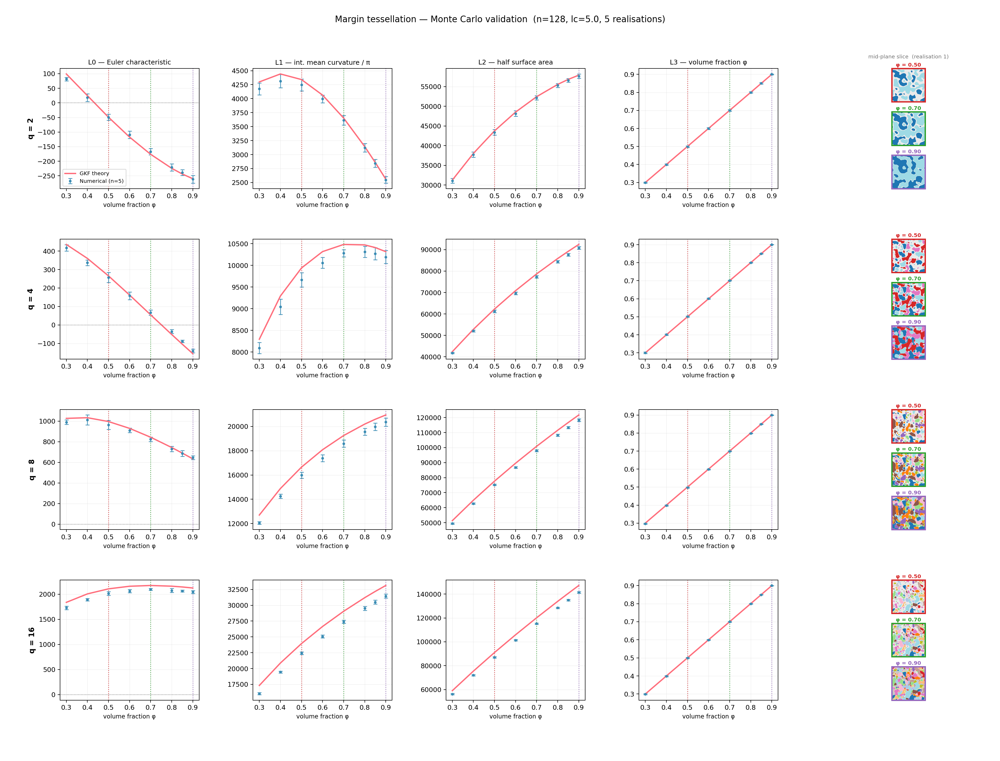
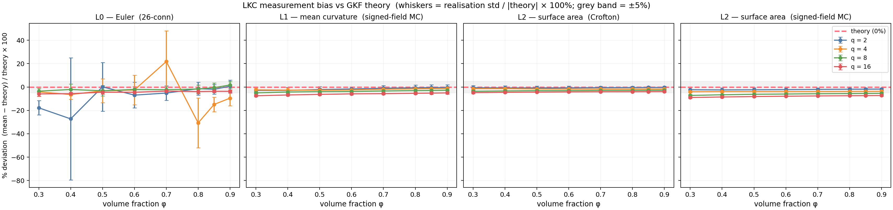
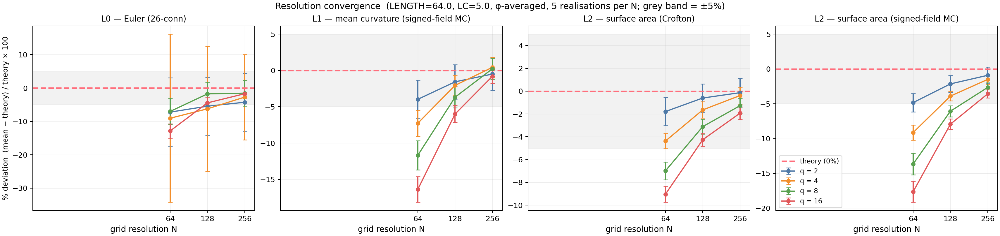
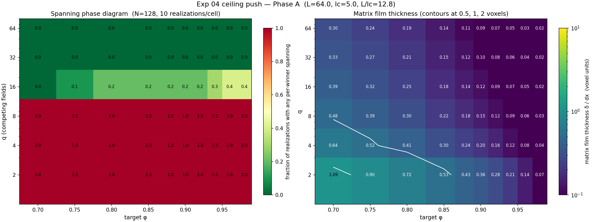
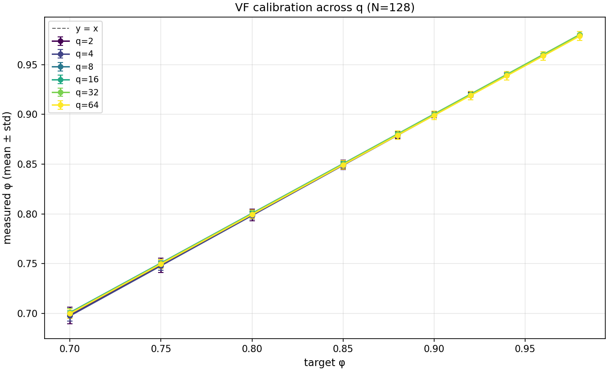
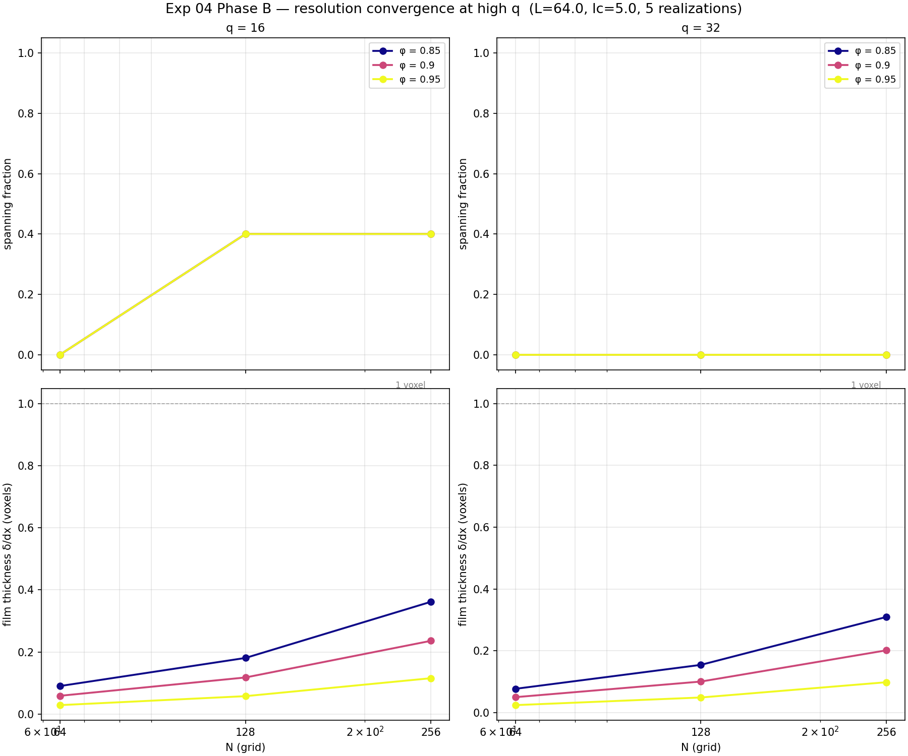

# Experiment 04 — Margin tessellation



Competing Gaussian fields with a "margin" rule. Pushes the disconnected-
phase volume fraction well past the Gaussian 16% / 22% ceilings while
keeping the Adler link intact.

## The model

Let $G = (G_1, \ldots, G_q)$ be $q$ i.i.d. smooth Gaussian RFs. Include a
voxel $x$ iff the winner's lead over the runner-up exceeds a margin
$\delta$:

$$
A_\delta = \bigl\{\, x : \max_i G_i(x) - \mathrm{second\!-\!max}_i\,G_i(x) \geq \delta \,\bigr\}.
$$

The hitting set in $\mathbb{R}^q$ is a disjoint union of $q$ unbounded
polyhedral "winner" chambers; the matrix film is where two or more fields
are tied. Larger $q$ → more, smaller winner cells. Larger $\delta$ →
thicker film, smaller $\varphi$.

Different winner labels are mutually separated by the film by
construction, but a *single* winner can still span. The relevant
percolation check is per-winner spanning, not spanning of the union.

## Adler link status

Closed-form $\mathcal M_j^\gamma(D_\delta)$ for $j = 0 \ldots 3$,
numerically validated to <2% at $N = 256$ across $q \in \{2, 4, 8, 16\}$
on all four LKCs. A formal stratified-tube proof is not written up — the
$q = 2$ identities and the $N = 256$ convergence are the current
evidence.

## The $\mathcal M_j$ (inline)

Set $a = \delta/\sqrt{2}$. The codimension-$k$ stratum measures are

$$
S_k(q,\delta) = q \binom{q-1}{k} \sqrt{k+1}
\int_{-\infty}^{\infty}
\varphi(t+\delta)\,\varphi(t)^{k}\,\Phi(t)^{q-1-k}\,dt,
\qquad 1 \leq k \leq \min(3, q-1).
$$

Then

$$
\begin{aligned}
\mathcal M_0(q,\delta) &= q \int_{-\infty}^{\infty}
    \varphi(t)\,\Phi(t-\delta)^{q-1}\,dt, \\[2pt]
\mathcal M_1(q,\delta) &= S_1 \;=\; -\sqrt{2}\,\frac{\partial \mathcal M_0}{\partial \delta}, \\[2pt]
\mathcal M_2(q,\delta) &= a\, S_1 + \frac{\pi}{3}\, S_2, \\[2pt]
\mathcal M_3(q,\delta) &= (a^{2}-1)\, S_1
    + \frac{4a}{\sqrt{3}}\, S_2
    + 2\!\left(3\arccos\!\tfrac{1}{3} - \pi\right)\! S_3.
\end{aligned}
$$

The constants are the normal-cone angles: $\pi/3$ for a wedge of two
active facets, $3\arccos(1/3) - \pi$ for the equilateral spherical
triangle of three active facets. For $q = 2$ the formulas reduce exactly
to twice the Gaussian $\mathcal M_j$ at $\delta/\sqrt{2}$ — a check the
code runs on every launch (also checks
$\mathcal M_1 = -\sqrt{2}\,\partial \mathcal M_0/\partial \delta$).

Full derivation (chamber stratification + normal-cone integration):
[`theory/gaussian_minkowski_functionals.md`](../../theory/gaussian_minkowski_functionals.md).

## What it runs

- `N_VALUES = [64, 128, 256]`, `N_MAIN = 128`, `LENGTH = 64`, `LC = 5`.
- `Q_VALUES = [2, 4, 8, 16]`, 10 target VFs in $[0.30, 0.90]$.
- 5 realizations per $(N, q, \varphi)$.
- Per-winner $L_0 \ldots L_3$ + per-winner spanning.

```bash
mamba run -n rf_explo python run.py
```

Runtime ≈ 2.5 h for the full three-resolution convergence; ≈ 30 min at
$N = 128$ only (edit `N_VALUES`).

## Estimator choices

See [`docs/measurement_conventions.md`](../../docs/measurement_conventions.md).
Short version:

- $L_0$: 26-connectivity (thin films sub-voxel at high $q$, high
  $\varphi$).
- $L_1$: dihedral sum on marching cubes of the *smooth signed margin
  field* $s_i(x) = G_i(x) - \max_{j \neq i} G_j(x) - \delta$.
- $L_2$: Crofton with analytic domain-face term (primary); MC on the
  signed field (`l2_field` column) for comparison.

Field generation uses `gstools` through `src.fields.simulate_random_field`.

## Outputs

| File | Contents |
|---|---|
| `results/margin_sweep.csv` | per-row $(N, q, \varphi)$ measurements and theory |
| `results/margin_sweep.png` | spanning frequency + $L_0 \pm \mathrm{std}$ vs theory, $N = 128$ |
| `results/margin_main.png` | 4×5 grid: per-$q$ LKC error bars + slices, $N = 128$ |
| `results/margin_euler_ratio.png` | measured/theory % deviation vs $\varphi$, $N = 128$ |
| `results/margin_convergence.png` | % deviation vs $N$, $\varphi$-averaged, per $q$ |







## Key numerical results ($N = 256$)

Measured/theory ratios:

| LKC | $q=2$ | $q=4$ | $q=8$ | $q=16$ |
|-----|-----|-----|-----|------|
| $L_0$ (26-conn)      | 0.957 | 0.973 | 0.985 | 0.983 |
| $L_1$ (signed field) | 0.995 | 1.004 | 1.002 | 0.992 |
| $L_2$ (Crofton)      | 0.999 | 0.996 | 0.987 | 0.981 |
| $L_3$                | 1.00  | 1.00  | 1.00  | 1.00  |

Convergence from $N = 64 \to 128 \to 256$ is monotonic across all LKCs.
$L_1$/$L_2$ scale roughly $\mathcal O(1/N^2)$, matching the expected
marching-cubes mesh amplitude bias.

## Film thickness

At $\varphi = 0.90$, $q = 16$: $\delta \approx 0.059$ physical units,
i.e. $0.59$ voxels at $N = 128$. The film is sub-voxel at the highest
$\varphi$ values, so individual winner cells can fragment into spurious
extra components — this is a discretization limit (see
`margin_convergence.png` for the fix at $N = 256$), not a formula failure.

## Ceiling push

Separate from the GKF-validation sweep above, `run_ceiling.py` pushes
$q$ to 32 and 64 and $\varphi$ to 0.98 to locate the practical ceiling
for *disconnected* morphology. The question is: at what
$(q, \varphi, N)$ does the per-winner spanning (any single winner-type
cluster touching opposite domain faces along any axis) actually fail?

**Phase A** — spanning phase diagram at $N = 128$, $q \in \{2, 4, 8, 16, 32, 64\}$,
$\varphi \in [0.70, 0.98]$, 10 realizations/cell.





**Phase B** — resolution convergence for $q \in \{16, 32\}$ at
$\varphi \in \{0.85, 0.90, 0.95\}$, $N \in \{64, 128, 256\}$, 5
realizations each.



### Headline (per-winner spanning check)

| $q$ | Usable for disconnected high-$\varphi$? | Notes |
|---|---|---|
| 2–8  | ❌ | Spans in 100% of realizations at every $\varphi \geq 0.70$ |
| 16   | ⚠️ | Transition zone; 10–40% spanning at $\varphi \geq 0.75$, resolution-sensitive at $N = 64$ |
| 32+  | ✅ (per-winner) | **No per-winner spanning observed** across $\varphi \in [0.70, 0.98]$ (200 trials each) |

For $q \geq 32$ the construction stays reliably **per-winner-disconnected**
up to $\varphi = 0.98$ (the highest tested). We never reached a spanning
regime at $q = 32$ or $q = 64$ — the real per-winner ceiling is above
$0.98$.

### Important caveat — "disconnected" has two meanings

The ceiling-push spanning check above is the **per-winner** check:
"does any single winner-label cluster span the domain?" That stays at
zero for $q \geq 32$. But at these resolutions the matrix film is deeply
sub-voxel, and on the voxel grid, neighbouring winner cells **physically
touch** across the unresolved film. If you measure spanning on the
*binary union* (phase mask, ignoring winner labels), the picture is
very different:

- **Per-winner spanning** (what the ceiling table reports): no single
  winner reaches opposite domain faces. Theoretical "disconnected cells"
  as the GKF defines them.
- **Binary-union spanning** (what ParaView's Connectivity filter on
  `phase.vti` reports): at $q = 32$, $\varphi = 0.75$, $N = 128$, the
  binary union forms a **single giant percolating cluster** — because
  the ~0.27-voxel film cannot physically separate adjacent winners.

Which interpretation matters depends on the downstream use:

- **Particle *identity*** (per-winner labels used by a mesher, physics
  solver, or statistical tracker): the construction gives you 5241
  individually-labelled aggregates even when they're voxel-touching.
  The ceiling claim holds in that sense.
- **Physical connectivity** (transport, diffusion, mechanical percolation
  measured on the binary phase alone): at $q = 32$, $N = 128$,
  $\varphi = 0.75$, the phase physically percolates. The ceiling claim
  does *not* hold in that sense.

### To get BOTH high VF AND physical disconnection

**The matrix film must be solidly resolved,** $\delta/dx \geq 1$ voxel.
The transition is remarkably sharp — at $\delta/dx < 1$ the voxelized
morphology is a dominant spanning sponge; at $\delta/dx \geq 1$ it is a
cloud of genuinely separated particles.

**Two scenes at the same (q, N) demonstrate the transition:**

| Scene | $\delta/dx$ | Per-winner components | Physical components | Largest physical | Binary spanning |
|---|---|---|---|---|---|
| $q = 16$, $\varphi = 0.75$, $N = 256$ | 0.63 (sub-vox) | 3409 | 3162 | 48% of volume | ✅ spans all axes |
| $q = 16$, $\varphi = 0.60$, $N = 256$ | **1.10** (resolved) | **3206** | **3206** | **2% of volume** | **❌ no spanning** |

At $\varphi = 0.75$ the sub-voxel film ($\delta/dx = 0.63$) leaks: half
the volume forms one spanning sponge, labelled 3162 components only
through 6-conn stickiness. At $\varphi = 0.60$ the resolved film
($\delta/dx = 1.10$) separates cleanly: per-winner and physical counts
match exactly, the largest piece is tiny (2% of volume), and the phase
does not span.

To get both high VF *and* physical disconnection, pick $(q, \varphi, N)$
so that $\delta/dx > 1$. From the film-thickness table:

| $(q, \varphi)$ | $\delta$ (physical) | minimum $N$ at $L = 64$ |
|---|---|---|
| $q = 16$, $\varphi = 0.60$ | 0.274 | $N \geq 233$ (✅ our scene at 256) |
| $q = 16$, $\varphi = 0.75$ | 0.158 | $N \geq 405$ |
| $q = 32$, $\varphi = 0.75$ | 0.136 | $N \geq 471$ |
| $q = 32$, $\varphi = 0.90$ | 0.038 | $N \geq 1685$ |
| $q = 64$, $\varphi = 0.90$ | 0.033 | $N \geq 1930$ |

The low-$\varphi$ end is easily reachable; VF of 90%+ with physical
disconnection requires either overnight-scale runs at very high $N$ or a
protected-gap construction that enforces physical gaps regardless of
voxel resolution (see future work in
`experiments/06_multiscale_margin/`).

### Practical honest conclusion

For disconnected-aggregate materials modeling:

- **Window where physical disconnection is cheap:** $(q, \varphi, N)$
  such that $\delta/dx \geq 1$. For $q = 16$ this means $\varphi \leq
  0.60$ at $N = 256$, or $\varphi \leq 0.75$ at $N \geq 405$. In this
  regime the per-winner construction gives both labelled and physically
  separated aggregates, with ~3200 clean grains at 60% VF in a 64 mm
  cube — a usable concrete-like morphology.
- **Transition zone** ($0.6 < \delta/dx < 1$): the construction gives
  mostly-separated grains but a dominant spanning cluster emerges.
- **Deep sub-voxel regime** ($\delta/dx \ll 1$, e.g. $q \geq 32$ at any
  practical $N$): the per-winner construction gives well-labelled
  particles for label-aware downstream workflows (meshing, per-phase
  physics coupling, statistical descriptors), but the voxelized
  physical morphology is a connected sponge, not aggregates.

### Film thickness is deeply sub-voxel in the safe regime

| $q$ | $\varphi = 0.90$ | $\varphi = 0.95$ | $\varphi = 0.98$ |
|-----|------------------|------------------|------------------|
| 16 | 0.14 vx | 0.07 vx | 0.02 vx |
| 32 | 0.08 vx | 0.04 vx | 0.02 vx |
| 64 | 0.07 vx | 0.03 vx | 0.02 vx |

At $q = 64$, $\varphi = 0.98$ the matrix film is $\delta/dx \approx 0.02$
voxels. Yet per-winner spanning stays at zero. This is because the
construction identifies each voxel with its *winning field index*,
not with a voxel-adjacent "matrix film". Neighbouring voxels of
different winners can touch physically but remain in different
connected components — the per-winner spanning check correctly reports
them as disconnected. This is the structural reason high-$q$ margin
tessellation defeats the voxel-resolution limit.

### Resolution convergence (Phase B)

- **$q = 32$:** spanning fraction $= 0$ at $N \in \{64, 128, 256\}$,
  $\varphi \in \{0.85, 0.90, 0.95\}$. **The disconnected result is
  resolution-robust.**
- **$q = 16$:** spanning fraction jumps from 0 at $N = 64$ (undersampling
  artefact — too few voxels per winner for correct connected-component
  detection) to ~0.4 at $N = 128$ and $N = 256$. Use $N \geq 128$ for
  $q = 16$.

### Practical recipe

For a target VF $\varphi$ in the disconnected regime:
- $\varphi \lesssim 0.80$: $q = 16$ at $N \geq 128$ works, with ~10–20%
  spanning risk per realization (reject-and-resample as needed).
- $\varphi \in [0.85, 0.98]$: use $q \geq 32$ for guaranteed-disconnected
  morphology.
- Larger $q$ is always safer; the only cost is field-generation time
  ($q = 64$ takes ~6 min of field gen per realization at $N = 128$).

### Outputs

| File | Contents |
|---|---|
| `results/ceiling_phase_a.csv` | per-realization $(q, \varphi, N, r)$ measurements |
| `results/ceiling_phase_a.png` | spanning heatmap + film thickness |
| `results/ceiling_phase_a_vf.png` | VF calibration $\varphi_{\text{meas}}$ vs $\varphi_{\text{target}}$ |
| `results/ceiling_phase_b.csv` | per-realization convergence table |
| `results/ceiling_phase_b.png` | spanning + film vs $N$ per $(q, \varphi)$ |

```bash
mamba run -n rf_explo python run_ceiling.py           # full ~5 h run
mamba run -n rf_explo python run_ceiling.py --phase a # just the heatmap
mamba run -n rf_explo python run_ceiling.py --phase b # just convergence
```
