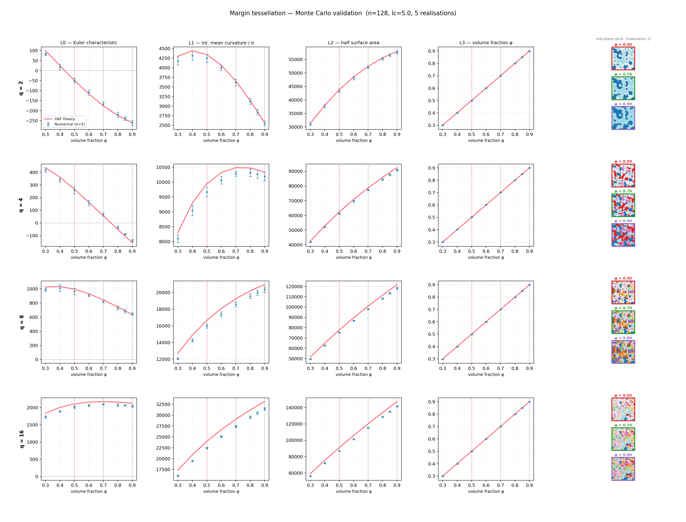
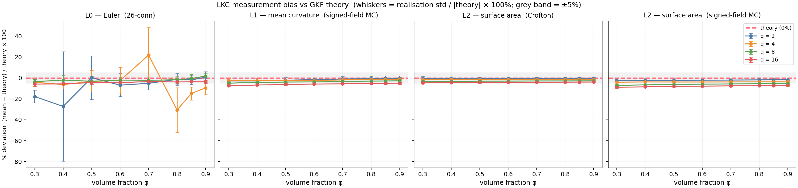
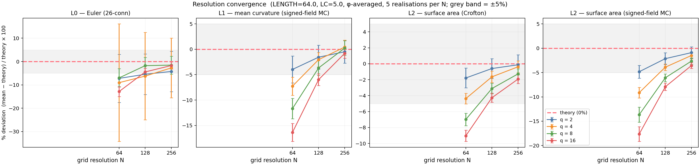

# Experiment 04 — Margin tessellation


Competing Gaussian fields with a "margin" rule. Pushes the disconnected-
phase volume fraction well past the Gaussian 16% / 22% ceilings while
keeping the Adler link intact.

## The model

Let $G = (G_1, \ldots, G_q)$ be $q$ i.i.d. smooth Gaussian RFs. Include a
voxel $x$ iff the winner's lead over the runner-up exceeds a margin
$\delta$:

$$
A_\delta = \bigl\{\, x : \max_i G_i(x) - \mathrm{second\!-\!max}_i\,G_i(x) \geq \delta \,\bigr\}.
$$

The hitting set in $\mathbb{R}^q$ is a disjoint union of $q$ unbounded
polyhedral "winner" chambers; the matrix film is where two or more fields
are tied. Larger $q$ → more, smaller winner cells. Larger $\delta$ →
thicker film, smaller $\varphi$.

Different winner labels are mutually separated by the film by
construction, but a *single* winner can still span. The relevant
percolation check is per-winner spanning, not spanning of the union.

## Adler link status

Closed-form $\mathcal M_j^\gamma(D_\delta)$ for $j = 0 \ldots 3$,
numerically validated to <2% at $N = 256$ across $q \in \{2, 4, 8, 16\}$
on all four LKCs. A formal stratified-tube proof is not written up — the
$q = 2$ identities and the $N = 256$ convergence are the current
evidence.

## The $\mathcal M_j$ (inline)

Set $a = \delta/\sqrt{2}$. The codimension-$k$ stratum measures are

$$
S_k(q,\delta) = q \binom{q-1}{k} \sqrt{k+1}
\int_{-\infty}^{\infty}
\varphi(t+\delta)\,\varphi(t)^{k}\,\Phi(t)^{q-1-k}\,dt,
\qquad 1 \leq k \leq \min(3, q-1).
$$

Then

$$
\begin{aligned}
\mathcal M_0(q,\delta) &= q \int_{-\infty}^{\infty}
    \varphi(t)\,\Phi(t-\delta)^{q-1}\,dt, \\[2pt]
\mathcal M_1(q,\delta) &= S_1 \;=\; -\sqrt{2}\,\frac{\partial \mathcal M_0}{\partial \delta}, \\[2pt]
\mathcal M_2(q,\delta) &= a\, S_1 + \frac{\pi}{3}\, S_2, \\[2pt]
\mathcal M_3(q,\delta) &= (a^{2}-1)\, S_1
    + \frac{4a}{\sqrt{3}}\, S_2
    + 2\!\left(3\arccos\!\tfrac{1}{3} - \pi\right)\! S_3.
\end{aligned}
$$

The constants are the normal-cone angles: $\pi/3$ for a wedge of two
active facets, $3\arccos(1/3) - \pi$ for the equilateral spherical
triangle of three active facets. For $q = 2$ the formulas reduce exactly
to twice the Gaussian $\mathcal M_j$ at $\delta/\sqrt{2}$ — a check the
code runs on every launch (also checks
$\mathcal M_1 = -\sqrt{2}\,\partial \mathcal M_0/\partial \delta$).

Full derivation (chamber stratification + normal-cone integration):
[`theory/gaussian_minkowski_functionals.md`](../../theory/gaussian_minkowski_functionals.md).

## What it runs

- `N_VALUES = [64, 128, 256]`, `N_MAIN = 128`, `LENGTH = 64`, `LC = 5`.
- `Q_VALUES = [2, 4, 8, 16]`, 10 target VFs in $[0.30, 0.90]$.
- 5 realizations per $(N, q, \varphi)$.
- Per-winner $L_0 \ldots L_3$ + per-winner spanning.

```bash
mamba run -n rf_explo python run.py
```

Runtime ≈ 2.5 h for the full three-resolution convergence; ≈ 30 min at
$N = 128$ only (edit `N_VALUES`).

## Estimator choices

See [`docs/measurement_conventions.md`](../../docs/measurement_conventions.md).
Short version:

- $L_0$: 26-connectivity (thin films sub-voxel at high $q$, high
  $\varphi$).
- $L_1$: dihedral sum on marching cubes of the *smooth signed margin
  field* $s_i(x) = G_i(x) - \max_{j \neq i} G_j(x) - \delta$.
- $L_2$: Crofton with analytic domain-face term (primary); MC on the
  signed field (`l2_field` column) for comparison.

Field generation uses `gstools` through `src.fields.simulate_random_field`.

## Outputs

| File | Contents |
|---|---|
| `results/margin_sweep.csv` | per-row $(N, q, \varphi)$ measurements and theory |
| `results/margin_sweep.png` | spanning frequency + $L_0 \pm \mathrm{std}$ vs theory, $N = 128$ |
| `results/margin_main.png` | 4×5 grid: per-$q$ LKC error bars + slices, $N = 128$ |
| `results/margin_euler_ratio.png` | measured/theory % deviation vs $\varphi$, $N = 128$ |
| `results/margin_convergence.png` | % deviation vs $N$, $\varphi$-averaged, per $q$ |







## Key numerical results ($N = 256$)

Measured/theory ratios:

| LKC | $q=2$ | $q=4$ | $q=8$ | $q=16$ |
|-----|-----|-----|-----|------|
| $L_0$ (26-conn)      | 0.957 | 0.973 | 0.985 | 0.983 |
| $L_1$ (signed field) | 0.995 | 1.004 | 1.002 | 0.992 |
| $L_2$ (Crofton)      | 0.999 | 0.996 | 0.987 | 0.981 |
| $L_3$                | 1.00  | 1.00  | 1.00  | 1.00  |

Convergence from $N = 64 \to 128 \to 256$ is monotonic across all LKCs.
$L_1$/$L_2$ scale roughly $\mathcal O(1/N^2)$, matching the expected
marching-cubes mesh amplitude bias.

## Film thickness

At $\varphi = 0.90$, $q = 16$: $\delta \approx 0.059$ physical units,
i.e. $0.59$ voxels at $N = 128$. The film is sub-voxel at the highest
$\varphi$ values, so individual winner cells can fragment into spurious
extra components — this is a discretization limit (see
`margin_convergence.png` for the fix at $N = 256$), not a formula failure.
