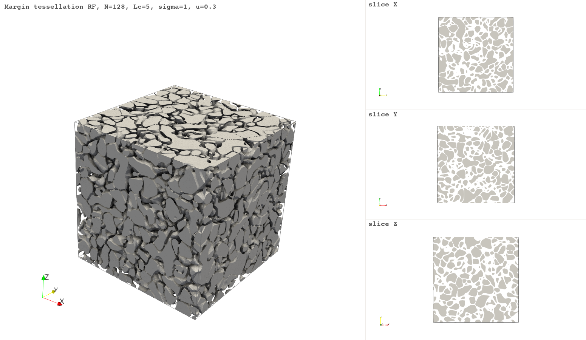

# Experiment 04 — Margin tessellation

Let $G_1,\ldots,G_q$ be independent unit-variance Gaussian fields with
correlation $\exp(-r^2/l_c^2)$. Write $G_{(q)}$ and $G_{(q-1)}$ for the
largest and second-largest values. Include a point when

$$
G_{(q)}(x)-G_{(q-1)}(x)\geq\delta.
$$

The scalar margin $\delta$ controls expected VF. For $\delta>0$, different
winner labels are separated in the continuous model. This does not prevent
a single label from spanning, and does not guarantee that a sampled binary
phase resolves the separating matrix film.

## GMFs and their scope

The expected VF is

$$
\mathcal M_0=q\int_{\mathbb R}\varphi(t)\Phi(t-\delta)^{q-1}\,dt.
$$

Define $a=\delta/\sqrt2$ and, for $1\leq k\leq\min(3,q-1)$,

$$
S_k=q\binom{q-1}{k}\sqrt{k+1}
\int_{\mathbb R}\varphi(t+\delta)\varphi(t)^k
\Phi(t)^{q-1-k}\,dt.
$$

Set absent strata to zero. For $\delta>0$, the implemented coefficients are

$$
\begin{aligned}
\mathcal M_1&=S_1,\\
\mathcal M_2&=aS_1+\tfrac\pi3 S_2,\\
\mathcal M_3&=(a^2-1)S_1+\tfrac{4a}{\sqrt3}S_2
+2(3\arccos(1/3)-\pi)S_3.
\end{aligned}
$$

Insert these in the [cube GKF](../../docs/framework.md). These are
one-dimensional integral formulas with an outlined stratified-tube
derivation; the complete proof remains outstanding. At exactly
$\delta=0$, the union is all value space, so the correct GMFs are
$(1,0,0,0)$ and the expected LKCs are those of the domain. Higher GMFs
need not approach these values as $\delta\downarrow0$.

## What the committed sweep shows

`results/margin_sweep.csv` contains 480 rows:
three resolutions (64, 128, 256), four values of $q$ (2, 4, 8, 16),
eight target VFs (30, 40, 50, 60, 70, 80, 85, 90%), and five realisations.
The domain has $L=64,l_c=5$.

At $N=256,q=16$, target VF 60%, ensemble-mean relative errors are:

| Descriptor | Error |
|---|---:|
| Per-winner Euler, 26 neighbours | −1.53% |
| Sampled margin-field $L_1$ | −0.77% |
| Crofton $L_2$ | −1.89% |
| Volume | −0.09% |

This setting supports good mean agreement; it does not establish a
global under-2% bound. For example, the mean Euler error at $N=256,q=2$,
target VF 30%, is about −16.4%. Percent errors are unstable near theoretical
zeros. The committed results do not establish a universal convergence rate.

The runner sums per-winner 26-neighbour Euler values. Its spanning diagnostic
uses per-winner 6-neighbour components. Neither is identical to applying
both conventions to the binary union. See
[measurement conventions](../../docs/measurement_conventions.md).

## Saved scenes and connectivity

The saved `paraview/q16_phi60_n256/phase.vti` has actual VF 60.77%.
Rechecking that same binary phase gives:

| Neighbours | Components | Largest fraction of inclusion volume | Spanning |
|---|---:|---:|---|
| 6 | 3,206 | 2.04% | None |
| 26 | 1,838 | 44.86% | All axes |

At target VF 75%, the saved scene's actual VF is 75.47% and it spans all
axes under both conventions. Largest-component fractions are about
47.95% (6 neighbours) and 99.62% (26 neighbours).
The historical images and summary files retain their original 6-neighbour
statistics. They are not proof of continuum-disconnected grains.

## Completed saved-scene threshold sweep

The later check in [SAVED_SWEEP.md](SAVED_SWEEP.md) reuses the saved
q=32, N=128, L=64, lc=5 margin and winner arrays at five theoretical target
VFs. It generates no new random fields. All five thresholds are complete;
they are correlated observations of **one realization**.

| Target VF | Measured VF | Spanning winner labels, 6 / 26 | Largest separate component / phase, 6 / 26 | Largest union component / phase, 6 / 26 |
|---|---:|---:|---:|---:|
| 60% | 59.890% | 0 / 0 | 0.641% / 0.642% | 76.854% / 99.848% |
| 70% | 69.898% | 0 / 0 | 0.618% / 0.630% | 98.576% / 99.992% |
| 75% | 74.921% | 0 / 0 | 0.621% / 0.621% | 99.667% / 99.998% |
| 80% | 79.916% | 0 / 0 | 0.612% / 0.612% | 99.899% / 99.999% |
| 85% | 84.935% | 0 / 0 | 0.605% / 0.605% | 99.978% / 100.000% |

Every binary union spans all three axes under both connectivities.
No single winner label spans under either convention. Thus the measured
union spanning requires cross-label contacts in these masks; it is not
evidence of within-label spanning. Per-winner topology still depends on
connectivity: at target VF 85%, Euler sums are 4919 / 3946 against an ensemble
expectation of 4190.34. This scene alone cannot separate sampling error from
discretization bias or validate the GMFs.

The largest absolute VF discrepancy is 0.11 percentage points in this one
scene. At 85%, the 26-neighbour union has just one component, while the
separate labels have 4063 components. A large positive union Euler in this
case must not be interpreted as a particle count.

The subsequent [local film audit](LOCAL_FILMS.md) checks unresolved
inter-label gaps by recovering the original Gaussian streams. Saved
margin/winner arrays suffice for rethresholding, but cannot in general
reconstruct all competing Gaussian fields within a cell. Neither study
establishes continuum-separated aggregates or a validated particle grading
curve throughout the domain.

## Completed local film audit

For the same q=32, N=128 realization, the audit samples 100 cross-label
contacts and 100 same-label controls at each of target VF 75% and 85%.
It compares linear interpolation of the stored margin, interpolation of
all Gaussian components, and direct evaluations between grid nodes.

All 200 cross-label segments have a detected gap under direct evaluation.
Component interpolation recovers all of them; margin interpolation misses
all of them. Median directional gap lengths are 0.6303 dx and 0.4390 dx,
respectively. Median absolute width errors for component interpolation are
0.00421 dx and 0.00445 dx. No gaps were detected in the 200 same-label
controls. All 400 references pass the numerical stability check after the
additional refinement recorded in results_local_films_refined.

See [LOCAL_FILMS.md](LOCAL_FILMS.md) for methods, figures, reproducible
commands, and limits. This is a local, conditional sample from one
realization; it does not remeasure global VF or L0, certify continuum
topology, or complete the GMF proof. The subsequent 3D check is summarized below.

## Completed local 3D patch study

[LOCAL_PATCHES.md](LOCAL_PATCHES.md) compares six fixed patches at target
VF 75% and 85%, using direct field evaluations and trilinear/tetrahedral
component reconstruction. The comparison grids are 9^3, 17^3, and 33^3.
A follow-up refines the component inputs while retaining the direct 33^3
reference. All patches come from the same saved q=32 realization.

Across these selected patches and thresholds, the worst phase disagreement
falls from 7.74% to 0.48% of patch volume for trilinear components, and
from 9.45% to 0.53% for tetrahedral components, when component input spacing
is reduced from dx to dx/4. Scalar-margin interpolation can give nearly
correct volume while severely misplacing the phase: one case has only
-0.31 percentage points of net VF bias but 42.70% phase disagreement.

At 85%, both refined component methods match the direct samples' recorded
Euler, components, and patch-face incidence in all six patches under both
digital adjacencies. At 75%, patches 0 and 2 retain unresolved Euler and
connectivity differences; their direct reference topology is not converged.
These local results support component refinement, but do not certify
continuum topology, global L0/L3 accuracy, or a full-domain implementation.

## Ceiling study: finite evidence, not a VF guarantee

The historical Phase A CSV has 600 rows: six $q$ values, ten target VFs,
and ten independent fields per $q$. A field is reused across VF thresholds;
100 rows per $q$ are not 100 independent trials at a fixed threshold.

- $q=2,4,8$: all ten fields span at every tested VF from 70% to 98%.
- $q=16$: spanning counts rise from 0/10 at 70%, to 1/10 at 75%,
  2/10 at 80–92%, 3/10 at 94%, and 4/10 at 96–98%.
- $q=32,64$: no spanning observed in these ten fields at the tested thresholds.

These are **per-winner, 6-neighbour** results. Zero spans in ten trials has
a one-sided 95% binomial upper bound of about 25.9% for spanning probability.
It does not establish a safe operating ceiling.

Phase B has 90 rows: two $q$ values, three resolutions, three VFs
(85, 90, 95%), and five fields per setting. For $q=16$, counts were 0/5
at $N=64$ and 2/5 at each higher resolution; $q=32$ had 0/5.
Seeds differ across resolutions, so this is not a paired refinement study.

There is no demonstrated EC-zero at VF 85–90% for $q=16$ in this setup:
the implemented expected Euler remains positive through that range and
near VF 100% on the positive-margin branch.

## Margin units and resolution

$\delta$ has Gaussian-component **value units**. It is not a physical
thickness, and $\delta/dx$ is not a number of film voxels.
Near a regular two-field tie, with competing fields $G_i,G_j$ and no
other winner, the local full film thickness is approximately

$$
w(x)\simeq\frac{2\delta}{\|\nabla(G_i-G_j)(x)\|}.
$$

The gradient varies in space, so neither a single thickness nor a minimum
grid resolution follows from $\delta$ alone. Example unit-component margins
are about 0.05897, 0.05044, and 0.04462 at VF 90% for $q=16,32,64$.

Historical ceiling CSV columns `delta_physical` and `delta_voxels` are
misnamed: they store $\delta$ and $\delta/dx$, respectively.
Historical film-resolution figures derived from those columns are not valid
spatial-thickness estimates. They are preserved as historical artifacts.
The corrected ceiling runner writes `delta` and `dx_over_lc` and replaces
those plots with value-margin and measured-VF diagnostics.

## Running

For the completed saved-scene diagnostics, see the
[reproduction and artifact guide](REPRODUCIBILITY.md). It identifies the
saved evidence, the 23 software controls, the ignored scene dependencies,
and the remaining research questions.

From the repository root:

~~~bash
python experiments/04_margin_tessellation/run.py
python experiments/04_margin_tessellation/run_ceiling.py --help
~~~

The main sweep writes its historical `results/` location; preserve or move
those outputs before a deliberate rerun. The corrected ceiling runner
defaults to `results_ceiling_v2/` and refuses a nonempty destination.
Use `--output` for another destination. No new ceiling or convergence
campaign was run as part of the review corrections.

The scene exporters still report their explicitly labelled 6-neighbour
statistics. A full resolution study under both conventions, and ultimately
a consistent continuum geometry, remain necessary for physical aggregate
connectivity claims.
