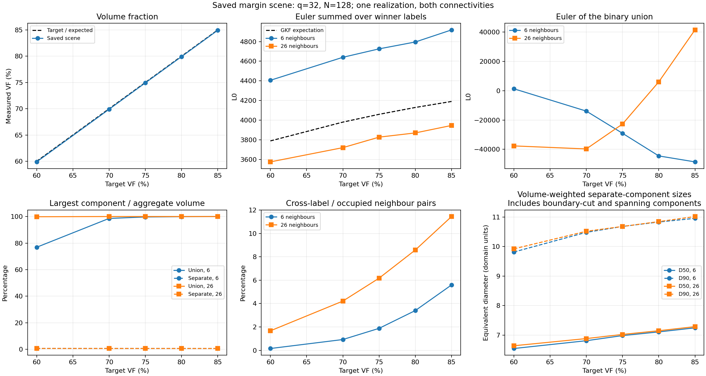

# Rethresholding the saved q=32 scene

## Status and purpose

Complete: five target VFs (60%, 70%, 75%, 80%, 85%), both 6- and
26-neighbour conventions, and one saved q=32, N=128 realization.
The domain and component correlation scales are L=64 and lc=5.
Seven small software controls passed before the run.

The calculation distinguishes connections between different winner labels
from connected components within one label. It reuses margin.vti and
winners.vti in paraview/q32_phi75; phase.vti checks that the saved 75%
reference mask is reproduced exactly. No fields, surfaces, or VTK volumes
are generated.

For each target VF the threshold is the theoretical delta_for_vf(q, phi),
not an empirical quantile fitted to the saved scene. Thresholding is performed
on the original samples, with the existing voxel convention.

## Main observations

| Target VF | Measured VF | Margin delta | Per-winner L0, 6 / 26 | Expected L0 | Separate components, 6 / 26 |
|---|---:|---:|---:|---:|---:|
| 60% | 59.890% | 0.236500 | 4406 / 3575 | 3788.59 | 4795 / 3631 |
| 70% | 69.898% | 0.167189 | 4640 / 3720 | 3980.00 | 5102 / 3819 |
| 75% | 74.921% | 0.135616 | 4726 / 3827 | 4059.36 | 5241 / 3928 |
| 80% | 79.916% | 0.105761 | 4796 / 3870 | 4129.19 | 5347 / 3991 |
| 85% | 84.935% | 0.077423 | 4919 / 3946 | 4190.34 | 5496 / 4063 |

No component within a winner label spans the domain at any of these
thresholds under either convention. The largest separate component occupies
0.605–0.642% of total phase volume across the settings and conventions.

In contrast, every binary union spans all three axes. Its largest component
already contains 76.85% / 99.85% of phase volume at target VF 60%, rising
to 99.98% / 100% at target VF 85%. At 85%, the 26-neighbour binary union
is a single component with Euler 41391; Euler is not a component count.

Cross-label contacts increase from 4833 / 208119 at 60% to
262866 / 2281483 at 85%. As fractions of all occupied neighbour pairs
these are 0.156% / 1.670% and 5.593% / 11.443%, respectively.
Since different continuum chambers are separated at positive margin,
these contacts diagnose unresolved inter-label separation in the sampled masks.
This does not prove that the separate digital components reproduce continuum
topology within each label.

VF agrees with the target within 0.11 percentage points. Per-winner Euler
lies about 16–17% above the ensemble expectation under 6-connectivity and
about 6% below it under 26-connectivity. The same scene is reused throughout:
the thresholds are not independent repetitions, and these discrepancies
cannot be attributed entirely to either sampling or numerical bias.

The volume-weighted median equivalent diameter grows from 6.55 / 6.64
to 7.25 / 7.29 domain units; the 90th percentile grows from 9.82 / 9.92
to 10.96 / 11.02. These distributions include boundary-cut components.
About 40–49% of aggregate volume belongs to components touching a domain
boundary, depending on threshold and connectivity. Their flags are saved
for later analysis; removing them would introduce a selection effect and
would not by itself provide an unbiased particle-size distribution.

## Outputs and conventions

The [saved summary](results_saved_q32_sweep/summary.md) reports the numerical
observations and their interpretation limits. The output folder contains:

- measurements.csv: ten rows, one per threshold/connectivity pair, including
  volume, Euler, spanning, component counts, cross-label contacts, and sizes.
- winners.csv: statistics for each of the 32 labels under both conventions.
- components.csv: one row per separate-label component, with volume-equivalent
  diameter, boundary contact, and per-axis spanning flags.
- threshold_sweep.png and summary.md: figures and a concise report.
- metadata.json: input and source hashes, declared theory parameters,
  dependency versions, baseline-mask consistency, timing, and completion.

Only L0 and L3 are measured. All four expected LKCs are recorded from the
implemented margin GMFs; the sweep is not a new derivation of those formulas.
The q and lc assumptions come from the scene definition and CLI parameters,
not a fit to the saved arrays.

The VTI files store point samples spanning (N-1)*dx=63.5. This analysis
retains the repository's nominal side length N*dx=64 and sample volume dx^3;
it does not measure the volume of a continuously interpolated VTI contour.
Diameters use those same domain units and have not been calibrated to mm
or to a sieve curve.

The 75% measurements reproduce the earlier read-only check exactly.
The run took about 43 seconds after loading the arrays, including writing
tables and the plot. Peak RAM was not measured.
Each threshold's measurement time appears in both connectivity rows and
must be counted once when summing timings.

## Running

From the repository root:

~~~powershell
mamba run -n rf_explo python -B experiments/04_margin_tessellation/test_saved_sweep.py
mamba run -n rf_explo python -u experiments/04_margin_tessellation/run_saved_sweep.py --output experiments/04_margin_tessellation/results_saved_q32_repeat
~~~

The default output is results_saved_q32_sweep, which already holds the
completed study. Nonempty outputs are protected. Intermediate tables and
completion metadata are written after every threshold; there is no resume
mode for this short study. An interrupted run can be repeated into a new folder.

The source VTI files are local, ignored binary outputs. A fresh checkout
needs those saved scene files, or a deliberately regenerated scene, to repeat
this calculation. Saved CSVs and figures can be read without them.

Optional arguments are --source, --output, --q, --lc, --source-phi, and
--target-phis. The loader requires matching cubic ImageData point arrays,
integer labels in [0,q), finite nonnegative margins, and exact agreement
with the reference phase at --source-phi. The runner imports shared src
utilities and does not depend on experiment 05.

## What remains open

This field is a promising candidate for studying separated high-VF grains:
within-label spanning is absent on both sampled adjacency conventions up to
84.93% measured VF. The binary unions do not provide a separated geometry.
The subsequent [local film audit](LOCAL_FILMS.md) recovered the original
Gaussian streams and checked 400 short segments at target VF 75% and 85%.
Component interpolation recovers the detected gaps on all 200 sampled
cross-label contacts; interpolation of the stored margin misses them all.
All references pass the numerical stability criterion after refinement.
This answers a local geometric question, while preservation of the
three-dimensional within-label morphology remains open.

Selected 3D patches, paired refinement, and additional independent
realizations would address numerical and sampling uncertainty. Particle shape,
boundary corrections, physical size calibration, and the complete
stratified-tube proof remain open. This threshold sweep alone settles none
of those questions.
