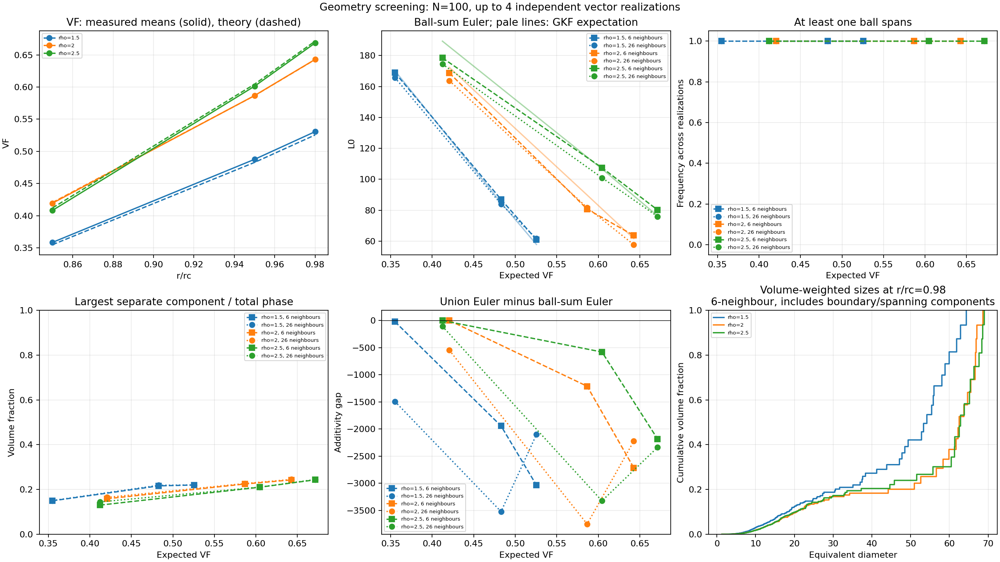

# Pre-contact geometry sweep — experiment 05

## Status

The N=100 study is complete: **36/36 cases**, four independent vector
realizations, and nine geometry/radius settings per realization.
Saved tables, component records, figures, metadata, and case checkpoints
are in [results_geometry/](results_geometry/).
Their case identities, source hashes, CSV/checkpoint agreement, and volume
and component accounting have been checked.
Further exploration is deferred; the completed run does not validate
isolated concrete aggregates.

All nine geometry software controls passed before publication. They include
connectivity, field reuse, component accounting, and interruption/resume
checks. They can be run independently:

~~~powershell
mamba run -n rf_explo python -B experiments/05_coalescing_lobes/test_geometry.py
~~~

To repeat the study from the repository root, choose a new destination:

~~~powershell
mamba run -n rf_explo python -u experiments/05_coalescing_lobes/run_geometry.py --output experiments/05_coalescing_lobes/results_geometry_repeat
~~~

## Purpose and defaults

The resolution pilot showed that near-contact voxel unions acquire spurious
cross-label connections, while individual ball measurements are much more
stable. This study asks whether changing the tetrahedron's value-space
circumradius can increase VF without individual lobes spanning the domain.

| Setting | Default |
|---|---|
| Grid | N=100 |
| Physical domain / component correlation length | L=100, lc=10 |
| Tetrahedron circumradius rho | 1.5, 2.0, 2.5 |
| Relative ball radius r/rc | 0.85, 0.95, 0.98 |
| Independent vector realizations | 4 |
| Total measured cases | 36 |
| Generator | GSTools RandMeth, 1000 modes, one thread |
| Measurements | Voxel Euler, volume, components, spanning, neighbour contacts |
| Output | `results_geometry/` |

Only four vector fields are generated: every realization is reused for all
nine geometry/radius settings. No marching-cubes curvature calculations or
large grid exports are requested.

rho is a calibration parameter in **Gaussian value space**, not a physical
particle radius. Once rho is selected, r/rc remains the scalar morphology
control. Physical component sizes still need calibration.

For four strictly disjoint tetrahedral balls,

$$
\phi=4F_{\chi'^2_3(\rho^2)}
\left[\left(\frac{r}{r_c}\rho\sqrt{\frac23}\right)^2\right].
$$

At r/rc=0.98 this gives approximately 52.55% for rho=1.5 and 67.13% for
rho=2.5. Optimizing rho numerically gives a limiting VF near 71.89% as the
balls approach contact. These are volume predictions, not nonspanning
guarantees. The runner accepts only 0<r/rc<1 so ball GMFs remain additive.
It records all four theoretical LKCs; only L0 and L3 are measured.

## Completed results

The following are means over four independent vector realizations, with
the same fields reused across settings:

| rho | r/rc | Expected VF | Measured VF | Expected L0 | Ball-sum L0, 6 / 26 |
|---|---|---:|---:|---:|---:|
| 1.5 | 0.85 | 35.51% | 35.87% | 170.24 | 169.00 / 165.75 |
| 1.5 | 0.95 | 48.29% | 48.77% | 84.92 | 87.00 / 84.00 |
| 1.5 | 0.98 | 52.55% | 53.07% | 57.88 | 61.00 / 61.75 |
| 2.0 | 0.85 | 42.07% | 41.96% | 172.34 | 168.75 / 163.75 |
| 2.0 | 0.95 | 58.66% | 58.67% | 89.84 | 80.75 / 81.75 |
| 2.0 | 0.98 | 64.28% | 64.29% | 61.68 | 63.75 / 57.75 |
| 2.5 | 0.85 | 41.22% | 40.84% | 189.32 | 178.50 / 174.50 |
| 2.5 | 0.95 | 60.44% | 60.13% | 106.75 | 107.50 / 101.00 |
| 2.5 | 0.98 | 67.13% | 66.84% | 76.41 | 80.25 / 76.00 |

Across settings the largest mean VF discrepancy is 0.52 percentage points.
At rho=2.5, r/rc=0.98, the sample standard error of mean VF is 0.34
percentage points; ball-sum L0 standard errors are 10.61 / 10.06.
These sampling estimates from four realizations do not include
discretization error.

**All 36 cases contain a spanning component within at least one individual
ball, under both connectivities.** At rho=2.5, r/rc=0.98, every ball has a
spanning component in every realization. Such components account for
80.55% / 81.21% of total phase volume on average. The largest separate
component accounts for 24.30% / 24.45%.

For that same setting, mean binary-union Euler is -2101.25 / -2261.25,
versus ball sums of 80.25 / 76.00. Good per-ball agreement is therefore
not agreement of the voxel union with GKF. The geometry change raises VF
but does not remove either the near-contact discretization problem or the
observed within-lobe spanning.

The run contains 288 ball-measurement rows and 13,019 component rows.
The latter include both connectivity conventions and all settings; they
are not independent samples. Recorded generation plus measurement time
was about 4.5 minutes, excluding report/plot overhead, on the machine used.
Peak RAM was not logged.

## Outputs and interpretation

- `theory.csv`: expected VF and LKCs for each geometry.
- `measurements.csv`: binary-union statistics, per-ball sums, and cross-label
  contact diagnostics for every realization and setting.
- `balls.csv`: separate measurements for each of the four balls under both
  6- and 26-neighbour connectivity.
- `components.csv`: individual per-ball components with volume-equivalent
  diameter, boundary contact, and spanning flags.
- `aggregate.csv`: means and standard errors across independent realizations.
- `field_diagnostics.csv`: seeds, component moments, and generation times.
- `geometry_summary.png` and `summary.md`: comparisons and interpretation limits.
- `cases/` and `metadata.json`: atomic case checkpoints, configuration, source
  hashes, dependency versions, and completion status.

The four balls share one Gaussian vector realization. They are correlated
observations and must not be counted as four independent trials.
An Euler value is not a component count. The per-ball sums avoid cross-label
mergers but remain susceptible to unresolved features within a ball.

Spanning uses opposite domain faces and an explicitly stated digital
connectivity. No observed spanning in four realizations would be weak
evidence, not a guarantee about continuum morphology.

The displayed size distribution includes boundary-cut and spanning
components. Their flags allow deliberate filtering; equivalent diameter is
not a sieve diameter or a validated concrete grading curve.

The useful screening question is whether the higher-VF cases retain small,
nonspanning individual components under both conventions. Selected candidates
would still need resolution checks and more realizations.

The deferred next questions are a matched-VF comparison with margin
tessellation, selected paired-resolution checks, and particle-size/shape
calibration with explicit boundary and spanning treatment. They are listed
in the [experiment README](README.md#deferred-work). No further scientific
run is implied by these notes.

## Additional commands

Theory only, without generating fields; outputs use a separate folder:

~~~powershell
mamba run -n rf_explo python -u experiments/05_coalescing_lobes/run_geometry.py --theory-only
~~~

Resume the default study:

~~~powershell
mamba run -n rf_explo python -u experiments/05_coalescing_lobes/run_geometry.py --resume
~~~

Each completed case is saved atomically. CSVs and reports can be rebuilt from
those checkpoints if writing a report is interrupted. A partially completed
realization regenerates its vector once, then computes only missing cases.
Resuming requires identical parameters, sources, and dependency versions.

For a small execution check after the tests:

~~~powershell
mamba run -n rf_explo python -u experiments/05_coalescing_lobes/run_geometry.py --n 8 --realizations 1 --mode-no 32 --output experiments/05_coalescing_lobes/results_geometry_smoke
~~~

Nonempty output folders are protected. Historical results and the resolution
pilot are not overwritten. The new runner imports the experiment-local
resolution sampler and shared `src` utilities; it does not depend on
experiment 06.
