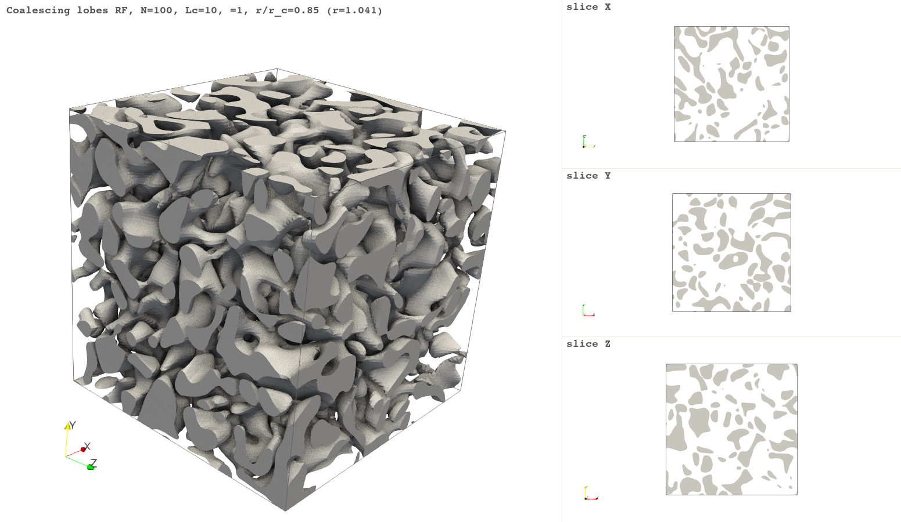
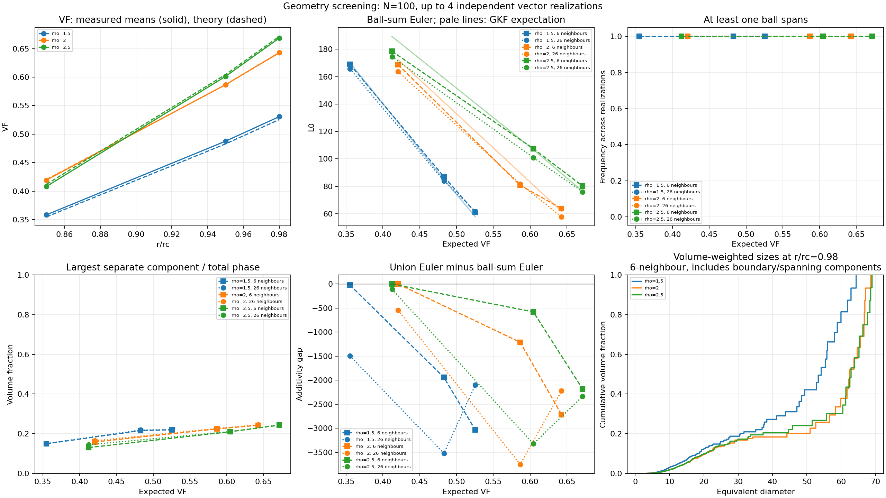

# Experiment 05 — Coalescing Gaussian-space lobes

For a three-component Gaussian field $G$, include a point when its value
lies inside at least one of four balls:

$$
A_r=\{x:\min_a\|G(x)-c_a\|\leq r\}.
$$

The centres are the vertices of a regular tetrahedron, with circumradius
$\rho_c=1.5$ in the original study and $1.5,2.0,2.5$ in the later geometry
sweep. The first value-space contact radius is
$r_c=\rho_c\sqrt{2/3}$. Radius $r/r_c$ is the scalar morphology control.

Value-space contact is not a spatial percolation criterion. Even for
$r<r_c$, one ball's preimage can span. For $r>r_c$, overlap allows contact
between preimages but does not force a particular spatial topology.

## Theory

For $B(c,r)\subset\mathbb R^3$, let $F$ and $f$ be the noncentral chi-squared
CDF and PDF with 3 degrees of freedom and noncentrality $\|c\|^2$. Since a
tube around a ball is a ball of radius $r+s$,

$$
\begin{aligned}
\mathcal M_0&=F(r^2),&
\mathcal M_1&=2rf(r^2),\\
\mathcal M_2&=2f(r^2)+4r^2f'(r^2),&
\mathcal M_3&=12rf'(r^2)+8r^3f''(r^2).
\end{aligned}
$$

The implementation evaluates the PDF derivatives numerically. For strictly
disjoint balls, their GMFs add and the [cube GKF](../../docs/framework.md)
gives all four expected LKCs. At or after contact, intersection terms are
needed; the disjoint-ball API now rejects those configurations. No
post-contact analytical $L_0,L_1,L_2$ claim is made.

Union VF can still be estimated by independent Gaussian value-space Monte
Carlo at every radius. That estimate also has sampling error.

## Historical results and the measurement correction

The committed `results/coalescing_lobes_sweep.csv` has four realisations
at each of eight radii, on $N=100,L=100,l_c=10$.
Pre-contact mean VFs are about 5.60%, 16.70%, 35.87%, and 53.07%
at $r/r_c=0.45,0.65,0.85,0.98$. Mean pre-contact discrepancies vary by
descriptor and radius, reaching approximately 7%; they are not uniformly
below 5%. The recorded binary spanning already occurs in all four
realisations at 0.85 and 0.98.

The historical measurement loop mixed different objects:

- Euler and Crofton surface were summed over nearest-centre partitions.
- Mesh curvature and surface were summed over individual ball preimages.
- VF and spanning were computed from the binary union.

After overlap, a partition introduces artificial internal interfaces and
per-ball sums double-count overlap. Neither gives the union's LKCs.
Historical post-contact Euler and curvature plots therefore cannot support
claims about union topology. Their files remain unchanged for provenance.

## Corrected measurement schema: `union_v2`

The new runner measures the union directly and keeps controls separately:

| Prefix / columns | Object and meaning |
|---|---|
| `union_euler_6/26`, `union_components_6/26` | Binary union, explicitly stated digital connectivity |
| `union_spans_6/26` and per-axis columns | Union opposite-face spanning |
| `union_largest_fraction_6/26` | Largest component divided by occupied volume |
| `union_L3`, `measured_phi` | Union voxel volume and VF |
| `union_L1_field`, `union_L2_field` | Mesh of $r-\min_a\|G-c_a\|$ at zero |
| `union_L2_crofton` | Binary-union transition-count surface estimate |
| `sum_ball_*` | Sums over individual ball preimages; additive theory controls only before contact |
| `partition_*` | Nearest-centre partition diagnostics, not union LKCs |
| `theory_L0...L3` | Disjoint-ball GKF before contact; NaN at and after contact |
| `theory_phi` | Gaussian-space Monte Carlo VF at every radius |

Meshing a sampled minimum is still an approximation: it is not exact
interpolation and Boolean clipping of the underlying Gaussian components.
The difference between 6- and 26-neighbour union measurements is reported,
not resolved by choosing the more favourable result.

## Running

From the repository root, in the `rf_explo` environment:

~~~bash
python experiments/05_coalescing_lobes/run.py
~~~

This runs the original full configuration: $N=100$, four realisations,
eight radii, and two million value-space Monte Carlo points.
Outputs go to **`results_union_v2/`**, preserving historical `results/`.
A nonempty destination is refused; choose a new directory with `--output`.

For a small execution check (not scientific validation):

~~~bash
python experiments/05_coalescing_lobes/run.py --n 8 --realizations 1 --radii 0.65 1.15 --mc-samples 2000 --output experiments/05_coalescing_lobes/results_smoke_union_v2
~~~

The runner writes the CSV, slice/diagnostic/LKC figures, and metadata with
parameters, schema version, source hashes, and completion status.
The corrected N=100 sweep has since completed (32 cases). It shows strong
pre-contact differences between the union and ball-sum topology near contact;
this motivated the paired resolution study below.

## Completed check: paired grid refinement

[RESOLUTION.md](RESOLUTION.md) documents the completed topology-only pilot:
N=50,100,200, r/rc=0.85 and 0.98, and one shared vector realization.
All six cases are saved in [results_resolution_topology/](results_resolution_topology/).
Shared-node field values agree exactly across the sampled resolutions.

At r/rc=0.85, N=200 removes the observed cross-label face contacts:
union Euler and the ball sum both equal 185 under 6-connectivity.
There are still 107 cross-label diagonal-neighbour pairs under 26-connectivity,
with union Euler 85 versus a ball sum of 184.

At r/rc=0.98, refining to N=200 does not resolve union topology: Euler is
-4577 / -5344 (6 / 26 neighbours), versus ball sums of 76 / 71.
Across the three grids, VF varies by less than 0.024 percentage points at
each radius. Stable volume therefore does not establish stable topology.
Individual-ball spanning occurs in every case under both conventions.

This is a paired numerical check, not an ensemble estimate or a proof of
continuum spanning. No scalar-mesh L1/L2 refinement run was completed.
The method note retains commands for optional reruns and extensions.

## Completed check: centre-position sweep

[GEOMETRY.md](GEOMETRY.md) documents `run_geometry.py`: N=100, three
tetrahedron circumradii, three pre-contact ball radii, and four realizations.
Each vector field is reused across all nine settings. The study compares
per-ball topology and component sizes with the union and Adler predictions.
All 36 cases are complete in [results_geometry/](results_geometry/).

At r/rc=0.98, the means over the four realizations are:

| Centre radius | Expected VF | Measured VF | Expected L0 | Ball-sum L0, 6 / 26 |
|---|---:|---:|---:|---:|
| 1.5 | 52.55% | 53.07% | 57.88 | 61.00 / 61.75 |
| 2.0 | 64.28% | 64.29% | 61.68 | 63.75 / 57.75 |
| 2.5 | 67.13% | 66.84% | 76.41 | 80.25 / 76.00 |

Across all nine settings the largest mean VF discrepancy is 0.52 percentage
points. Per-ball Euler agreement is encouraging, with only four independent
realizations and unresolved discretization uncertainty.

**Higher VF did not produce isolated spatial grains in this screening.**
At least one individual ball has a spanning component in all 36 cases under
both conventions. At rho=2.5, r/rc=0.98, spanning components contain on average
80.55% / 81.21% of the total phase volume (6 / 26 neighbours), even when
different ball labels are measured separately. The union Euler is
-2101.25 / -2261.25, so the per-ball agreement must not be described as
validation of the voxel union.

The largest separate component at that setting occupies about 24% of the
total phase volume. Positive Euler and a high VF do not suffice to identify
a concrete-like particle population. These observations concern the sampled
grids; neither digital convention certifies continuum connectivity.

## Software controls

The small regression suites cover the shared theory and measurement
corrections, paired field sampling, volume accounting, connectivity,
per-ball component statistics, output protection, and checkpoint recovery.
They use small grids and temporary outputs; they do not rerun the scientific
N=100 or N=200 studies.

All three suites passed before publication: 25 shared regression controls,
7 paired-resolution controls, and 9 geometry-sweep controls (41 total).
The 21 existing experiment 06 model/interpolation controls also passed,
giving 62 passing checks across the affected framework.

~~~powershell
mamba run -n rf_explo python -B tests/test_review_regressions.py
mamba run -n rf_explo python -B experiments/05_coalescing_lobes/test_resolution.py
mamba run -n rf_explo python -B experiments/05_coalescing_lobes/test_geometry.py
~~~

Passing software controls checks implementation contracts; it is not a
substitute for scientific convergence or independent theoretical derivation.

## Deferred work

Further exploration is currently deferred. The completed runs above do not
require another computation to be read or reproduced from their saved tables.
If this line of research is resumed, the useful next questions are:

1. **Separate sampling artefacts from within-lobe morphology.** Refine selected
   high-VF cases using the same fields and both connectivities, tracking
   cross-label contacts and per-ball spanning separately. N=200 has not
   established convergence near contact; more realizations address a
   different uncertainty.
2. **Compare constructions at a matched VF, around 65%.** Apply the same
   component and spanning-volume diagnostics to the margin-tessellation
   model before deciding which family to pursue. A positive value-space
   separation alone is not a guarantee of small, nonspanning grains.
3. **Calibrate a particle population.** Examine component sizes and shapes,
   explicitly handling boundary-cut and spanning objects, before choosing
   coarse, fine, and sand scales. Volume-equivalent diameters are not a
   validated sieve curve.
4. **Retain the analytical scope.** For fixed centre geometry, r/rc remains
   the scalar control and pre-contact ball GMFs remain the theoretical
   reference. Post-contact L0/L1/L2 require intersection terms; accurate
   component interpolation and domain clipping remain separate open work.

The current result is a useful high-VF model with quantified limitations,
not a finished validation of concrete microstructure.
