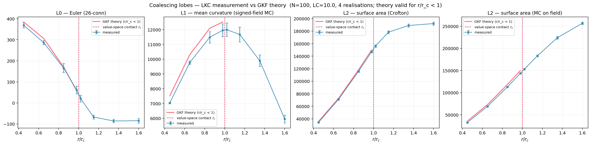
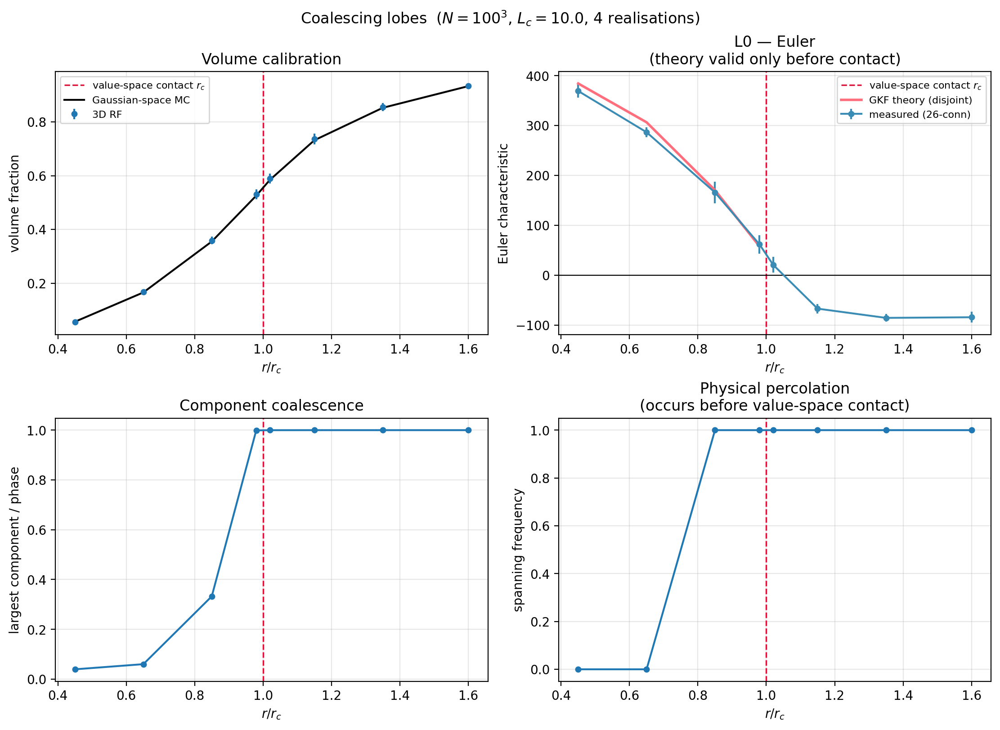
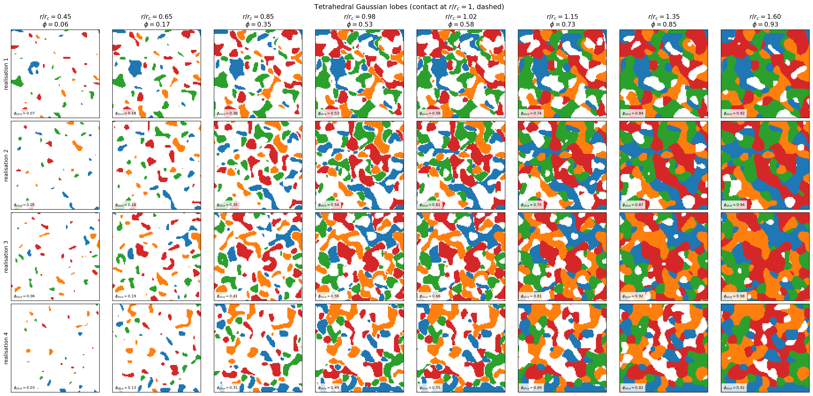

# Experiment 05 — Coalescing Gaussian-space lobes


A vector Gaussian field whose hitting set is a *union of balls* in value
space. Single continuous parameter `r/r_c` sweeps morphology from
disjoint droplets to a merged bicontinuous phase.

## The model

Let `G(x) = (G_1(x), G_2(x), G_3(x))` be a vector of three i.i.d. smooth
Gaussian RFs mapping each voxel to a point in $\mathbb{R}^3$. Fix `K = 4`
centres `c_a` at the vertices of a regular tetrahedron of radius `ρ` in
Gaussian value space. Include a voxel iff its Gaussian-space point is
within `r` of any centre:

```
A_r = { x : min_a ||G(x) − c_a|| ≤ r }     =    G^{−1}(D_r)
D_r = ⋃_a B(c_a, r)
```

Two adjacent Gaussian-space balls first touch at the contact radius

```
r_c = ρ · √(2/3)
```

(from the tetrahedron pair-distance `ρ·√(8/3)`). The ratio `r/r_c` is a
single morphology control: below 1 the balls are disjoint; above 1 they
overlap and the lobe structure merges.

## Adler link status

**Before contact (`r < r_c`):** closed-form on all four LKCs via ball-union
additivity. Validated to <5% at `N = 100` across `r/r_c ∈ {0.45, 0.65,
0.85, 0.98}`.

**After contact (`r ≥ r_c`):** open. The required Gaussian-weighted
ball-intersection volumes in $\mathbb{R}^3$ have not been derived.

## `M_j` for a single ball (inline)

For a ball `B(c, r)` in $\mathbb{R}^3$ with standard Gaussian measure, the
tube `T_s(B(c,r)) = B(c, r+s)` and the tube probability is

```
μ_γ(T_s) = P(||Z − c|| ≤ r + s) = F((r+s)²)
```

where `F = ncx²(df=3, nc=||c||²).cdf`. Expanding in `s` around `s = 0`,
the four `M_j` are

```
M_0(c, r) = F(r²)
M_1(c, r) = 2r · f(r²)
M_2(c, r) = 2 · f(r²) + 4r² · f'(r²)
M_3(c, r) = 12r · f'(r²) + 8r³ · f''(r²)
```

with `f` the non-central $\chi^2(3, ||c||^2)$ PDF and `f', f''` its first
two derivatives in `x = r²`. For the ball union before contact,
additivity gives

```
M_j^γ(D_r) = Σ_a M_j^γ(B(c_a, r))        (r < r_c)
```

Implemented in `src/adler.py: ball_lkcs` and `expected_lkcs_lobes_disjoint`.
Full note:
[`theory/gaussian_minkowski_functionals.md`](../../theory/gaussian_minkowski_functionals.md).

## What it runs

- `N = 100`, `LENGTH = 100`, `LC = 10`, `RHO = 1.5`, 4 realizations.
- `r/r_c` sweep from 0.45 to 1.60.
- `MC_SAMPLES = 2 × 10⁶` for Gaussian-space `M_0` cross-check.

```bash
mamba run -n rf_explo python run.py
```

Runtime ≈ 15–25 min.

## Outputs

| File | Contents |
|---|---|
| `results/coalescing_lobes_sweep.csv` | `r/r_c`, measured `φ`, measured `L_0..L_3`, GKF theory (pre-contact), spanning |
| `results/coalescing_lobes_slices.png` | winner-coloured central slices per realization × radius |
| `results/coalescing_lobes_diagnostics.png` | 4-panel: volume, `L_0` vs theory, lobe coalescence, percolation |
| `results/coalescing_lobes_lkcs.png` | all 4 LKCs measured vs GKF theory (pre-contact validation) |







## Key numerical results (N = 100, 4 realizations)

Measured/theory ratios, pre-contact:

| `r/r_c` | `L_0` | `L_1` | `L_2` (Crofton) | `L_2` (MC field) |
|---------|-------|-------|-----------------|------------------|
| 0.45 | 0.961 | 0.937 | 0.955 | 0.905 |
| 0.65 | 0.935 | 0.948 | 0.978 | 0.945 |
| 0.85 | 0.974 | 0.950 | 0.979 | 0.954 |
| 0.98 | 1.067 | 0.955 | 0.981 | 0.958 |

`L_0` noise is large near its zero-crossing (0.98). Crofton `L_2` is the
cleanest estimator, consistently 0.96–0.98. These numbers are comparable
to exp04 at the same `N`; they will tighten at `N = 200` as in exp04.

Post-contact (`r/r_c > 1`): no theory curve. Empirically `L_0` passes
smoothly through zero near `r/r_c = 1` and settles at modest negative
values with 26-connectivity. The pilot "L_0 drops to −3000" result was a
6-connectivity thin-film artifact — see
[`docs/measurement_conventions.md`](../../docs/measurement_conventions.md).

## Open

1. Derive `M_j` for two Gaussian-weighted intersecting balls in $\mathbb{R}^3$
   (post-contact lobes).
2. Explain why spatial percolation precedes value-space contact
   (`r/r_c ≈ 0.85` empirically vs 1 analytically).
3. Confirm convergence at `N ≥ 200`.
