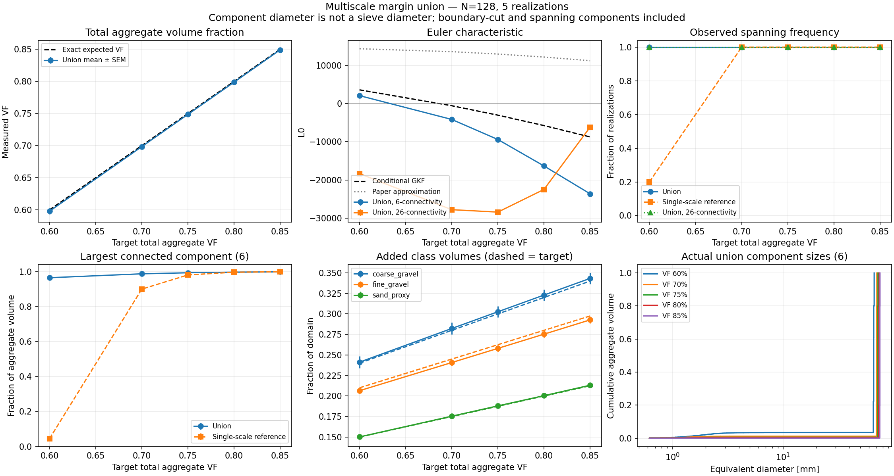
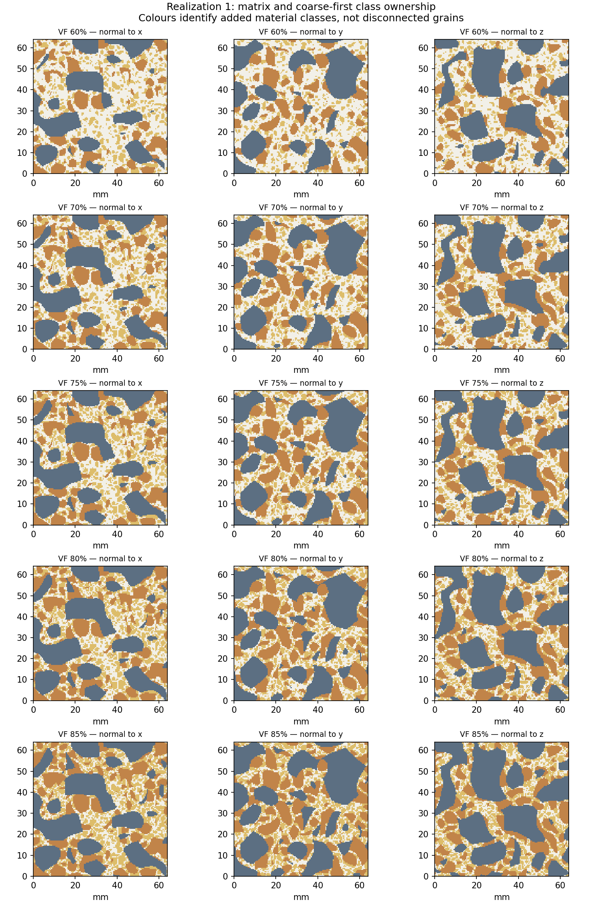

# Experiment 06 — Multiscale margin tessellations for aggregate grading


Combine three independent margin tessellations at coarse-gravel, fine-
gravel, and sand correlation lengths into one composite phase. Study
total volume fraction, actual connectivity, and component sizes while
keeping analytic `E[L_0]` and `E[L_3]` through a conditional-GKF
intersection formula.

This follows the independent-union construction described in
[Bogdan (2015)](<../../references/BOGDAN.cleaned (1).pdf>) §4.2 (eqs.
19–24). The paper's approximate Euler prediction is evaluated alongside
the conditional-GKF prediction below. Reference:

> Bogdan, M. (2015). *Morphological multiscale modeling of cementitious
> materials — Application to effective diffusive properties prediction.*
> PhD thesis, École Normale Supérieure de Cachan.
> [tel-01346484](https://theses.hal.science/tel-01346484v1)

The experiment is isolated from exp01–05 and reuses `src/adler.py` only
for the margin GMFs.

## Status: deferred prototype

Volume calibration and class accounting work. Everything else is
unresolved. In particular:

- The construction *always* produces a spanning phase at every target VF
  (5/5 realizations span under both 6- and 26-connectivity across
  $\varphi \in \{60, 70, 75, 80, 85\}\%$). This is not "a collection of
  separated aggregates" in any realization we ran.
- The $L_0$ measurements disagree massively between 6- and
  26-connectivity, and both disagree with the conditional-GKF
  prediction. Connectivity convention and voxel-film resolution dominate
  the measurement at these resolutions. Example at 60% target: GKF
  predicts $L_0 \approx 3600$, 6-conn gives $+2000$, 26-conn gives
  $-18000$.

Interpret the results as *a granulometry demo* (hit a prescribed
per-class VF mix inside the margin model) rather than a validated GKF
prediction.

## Do we lose the other LKCs?

Measurement side: yes, for now. Only $L_0$ and $L_3$ are measured. The
code intentionally skips numerical $L_1$ and $L_2$ on the composite
union because
(a) at these resolutions the matrix films between classes are sub-voxel,
(b) a single conforming marching-cubes mesh across three correlation
scales would be the right instrument but has not been built,
(c) binary marching cubes without the signed field would just inherit
the amplitude bias documented in
[`docs/measurement_conventions.md`](../../docs/measurement_conventions.md).

Theory side: no. The conditional-GKF intersection formula computes all
four $\mathbb{E}[L_j(A \cup B)]$ for the independent union — see the
"Expected Euler characteristic" section below. $L_1$ and $L_2$ are used
as *internal inputs* to the recursion that produces $\mathbb{E}[L_0]$;
the intermediate $\mathbb{E}[L_1], \mathbb{E}[L_2]$ of the final union
are written out but have nothing to compare against.

In short: the Adler link is still invoked for all four LKCs internally;
we just don't trust the voxel-level $L_1$/$L_2$ measurements enough to
include them in the plots.

## Editable pilot defaults

| Setting | Default |
| --- | --- |
| Domain | Bounded cube, side 64 mm |
| Grid | $128^3$; $dx = 0.5$ mm |
| Coarse-gravel scale | $l_c = 12$ mm, $q = 16$, 40% of aggregate volume |
| Fine-gravel scale   | $l_c = 6$ mm, $q = 16$, 35% of aggregate volume |
| Sand-scale proxy    | $l_c = 2$ mm, $q = 16$, 25% of aggregate volume |
| Total aggregate VF | 60%, 70%, 75%, 80%, 85% |
| Realizations | 5; base seed 7301 |
| Padding | At least 24 mm on each side before cropping |
| Single-scale reference | Fine-gravel field group at the same total VF |

Edit `config.json`. Once class scales, shares, competitor counts, and
seed are fixed, **total aggregate VF is the only morphology control** —
all class margins are derived from it. The same fields are reused across
the VF sweep, so retained unions are nested as the target VF increases.

**$l_c$ is not a particle diameter.** Winner competition, threshold,
overlap, and clipping change the actual sizes. The 2 mm class does not
represent the entire sand grading curve, especially its smallest grains.
Calibrate against measured size distributions before treating this as a
concrete microstructure.

The shares are a pilot design, not a prescribed concrete mix. Typical
aggregate contents are approximately 60–75% by volume
([NRMCA on concrete](https://www.nrmca.org/draft-about-concrete/)); the
80–85% cases explore high packing fractions rather than realistic mixes.

## Run

From the repository root, with the `rf_explo` environment active:

```bash
python -B experiments/06_multiscale_margin/test_model.py
python -B experiments/06_multiscale_margin/run.py --theory-only \
    --output experiments/06_multiscale_margin/results_theory
python -B experiments/06_multiscale_margin/run.py --n 64 --realizations 2 \
    --output experiments/06_multiscale_margin/results_pilot
python -B experiments/06_multiscale_margin/run.py --n 100 \
    --output experiments/06_multiscale_margin/results_n100
python -B experiments/06_multiscale_margin/run.py
```

The $N = 64$ run is a coarse pilot — the smallest $l_c$ has only two
grid spacings. Use it to check the pipeline and identify connectivity
problems, not to claim continuum agreement. Higher-resolution runs:

```bash
python -B experiments/06_multiscale_margin/run.py --n 256 \
    --output experiments/06_multiscale_margin/results_n256
python -B experiments/06_multiscale_margin/run.py --lcs 12 6 3 \
    --output experiments/06_multiscale_margin/results_lc_12_6_3
python -B experiments/06_multiscale_margin/run.py --q 2 \
    --output experiments/06_multiscale_margin/results_q2_control
```

`--q 2` supplies an exact two-tail Gaussian GMF control, not a promising
aggregate model. `--phis`, `--realizations`, and `--config` are also
available. Existing nonempty output folders are protected unless
`--overwrite` is passed. Changing $N$ regenerates the fields; matching
seeds across grids is *not* paired refinement of one continuous
realization.

## Volume calibration and class accounting

Let $s_k$ be fixed class shares summing to one in coarse-to-fine order,
and let $\Phi$ be the target total aggregate VF. The raw occupancy
required for class $k$ is

$$
p_k(\Phi) = \frac{s_k\, \Phi}{1 - \Phi\, \sum_{j<k} s_j}.
$$

Set $\mathcal M_0(q_k, \delta_k) = p_k(\Phi)$ and generate

$$
A_k = \{\, G^{(k)}_{\max} - G^{(k)}_{\mathrm{second}} \geq \delta_k \,\},
\qquad A = \bigcup_k A_k.
$$

Independence gives the exact expected total VF and added class
fractions:

$$
\mathbb{E}[L_3(A)] / |\Omega| = 1 - \prod_k (1 - p_k) = \Phi,
\qquad
\mathbb{P}\!\left(A_k \setminus \bigcup_{j<k} A_j\right) = s_k\, \Phi.
$$

At overlaps the material-class map gives priority to the coarse class.
This is an accounting convention; it does not insert a physical
interface or separate connected aggregates. The final binary union
retains all cross-scale contacts. Consequently, its connected-component
size distribution may differ greatly from the nominal class mixture.
Independent field streams are essential — smoothing the same noise at
several scales would invalidate the probability product.

## Expected Euler characteristic — conditional GKF

For an independent new phase $B$ with $b_j = \rho_B^{j}\, \mathcal M_j(B)$
and $\rho_B = \sqrt{\lambda_2^B / 2\pi}$, if $a_j = \mathbb{E}[L_j(A)]$,
conditioning on $A$ and applying the GKF to $B$ gives the intersection
expectations

$$
\begin{aligned}
I_0 &= b_0 a_0 + b_1 a_1 + b_2 a_2 + b_3 a_3, \\[2pt]
I_1 &= b_0 a_1 + \tfrac{\pi}{2}\, b_1 a_2 + 2\, b_2 a_3, \\[2pt]
I_2 &= b_0 a_2 + 2\, b_1 a_3, \\[2pt]
I_3 &= b_0 a_3.
\end{aligned}
$$

Update $\mathbb{E}[L_j(A \cup B)] = a_j + \mathbb{E}[L_j(B)] - I_j$ per
class. Starting from domain LKCs $(1, 3L, 3L^2, L^3)$ keeps the boundary
terms and permits different correlation lengths per class — no averaged
$l_c$ is substituted. See the
[general GKF](https://arxiv.org/abs/math/0612580).

The calculation has independent analytical controls ($q = 2$ intersection
checked against Gaussian tube coefficients of four orthants, symmetry
under permutation, order-independent unions). All nine controls pass. It
does *not* assert that the measured binary topology has converged.

For comparison, Bogdan (2015) uses a simpler coarse-to-fine
approximation
$\mathbb{E}[L_0(A_1)] + \sum_{k \geq 2} \mathbb{E}[L_0(A_k)]\,(1 - \text{previous union }\varphi)$;
the plot reports both.

## Gaussian sampling and measurement conventions

The local sampler filters real Gaussian white noise using a real FFT so
the Fourier coefficients have the required Hermitian symmetry. It uses
deterministic ensemble variance normalization and retains the random
zero-frequency mode; individual fields are not centered or divided by
their empirical standard deviation. Padding then cropping gives a
bounded observation window. Nyquist modes are removed for an unambiguous
stationary continuous interpolant.

The exact derivative variance of the discrete spectrum is computed and
used in the GKF. At adequate resolution it agrees with $2/l_c^2$. Saved
diagnostics compare observed forward-difference variances with the
corresponding spectral finite-difference prediction, rather than
confusing finite differences with exact derivatives. This sampler is
local to exp 06; the other experiments keep their original generators.

Both 6- and 26-connectivity are reported for Euler, component count,
spanning, and largest-component fraction. Neither convention is declared
the continuum answer. Raw single-scale phases additionally have
per-winner Euler diagnostics. The final union is measured as a binary
phase: genuine cross-scale connections must not be removed via winner
labels. Binary marching-cubes $L_1$/$L_2$ are not used as validation
measurements here — their expectations are internal inputs to the GKF
recursion.

## Reading `multiscale_summary.png`

Six panels, all plotted against the target total aggregate VF. "Union"
is the composite, "single-scale reference" is a one-scale margin field
sized to the same total VF for comparison.

- **Top-left — Total aggregate VF.** Measured vs target. The line should
  sit on $y = x$; it does. Volume calibration is exact (as the
  construction guarantees).
- **Top-centre — Euler characteristic.** The headline plot and the
  unresolved one. Shows conditional-GKF prediction (dashed), the Bogdan
  2015 paper approximation (dotted), and union measurements under 6- and
  26-connectivity. All disagree, and the 6/26 gap is enormous ($10^3$ to
  $10^4$). Interpretation: at $N = 128$ the sub-voxel matrix films
  between classes make $L_0$ dominated by connectivity convention rather
  than morphology.
- **Top-right — Spanning frequency.** Union spans in all 5/5
  realizations at every VF. The single-scale reference starts
  disconnected and crosses $0.5$ as it approaches its own ceiling.
- **Bottom-left — Largest connected component (6-conn).** Fraction of
  aggregate volume held by the single largest component. Already at
  60% target the union's largest component holds >96%; at 85% it holds
  99.9%. The construction does *not* produce separated particles.
- **Bottom-centre — Added class volumes.** Measured vs target per
  class. Lines on target: class accounting works regardless of what
  happens topologically.
- **Bottom-right — Actual union component sizes.** Cumulative diameter
  distribution of the union's connected components, one line per target
  VF. A single huge component dominates every curve.

**Overall quality.** Volume calibration and class accounting: solid.
Spanning / largest-component: a clear negative result — this
construction does not yield disconnected aggregates at any of the tested
VFs. Euler-vs-theory comparison: inconclusive at $N = 128$; a
convergence study at $N \geq 256$ and (eventually) a conforming interface
mesh are needed before this experiment can be read as a GKF validation.
The current state is "the composite statistics behave as calibrated, the
topology does not".





## Outputs

| File | Contents |
| --- | --- |
| `metadata.json` | Effective config, versions, spectrum, generator description, source hashes, completion status |
| `theory.csv` | Raw, intersection, cumulative-union, and reference expected LKCs; calibrated margins |
| `measurements.csv` | Measured L0/L3 under both connectivities, component counts, spanning, largest fraction |
| `class_volumes.csv` | Raw, overlap, and added class volumes versus targets |
| `field_diagnostics.csv` | Component means, variances, directional finite-difference checks |
| `union_components.csv` | Actual union components under 6-connectivity, equivalent diameters, class composition, boundary/spanning flags |
| `raw_winner_components.csv` | Candidate grain sizes within individual winner regions before cross-scale union |
| `sample_vf_*.npz` | Realization 1 binary phase and class ownership, geometry and threshold metadata |
| `multiscale_summary.png` | VF, Euler, connectivity, class-volume calibration, union component-size distributions |
| `class_slices.png` | Three orthogonal slices of each VF, coloured by material-class ownership |
| `summary.md` | Compact numerical findings and interpretation limits |

CSV files are checkpointed after each completed realization. Error bars
in `multiscale_summary.png` are standard errors across realizations;
spanning frequencies from small pilots are descriptive, not precise
estimates of percolation probabilities.

Component equivalent diameter is $(6V/\pi)^{1/3}$, not a sieve diameter.
Boundary-cut and spanning components are flagged and included in the
displayed union CDF — exclude them deliberately when making a grain-size
calibration; the included spanning components are evidence of merger.

## Initial results

Two realizations at $N = 64$ in `results_pilot/`, five at $N = 128$ in
`results/`. See [`results/summary.md`](results/summary.md),
[plots](results/multiscale_summary.png),
[slices](results/class_slices.png). An additional 5-realization run at
$N = 100$ in `results_n100/`:
[summary](results_n100/summary.md),
[plots](results_n100/multiscale_summary.png),
[slices](results_n100/class_slices.png) (physical domain remains 64 mm,
$dx = 0.64$ mm).

At $N = 128$, mean total VF ranges from 59.8% (60% target) to 84.9%
(85% target). All five unions span the domain at every target under both
connectivity conventions. Already at 60%, the largest 6-connected
component contains 96.5% of aggregate volume on average; this rises to
99.9% at 85%. The construction achieves the volume calibration but these
voxel realizations do not give the intended collection of separated
aggregate particles.

Euler characteristic remains unresolved: at the 60% target its means
are $2085$ (6-connectivity) and $-18343$ (26-connectivity), versus the
conditional-GKF prediction $3598$. The single-scale reference also
becomes sensitive to digital connections at high VF. Raw per-winner
diagnostics are saved to help distinguish missed separating films from
cross-scale connections.

All nine analytical/geometric controls pass. Saved-output checks also
pass for class-volume accounting, component-volume totals, nested VF
snapshots, finite values, and source hashes. Across the $N = 128$
fields, ensemble second moments are 1.0107, 0.9982, and 1.0004 for
coarse, fine, and sand classes; mean directional finite-difference
energies are within 2.8% of their spectral predictions.

## Decision criteria and next direction

First check total VF and added class fractions, then intersection/union
$L_0$ agreement and 6/26 sensitivity. Inspect spanning and actual
component sizes before describing a high-VF realization as a collection
of aggregates.

If independent union fills the separating films and merges the classes
(as it does here), the appropriate next step is a protected-gap
construction (fine inclusions enter only the deeper part of coarse
gaps, with a reserved matrix band around coarse cores). That requires
additional complementary-region theory and is not silently substituted
for the paper's union in this experiment.

## Precise thresholding — deferred

**Status: deferred on 31 October 2026.** Keep the existing voxel
workflow for routine exploration, including its 6/26-connectivity
diagnostics. The full interpolated $N = 100$, $q = 16$ run was stopped
because its time and memory costs were too high. Its prototype and
completed checkpoints are preserved.

The motivation is to measure the same interpolated geometry that a
scalar clip can display in ParaView. Whole-voxel thresholding can lose
thin matrix films and change $L_0$ substantially while changing $L_3$
only slightly. For margin tessellations, interpolate the **original
Gaussian competitors**, then impose every winner inequality
$G_i - G_j \geq \delta$. Interpolating a sampled top-two gap can itself
erase a film when the winner changes between nodes.

The prototype in `run_interpolated.py` uses boundary-inclusive GSTools
samples and piecewise-affine components on six tetrahedra per cube. It
measures $L_0$/$L_3$ from clipped volumes and accounts for cross-class
overlaps by inclusion-exclusion. This is a precise calculation for that
discretized geometry, subject to numerical clipping checks; it is not an
exact reconstruction of the smooth random field. Adler remains the
continuum reference; refinement is still required.

The stopped full run completed only these two cases of its first
realization:

| Target VF | Interpolated VF | Interpolated $L_0$ | GKF $\mathbb{E}[L_0]$ |
| --- | --- | --- | --- |
| 60% | 58.689% | 4108 | 3598.1 |
| 70% | 68.930% |    4 | $-558.2$ |

They took about 3 h 38 min and 4 h 11 min respectively, after field
generation. Private committed memory reached approximately 39 GiB on a
machine with 31.6 GiB physical RAM. These are single-realization
observations, not validation of the theory. Both interpolated unions
still spanned the domain. The unfinished 75% case has no completed
measurement and must not be treated as a result.

Before revisiting this approach, reduce retained mesh/component data
and avoid unnecessary intersection work, then benchmark one
representative case before launching an ensemble.

Retained material:

- [Method, tests and small pilots](INTERPOLATED.md)
- [Matched voxel/interpolated slices](../../explorations/exp06_pilot_runs/results_pl_n24/geometry_slices.png) (archived in `explorations/`)
- [Stopped full-run notes](../../explorations/exp06_pilot_runs/results_pl_full/STOPPED.md) and
  [completed measurements](../../explorations/exp06_pilot_runs/results_pl_full/measurements.csv)

The prototype currently measures $L_0$/$L_3$ and connectivity.
Numerical $L_1$/$L_2$ and a single conforming Boolean-union mesh remain
separate future extensions.
